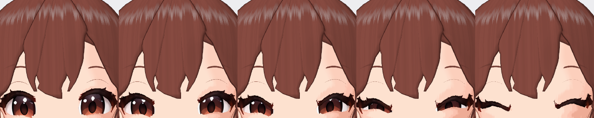
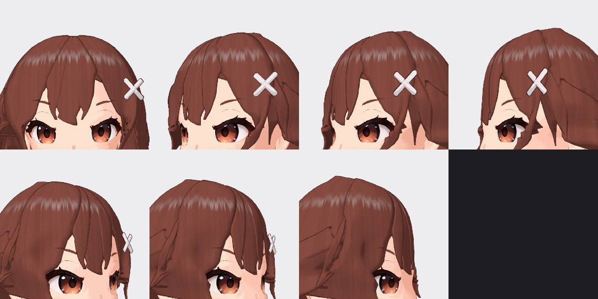
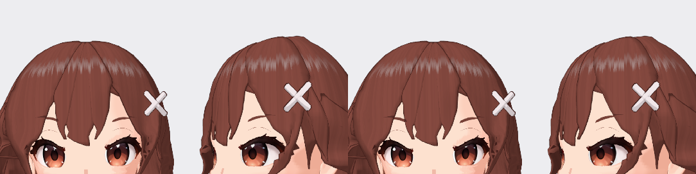
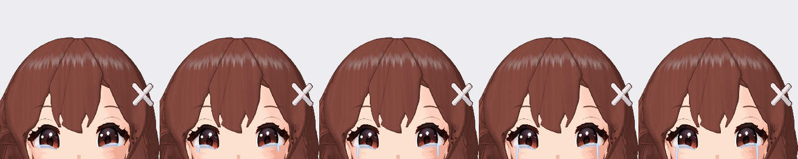
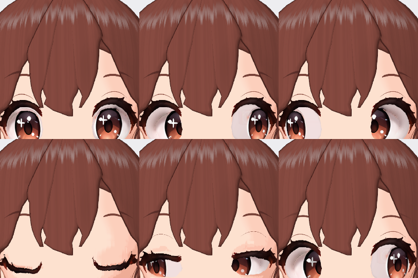
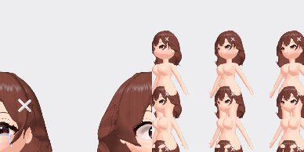

# REPORT 24 — Race3D 표정 v3b Galaxy S24 실기기 검증 (2026-11-15)

## 결론

- **기기·빌드:** v3b 표정 실험 빌드는 Galaxy S24(SM-S921U, Android 14, Adreno 750 Vulkan)에서 설치·실행에 성공했다. 오류·크래시 0건, `ALL_DONE` 확인.
- **화질·기능:** Happy 0.6~1.0, Angry2 Pull(0/±35/±45/±60), 약한 Angry, Cry `_Flow`, Surprise×시선×Blink, 2인 재질 격리가 모두 통과했다.
- **성능:** 1명·12명 모두 **120 fps** 유지. 표정 드라이버는 1명 ~0.11 ms, 12명 ~0.52 ms. 메모리 증가(1→12)는 할당 기준 약 +3 MB.
- **원본 보존:** 정식 v1 FBX·프리팹·`Mobile_RPAsset` MSAA/RS·`EditorBuildSettings` 는 빌드 전 백업과 동일하게 복원·확인했다.
- **정식 통합:** 실기기 결과는 통합 **후보를 지지**한다. 최종 통합 여부는 사용자 결정에 맡긴다.

## 1. 기기와 연결

| 항목 | 값 |
|---|---|
| 기기 | Samsung Galaxy S24 `SM-S921U` (e1q), 시리얼 `RFCX70D90WJ`, USB |
| OS | Android 14 / API 34 (`UP1A.231005.007`) |
| GPU | Adreno 750, Vulkan |
| CPU / RAM | ARM64 8코어 / 7118 MB |
| 화면 | 1080×2340, 120 Hz |
| ADB | `/Users/jjeong/Library/Android/sdk/platform-tools/adb` |
| 배터리 | 충전 중, 약 31 % |
| 열 | Thermal Status 0, AP ~40–44 °C (호스트 15초 샘플) |

## 2. 빌드와 실행

| 항목 | 값 |
|---|---|
| 씬 | `Assets/_Experiments/Race3D_v3b/Race3DExprAndroidTest.unity` |
| 패키지 ID | `com.mmg.race3dexprtest` (본 게임 ID와 별도) |
| APK | `/Users/jjeong/UnityProjects/Race3DExprTestBuild/race3dexprtest.apk` (프로젝트 밖, ~55 MB) |
| 빌드 | Development, 오류 0, 약 86 s |
| phases | `quality,isolation,perf,hostcapture` (측정 12 s) |
| 캡처 | 호스트 `adb exec-out screencap` (앱 내 ScreenCapture 미사용) |
| 결과 폴더 | `Models/Race3D/experiments/android_v3b/` (스크린 46장 + CSV + log) |

**빌드 중 잠시 바꾼 설정 (모두 복원 확인):**
- 빌드 대상 macOS → Android → **다시 StandaloneOSX**
- Android 패키지 ID → `com.mmg.race3dexprtest` → 원래 템플릿 ID
- productName, FrameTimingStats, Development
- 씬은 `BuildPlayerOptions` 로만 지정, `EditorBuildSettings` 미변경 (md5 일치)
- `Mobile_RPAsset.asset` md5 = 빌드 전 백업과 동일 (`0cf0b513…`)

기록: `/Users/jjeong/UnityProjects/Race3DExprTestBuild/android_build_temp_settings.json`

## 3. 기능·화질 검증

품질 샷은 URP **C: MSAA 4×, Render Scale 0.8** (기기 지원 확인: 864×1872 @ 4×).

### 3.1 Happy 0.6 ~ 1.0

- 정면·+35° 각 5단계(0.6/0.7/0.8/0.9/1.0) 캡처.
- EyeSmile 비중이 커지며 눈꼬리·속눈썹이 자연스럽게 닫히는 쪽으로 이어진다. 중간 단계(0.7~0.9)에서 홍채가 갑자기 사라지거나 입이 끊기는 현상은 없다.



### 3.2 Angry2 Pull (강한 화남 기본) / Angry (약함)

- Angry2: 0 / ±35 / ±45 / ±60 전부 정상. 앞머리 스텐실·카드가 눈썹 실루엣을 유지한다.
- 약한 Angry: 0 / ±35 / ±45 에서 Angry2보다 완만한 미간·눈썹. 두 키는 독립 입력으로 모두 사용 가능.
- Pull 거리: `HairBrowPullTable` bob `hair_bob_01_01` → **0.030 m**. 전역 상수 고정 아님 (액터 override·표 조회).





### 3.3 Cry 눈물

- `_Flow` 0→1 단계가 기기에서 정상. 현재 줄기는 거의 직선(구조·API 유지).
- 뺨 곡선 개선은 메시 경로만 바꾸면 되며 `_Flow`/UV 계약은 그대로 둔다 (설계 메모 3장).



### 3.4 Surprise × 시선 × Blink

- 홍채 축소·스파클이 좌/우 시선과 함께 이동한다.
- Blink=1 에서는 눈이 닫히고 스파클이 가려진다 (깜빡임과 충돌로 남는 하이라이트 없음).
- Blink 0.5 + 시선에서도 노출된 홍채 쪽만 스파클이 보인다.



### 3.5 재질 격리 (2인)

기기 로그·`isolation.txt`:

```
ok=True
A sparkle=1 iris=0.92 flow=0 pull=0.03
B sparkle=0 iris=1 flow=1 pull=0.045
```

- A=Surprise+시선, B=Cry+_Flow=1, Pull override 각각 0.030 / 0.045.
- 재질 인스턴스의 `_Sparkle` / `_Pull` 이 액터별로 일치. 서로 덮어쓰지 않음.



## 4. 성능 (1명 / 12명)

조건: Development, vSync off, target 120, 각 조건 워밍업 2 s + 측정 12 s (1,441 프레임). 표정 사이클에 Happy→Angry2→약한 Angry→Cry→Surprise+시선+Blink 포함. 12명은 3×4 격자, 머리 ±60° 요.

### 1명

| 설정 | FPS | 프레임 avg / P95 (ms) | CPU main avg / P95 | GPU avg / P95 | 표정 드라이버 avg / P95 | 12.5 ms 초과 |
|---|---|---|---|---|---|---|
| A MSAA1 RS0.8 | 120.0 | 8.33 / 8.71 | 2.77 / 3.59 | 2.86 / 3.11 | 103 / 142 µs | 0 |
| C MSAA4 RS0.8 | 120.0 | 8.33 / 8.76 | 3.09 / 3.73 | 3.52 / 3.73 | 113 / 151 µs | 1 |

### 12명

| 설정 | FPS | 프레임 avg / P95 | CPU main avg / P95 | GPU avg / P95 | 표정 드라이버 12개 avg / P95 | 16.7 ms 초과 |
|---|---|---|---|---|---|---|
| A MSAA1 RS0.8 | 120.0 | 8.33 / 8.59 | 4.74 / 5.82 | 6.53 / 7.13 | 522 / 683 µs | 0 |
| C MSAA4 RS0.8 | 120.0 | 8.33 / 8.61 | 4.67 / 5.79 | 6.72 / 7.32 | 515 / 681 µs | 0 |

### 메모리 (앱 로그)

| 시점 | allocated | reserved | graphics |
|---|---|---|---|
| 1명 시작 | 77.1 MB | 540.7 MB | 110.0 MB |
| 1명 메시·텍스처 (캐릭터 1기 기준) | 메시 46 = 6,669 KB, BlendShape 137, 텍스처 5 = 1,795 KB | | |
| 12명 측정 후 | 79.7~80.1 MB | — | — |

1→12 전환 시 프로세스 할당 증가는 약 **3 MB**. 재질 인스턴스·스키닝 비용이 프레임 예산 안에서 안정적이다.

원본 CSV: `android_v3b/pulled/race3dexpr/perf_*.csv`

## 5. 설계 반영 (이번 검증에서 고정하지 않은 것)

| 항목 | 상태 |
|---|---|
| Angry2 = 강한 기본, Angry = 약함 | 문서·드라이버·실기기 샷으로 확인 |
| Pull 거리 | `HairBrowPullTable` (헤어 itemId별). 30 mm는 bob 기본값일 뿐 전역 상수 아님 |
| Cry 곡선 | 구조 유지. 최종 애니 단계에서 경로 메시만 곡선화 가능 |
| 재질 공유 | 액터별 인스턴스. 격리 테스트 ok |
| Mobile_RPAsset / 정식 v1 | **미변경** (검증 완료 후 통합 결정 대기) |

## 6. 원본·실험 범위

- 수정·추가: `Assets/_Experiments/Race3D_v3b/` 만 (런타임·씬·HairBrowPullTable·보고서·캡처).
- 건드리지 않음: 정식 `MainGirlfriend_Race3D_v1`, Live2D, Localization, Cubism, Admin DB.
- 빌드 임시 설정은 전부 되돌림 (위 2장).

## 7. 남은 참고 (통합 차단 아님)

- Cry 줄기는 아직 직선에 가깝다 → 계획된 뺨 곡선 개선.
- Happy 1.0은 EyeSmile이 강해 눈이 거의 감긴 스마일 형태(의도된 Happy 단계).
- Development 빌드 워터마크가 화면 구석에 보일 수 있다 (캡처에만 영향).

## 8. 사용자 결정 요청

실기기 검증은 통과했습니다. **v3b를 정식 Race3D 표정으로 통합할지** 최종 결정해 주세요.

- **통합 승인** 시: 정식 모듈/프리팹 이전, Pull 표 원본 위치(외형 데이터 vs Admin)는 00 문서 미정 절차에 따라 별도 확인.
- **보류/수정** 시: 수정 항목을 지정해 주시면 실험 폴더에서만 이어서 작업합니다.
