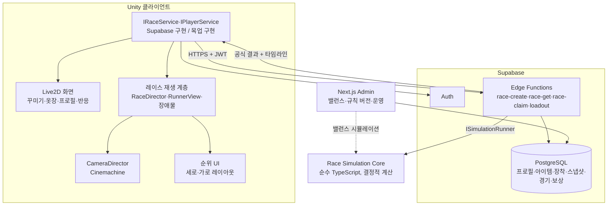
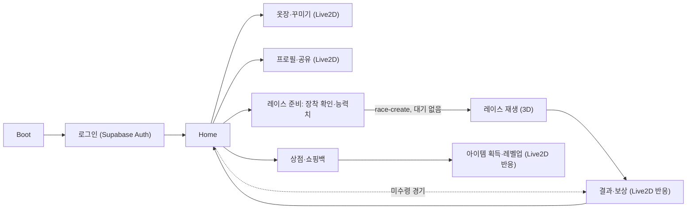
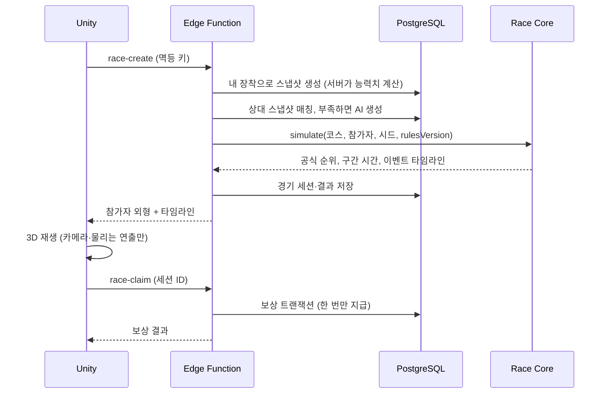

# MyMischiefGirlfriend — 목표 아키텍처 (확정본)

- 확정일: 2026-11-09 (1차: 하이브리드 구조), 2026-11-09 (2차: 비동기 PvP 서버, 세로 화면, 카메라)
- 관련 문서:
  - [01_CharacterItemDataModel.md](01_CharacterItemDataModel.md) 캐릭터·아이템 데이터
  - [02_RacingModules.md](02_RacingModules.md) 레이싱 계산 코어와 Unity 재생 계층
  - [03_ServerAsyncPvP.md](03_ServerAsyncPvP.md) 서버, 비동기 PvP, 매칭, 확장, 부하 테스트
  - [04_ScreenAndCamera.md](04_ScreenAndCamera.md) 화면 방향, UI, 카메라 연출
  - [05_CharacterItemSystem.md](05_CharacterItemSystem.md) 2D·3D 공통 캐릭터·아이템 시스템 (2026-11-10 방향 승인·초기 정책 결정, S1·S2 구현, A0·A1 Cubism 분리 모델 실험)
  - [06_StarterOutfitSpec.md](06_StarterOutfitSpec.md) 기본 지급 의상(트레이닝 세트) 2D·3D 제작 명세 (2026-11-11)
- 이 문서는 방향을 정하는 문서다. 여기 적힌 기능 대부분은 아직 구현되지 않았다 (6장 참고).

## 1. 확정된 방향

게임은 **Live2D Cubism + Unity 3D + Blender 하이브리드**로 만들고, 서버는 **비동기 PvP**(상시 실행 게임 서버 없음)로 만든다.

| 영역 | 담당 | 품질 기준 |
|---|---|---|
| 캐릭터 생성·꾸미기, 옷장, 프로필, 공개·공유, 표정·감정, 아이템 획득·레벨업 반응, 승리·패배·이벤트 연출 | Live2D Cubism (Unity 의 Cubism SDK 로 표시) | 일러스트 품질 우선 |
| 실제 레이싱 화면 (Pocket Champs 와 비슷한 3D 레이스, 완전 자동 진행) | Unity 3D + Blender 모델 | 귀여움과 아이템 특징 유지, 모바일 경량 |
| 인증, 데이터, 경기 생성, 매칭, 보상 | Supabase (Auth, PostgreSQL, Edge Functions) | 정확성, 중복 방지 |
| 공식 순위·이벤트 타임라인 계산 | Race Simulation Core (서비스와 독립된 순수 계산 모듈) | 결정적, 규칙 버전 관리 |
| 밸런스·운영 데이터 관리 | Next.js Admin | 버전 관리, 감사 기록 |

원칙:

1. 지금 진행 중인 Live2D 작업은 멈추지 않는다. Blender 를 위해 Live2D 작업을 바꾸지 않는다.
2. 기존 Blender 캐릭터와 작업 파일은 지우지 않는다. 레이싱용 3D 캐릭터는 **Live2D 디자인이 확정된 뒤 그것을 레퍼런스로 새로 만든다**.
3. Live2D 모델에서 3D 모델을 자동으로 만들 수 있다고 가정하지 않는다. 3D 캐릭터와 3D 아이템은 따로 제작한다.
4. Live2D 와 3D 는 **같은 캐릭터·아이템 데이터(같은 ID)** 를 쓴다. 외형 데이터와 성능 데이터는 분리한다.
5. 아직 만들지 않은 3D 아이템은 슬롯별 임시 기본 모델로 표시한다.
6. **공식 결과는 서버가 정한다.** Unity 는 공식 데이터를 3D 로 재생만 한다. Unity 의 물리, 애니메이션, 카메라는 결과에 영향을 주지 않는다.
7. 레이스 중 선수 좌표를 매 프레임 서버로 보내지 않는다. 실시간 위치 동기화는 없다.
8. 화면 방향(기본 세로)과 3D 카메라 각도는 따로 관리한다.
9. 불필요한 패키지는 미리 설치하지 않는다 (Cinemachine 은 레이싱 재생 단계, IAP 는 상점 단계).
10. 아직 정하지 않은 사항(8장)은 데이터와 모듈을 갈아 끼울 수 있게 설계한다.

### 레이싱 3D 캐릭터 조건 (우선순위 순)

1. 귀엽고 매력적인 일본 애니메이션풍
2. Cubism 캐릭터와 같은 몸 비율의 치비 스타일
3. 얼굴과 눈을 상대적으로 크게
4. 자연스러운 신체 비율과 부드러운 실루엣
5. Live2D 캐릭터와 일관된 외형
6. 모바일에 맞는 간소화된 폴리곤·리깅
7. 의상, 헤어스타일, 신발, 액세서리 교체
8. 다양한 레이싱 애니메이션

디테일은 줄여도 **귀여움과 착용 아이템의 특징(실루엣, 색, 대표 장식)** 은 유지한다.

## 2. 시스템 구성도

- Race Simulation Core 는 처음에 Edge Function 안에서 같은 프로세스로 실행한다. 계산량이 커지면 같은 코드를 AWS Lambda 같은 서버리스 함수로 옮기고, Edge Function 은 HTTP 로 호출만 한다 (03 문서 5장).
- Core 를 TypeScript 로 만드는 이유: Edge Functions(Deno), AWS Lambda(Node.js), Next.js Admin 이 **같은 코드를 그대로** 쓴다. 공식 계산 코드가 한 벌뿐이라 서버 간 결과 불일치가 없다.
- Unity 에는 공식 계산 코드를 두지 않는다. Unity 는 공식 타임라인을 재생한다. 개발용으로는 Core 가 만든 예시 타임라인(JSON 고정 파일)을 목업 서비스로 읽는다.

## 3. 모듈과 폴더 (계획)

### Unity (`Assets/_Game/Scripts`, 코드 작성 단계에서 asmdef 로 분리)

| 어셈블리 (계획) | 폴더 | 내용 |
|---|---|---|
| `MMG.Core` | `Scripts/Core` | ID 타입, 공통 유틸 |
| `MMG.Data` | `Scripts/Data` (S1 구현, UnityEngine 참조 없음) | 캐릭터·체형·외형·아이템·변형·슬롯·착용 타입, JSON 읽기, 카탈로그 검사 |
| `MMG.Appearance` | `Scripts/Appearance` (S2 구현, UnityEngine 참조 없음) | 착용 규칙(`EquipmentRules`), 표시 해석(`AppearanceResolver`), 능력치 출처, 렌더러 지원 검사 (05 문서) |
| `MMG.Contracts` | `Scripts/Contracts` (신규) | 서버와 주고받는 JSON 형식 (경기 세션, 참가자 스냅샷, 타임라인, 보상). `contractVersion` |
| `MMG.Backend` | `Scripts/Backend` | `IAuthService`, `IPlayerService`, `IRaceService` 와 구현 (Supabase, 목업) |
| `MMG.Inventory` | `Scripts/Inventory` | 보유 아이템 사본, 장착 화면용 상태 |
| `MMG.Characters.Live2D` | `Scripts/Characters/Live2D` | Live2D 캐릭터 표시, 외형 적용, 표정 |
| `MMG.Characters.Avatar3D` | `Scripts/Characters/Avatar3D` | 3D 캐릭터 조립, 임시 기본 모델 |
| `MMG.Racing.Playback` | `Scripts/Racing/Playback` (신규) | 타임라인 시계, 선수 위치 보간, 순위 계산(표시용) |
| `MMG.Racing.Presentation` | `Scripts/Racing/Presentation` | 선수 3D, 장애물 변형, 파티클, 사운드, 장소 테마 |
| `MMG.Racing.Camera` | `Scripts/Racing/Camera` | 카메라 연출 (Cinemachine) |
| `MMG.UI` | `Scripts/UI` | 화면, 순위 HUD, 화면 방향별 레이아웃 |
| `MMG.Progression` | `Scripts/Progression` | 쇼핑백, 패션 택, 레벨업 표시 |

- 기존 `Scripts/Localization` 의 두 스크립트는 지금처럼 기본 어셈블리(Assembly-CSharp)에 둔다.
- 에셋: Live2D 모델 `Art/Characters/<캐릭터>/Live2D`, 3D 모델 `Art/Characters/<캐릭터>/Model3D` (신규), 아이템 3D `Art/Clothing/<슬롯>/<아이템ID>`, 장소별 장애물 `Art/Environments/<장소>`.

### Unity 밖 (프로젝트 루트, 해당 단계에서 생성)

| 폴더 (계획) | 내용 |
|---|---|
| `Server/race-core/` | Race Simulation Core (TypeScript 패키지, 의존성 없음, 테스트·벤치마크 포함) |
| `Server/supabase/` | DB 마이그레이션, RLS 정책, Edge Functions |
| `Server/loadtest/` | 부하 테스트 스크립트 |
| `Admin/` | Next.js Admin |
| `Shared/` | Unity·서버가 함께 쓰는 JSON 스키마(`schemas/`), 샘플 카탈로그(`samples/`), 공통 테스트 케이스(`testcases/`), 검사 스크립트(`tools/`) (05 문서 S1·S2 에서 생성) |
| `Live2DSource/`, `BlenderSource/` | 기존 원본 작업 폴더 (그대로) |

## 4. 화면 흐름 (계획)

- 기본 화면 방향은 **세로**다. UI 레이아웃과 3D 카메라 구도는 각각 화면 방향별 프로필을 두어, 나중에 가로로 바꾸거나 둘 다 지원해도 레이스 로직은 바뀌지 않는다 (04 문서).
- Live2D 와 3D 를 한 화면에 섞을 때(예: 레이스 결과 위 Live2D 캐릭터)는 Live2D 를 UI 레이어(별도 카메라 또는 RenderTexture)로 그린다.

## 5. 경기 한 판의 흐름 (요약)

자세한 내용은 03 문서.

## 6. 현재 프로젝트 상태 (2026-11-09 분석)

### 이미 있는 것

| 항목 | 상태 |
|---|---|
| Unity 6000.6.8f1 (Unity 6.6), URP 17.6 | PC·Mobile 렌더 파이프라인 에셋 있음 |
| Input System 1.20.1 | `activeInputHandler: 1` (새 Input System 만 사용) |
| Localization 1.5.14 | 한국어·영어, 테이블 `UI_Text`, `LanguageSwitcher.cs`, `LocalizedTitle.cs`, 테스트 씬 `Scenes/LocalizationTest.unity` |
| Addressables 2.11.2 | Localization 의존성으로 설치됨 (manifest 에 직접 선언은 없음) |
| Cubism SDK for Unity 5-r.6.1 | `Assets/Live2D/Cubism` 에 들어 있음 (Cubism 5.3 moc3, URP RenderGraph 지원). 단 macOS 용 Core `Plugins/macOS/Live2DCubismCore.bundle` 이 빠져 있다 (폴더만 있고 git 에는 `macOS.meta` 만 있음, 이 Mac 의 다른 곳에도 없음). 그래서 macOS 에디터에서 moc3 가져오기가 `DllNotFoundException: Live2DCubismCore` 로 실패한다 (2026-11-10). 사용자 결정: 사용자가 같은 버전 SDK 를 받아 주면 그 안의 macOS bundle 만 복사한다. URP: 사용자 결정대로 SDK 의 `Rendering/URP/CubismURPRenderer.asset` (`CubismRenderPassFeature` 포함) 을 `PC_RPAsset`·`Mobile_RPAsset` 렌더러 목록 1번에 추가했다 (기본 렌더러는 0번 그대로, 기존 씬·카메라 영향 없음). Live2D 를 그리는 카메라는 렌더러 1번을 고른다. 테스트 씬 `_Game/Scenes/Live2DTest_MainGirlfriend.unity` (정사영 카메라, 렌더러 1번). MainGirlfriend r26 내보내기 파일은 `Art/Characters/MainGirlfriend/Live2D/MainGirlfriend/` 에 복사했고 프리팹은 Core 를 넣은 뒤 생성. 사용자가 받은 `CubismSdkForUnity-5-r.6.1.unitypackage` 에서 `Plugins/macOS/Live2DCubismCore.bundle` 과 `.meta` 만 복사했다 (같은 버전인지 폴더 meta guid·CHANGELOG·`CubismRenderPassFeature.cs` 가 같은 것으로 확인. bundle 에 macOS 격리 표시(quarantine)가 붙어 있지만 로드됨). 그 뒤 moc3 가져오기 성공, 프리팹 생성 (드로어블 96, 파라미터 28, 파츠 29). 확인 결과 (Play 모드, `12_UnityCheck/r26/play/`): 기본 화면, 마스크(흰자 안 홍채), 눈 감기·웃음·놀람·시선 좌우·각도 X ±30 이 Cubism 에디터와 같은 모양으로 나온다. 에디터 정지 상태에서 스크립트로 파라미터를 바꾸고 바로 렌더하면 메쉬·마스크가 이전 상태로 남아 맞지 않는다 (확인용 캡처는 Play 모드에서 매 프레임 값을 넣어야 함). Cubism 은 파라미터를 매 프레임 복원하므로, 게임 코드도 표정 값은 매 프레임(LateUpdate 이전) 넣어야 한다. r28 내보내기는 기존 r26 에셋을 바꾸지 않고 `Art/Characters/MainGirlfriend/Live2D/MainGirlfriend_r28/` 에 따로 넣었다 (테스트 씬은 아직 r26 프리팹을 씀, Play 모드 안에서만 r28 로 바꿔 확인, `12_UnityCheck/r28/`). 에디터가 뒤에 있을 때 Play 모드 캡처는 Run In Background 를 켜야 화면이 갱신된다 |
| `_Game` 폴더 구조 | Scripts(Core, UI, Inventory, Progression, Characters, Backend, Minigames, Localization), Art, Prefabs 등 — 대부분 빈 폴더 |
| 캐릭터 원화 | `Art/Characters/MainGirlfriend/Source` 에 컨셉 시트·턴어라운드 4장 |
| 빌드 씬 | `Scenes/SampleScene.unity` 만 등록 (조명·카메라만 있음) |
| `Assets/CursorConnectTest.cs` | 빈 테스트 스크립트 |

### Unity 밖에서 진행 중인 것

- **Live2D (`Live2DSource/MainGirlfriend`)**: Cubism 5.3 FREE 로 정면 모델 제작 중. 최신 `06_PSD/MainGirlfriend_Front_v7_r30_neckhair.cmo3` (r30 에서 PSD v30 으로 목 줄·어깨 잔상을 고침, r29 에서 이목구비·귀 워프 8개를 `머리 회전` 아래로 옮기고 앞머리 그림자에 각도 X 키를 넣음. r29·r30 은 아틀라스를 다시 하지 않아 moc3·Unity 는 아직 r28. r27 에서 PSD v24 로 머리카락을 가닥 경계로 다시 나누고 `뒷머리 워프` 를 넣어 고개를 돌릴 때 머리 직사각형 잘림을 고침, r28 에서 텍스처 아틀라스 2048 px 1장을 다시 배치: `Head` 그룹 100%, 나머지 51.1%. 사용자 결정: 이후 아틀라스는 모델 수정이 모두 끝난 뒤 마지막에 한 번만 다시 하고, 그때 moc3·Unity 를 갱신한다. r25 에서 `EyeShade` 메쉬를 다시 만들어 눈 음영이 그려짐. r24 는 PSD v18: v8–v17 PSD 의 레이어 마스크 때문에 반투명 알파가 제곱돼 옅게 보이던 문제를 고침. 스크립트로 만든 PSD 는 `scripts/s17_strip_psd_masks.py` 로 마스크를 뺀 뒤 넣는다). 얼굴 각도, 눈 깜빡임·눈동자, 입, 눈썹, 머리 흔들림·물리, 가슴 흔들림까지 진행. 소체(속옷 상태 몸)는 PSD v10 으로 Cubism 에 반영 완료. 머리 소체(민머리 `Head_Skin` + 헤어 그림자·얼굴 음영 분리)도 PSD v11 로 Cubism r18 에 반영, 얼굴 잔상·자국 정리는 PSD v12 · r19, 눈 가리개 삭제·어깨 피부 조각 정리는 PSD v13 · r20, 오른쪽 귀 이음매 정리는 PSD v14 · r21, 눈 음영(`EyeShade`)·이마 그림자 보강은 PSD v15 · r22 (`EyeShade` 메쉬는 r25 에서 다시 만듦), 머리핀(`HairClip_X`) 아래 머리카락을 그려 머리핀을 뺄 수 있게 한 것은 PSD v17 · r23 (아트메쉬 96/100, 파츠 29/30, `Live2DSource/MainGirlfriend/09_Head/HeadBase_LayerPlan.md`).
- **Blender (`BlenderSource/Characters/MainGirlfriend`)**: 참조 이미지 배치, 몸·얼굴·눈·머리 블록아웃 스크립트와 .blend 파일. 품질이 목표에 못 미쳐 보류. 삭제하지 않는다.

### 아직 없는 것

게임 플레이 코드와 서버 전부: 데이터 모델, 인벤토리, 옷장, Live2D 런타임 표시, 3D 캐릭터, 레이스 계산 코어, 레이스 재생, 카메라, Supabase 프로젝트·DB·함수, Admin, 성장, 상점.

## 7. 충돌 지점과 위험 요소

### 기존 구현·문서와의 충돌

| # | 충돌 지점 | 대응 |
|---|---|---|
| C1 | Live2D manifest 의 `slot` 은 `shoes`, `legwear` 를 나누지만 게임의 Footwear 는 둘을 묶음 | Live2D 는 그대로, 게임 아이템이 Live2D 파츠 ID 목록을 가리킴 (01 문서 4장) |
| C2 | "의상마다 cmo3" 방식으로는 상·하의 자유 조합을 실행 중에 만들 수 없음 | 옷장 방식은 미정 (8장). 프로토타입으로 결정 |
| C3 | PSD v9/v10 의 소체는 블라우스 전용 버전 | 전체 버전 `08_Body/v10/png_full` 보관, 옷장 방식 결정 후 사용 |
| C4 | Cubism FREE 한도 (아트메시 100, 파라미터 30), v9 기준 99/100 예정 | 아이템이 늘면 PRO 라이선스 필요 |
| C5 | 얼굴은 아이템이 아님 | `CharacterDefinition` 의 얼굴 스타일, 머리 소체 필요 |
| C6 | 기존 Blender 블록아웃은 치비 비율이 아님 | 보관, 새 치비 베이스 별도 제작 |
| C7 | asmdef 를 만들면 그 폴더 스크립트가 기본 어셈블리에서 빠짐 | 새 코드 폴더에만 asmdef. `Scripts/Localization` 그대로 |
| C8 | `ProjectSettings` 의 `defaultScreenOrientation: 4`(자동 회전), 빌드 대상 데스크톱 — 세로 결정과 다름 | 지금은 바꾸지 않는다. 레이스 재생 단계(로드맵 4)에서 세로 고정과 모바일 대상으로 바꾼다 |
| C9 | (1차 문서) 계산 코어를 Unity C# `MMG.Racing.Simulation` 으로 두고 .NET 서버와 공유하는 안 | 폐기. 계산 코어는 Unity 밖 TypeScript 모듈. Unity 는 `MMG.Contracts` + `MMG.Racing.Playback` 만 가짐 (02 문서) |
| C10 | (1차 문서) 아이템 카탈로그 원본을 Unity ScriptableObject 로 보고 서버로 내보내는 안 | 수정. 능력치·효과·규칙·코스의 원본은 DB(Admin 관리). 외형 데이터의 원본은 Unity. 아이템 ID 목록은 양쪽 검증 (01 문서 5장) |

### 기술 위험 요소

| 위험 | 대응 |
|---|---|
| Live2D 옷장 구현 방식 미정 | 작은 프로토타입(상의 2 × 하의 2)으로 먼저 검증. A0 (2026-11-10, 같은 moc 인스턴스 2개 겹치기): 같은 정렬 그룹·순서와 파라미터 복사면 단일 모델과 같은 화면, 모델마다 Cubism 갱신 비용이 늚, 다른 모델 드로어블로 마스크 불가 (05 문서 17-4). A1 (2026-11-11, 별도 moc3 본체·블라우스): 마스터 순서표로 드로어블마다 정렬값을 넣고 파라미터를 ID 로 복사하면 단일 모델과 같은 화면, 한 그룹 안 정렬 모드를 섞으면 정렬이 깨짐, 리깅·아틀라스가 아이템 파일마다 복사됨 (05 문서 17-6). U5 는 방식 B 비교 뒤 결정 |
| Cubism PRO 와 SDK 출판 라이선스 | 출시 전 Live2D 출판 허락 계약 조건 확인 |
| URP + Unity 6.6 의 Cubism SDK 렌더링 (마스크 포함) | 2026-11-10 MainGirlfriend r26 로 테스트 씬에서 확인 (위 Cubism SDK 행). r26 의 각도 ±30 직사각형 머리 잘림은 r27 (PSD v24 머리카락 다시 나누기 + `뒷머리 워프`) 에서 고쳤고 r28 로 Unity Play 모드에서 확인했다. 어깨 위 반투명 조각·목 줄은 Cubism r30 에서 고쳤고, Unity 확인은 아틀라스를 다시 한 뒤에 한다 |
| Edge Function 실행 한도 (CPU 시간, 메모리, 실행 시간) 안에서 12명 계산이 가능한지 | Core 벤치마크 → 부하 테스트 → 넘치면 Core 만 서버리스 함수로 분리 (03 문서 5·7·8장) |
| 결과 위조, 중복 보상 | 서버 계산, 멱등 키, 보상 한 번만 지급하는 DB 제약, 클라이언트 값 불신 |
| 규칙 변경 후 이전 경기 재생 | 경기마다 `rulesVersion` 과 참가자 스냅샷 저장, 타임라인 저장 |
| 상대 데이터 개인정보 | 다른 유저에게는 표시명·외형·능력치만 공개, 함수를 통해서만 조회 (RLS) |
| AI 선수 표기 | 내부 구분 필수, AI 를 실제 접속 유저처럼 표시하지 않음 (03 문서 3장) |
| 12명 3D 캐릭터의 모바일 성능, 세로 화면 가독성 | 플레이어 외 주자 간소화, 카메라·HUD 원칙 (04 문서), 가독성 테스트 후 방향 재검토 |
| 2D·3D 외형 일치 | 아이템 기획서에 대표 특징(실루엣·색·장식)을 적고 3D 는 그것만 지킨다 |
| 원본 작업 데이터 백업 | `Live2DSource/` 는 git 제외, .blend 일부 미추적 → 정기 백업 유지 |
| 실험 패키지 `com.unity.pipeline 0.10.0-exp.1` | 용도 확인 전에는 건드리지 않는다 |

## 8. 미정 사항 (지금 확정하지 않음)

| 항목 | 정하는 시점 | 지금 하는 준비 |
|---|---|---|
| Live2D 옷장 구현 방식 | 옷장 프로토타입 단계 | 아이템 → Live2D 파츠 ID 목록 구조, 전체 소체 보관. 고려할 점: FREE 한도(아트메쉬 100·파츠 30, MainGirlfriend r30 은 96·29, 디포머 25/50, 텍스처 2048 px 1장도 이미 사용)라 머리띠·모자·안경 같은 액세서리를 한 모델에 계속 더할 수 없다 (PRO, 아이템별 별도 모델 겹치기, 같은 메쉬에 텍스처 교체 등에서 고름). 모자처럼 머리를 누르는 아이템은 헤어 쪽 변형이 따로 필요하다. 아이템 아래(머리핀 아래 머리카락 등)는 그려 두어야 뺄 수 있다 |
| 액세서리 동시 장착 개수 | 데이터 기반 단계 이후 밸런스 테스트 | 위치별 장착 + 최대 개수 설정값 |
| Slide 구간의 장소별 장애물 | 장소 테마 단계 | 장소 × 구간 종류 테마 데이터 (계산과 분리) |
| Hair 구간의 장소별 장애물 | 장소 테마 단계 | 위와 같음 |
| 3D 캐릭터 폴리곤·LOD 예산 | 3D 파이프라인 단계 | 플레이어 / 상대 LOD 구분 구조 |
| 세부 아이템 성장 수치 | 성장 단계 | 레벨별 값 테이블, 규칙 버전 |
| 상품 가격·인앱결제 패키지 | 상점 단계 | 상품 정의를 데이터로 |
| 리그·트로피 규칙, 참가 비용(스태미나 등) | 서버 MVP 단계 | DB 컬럼과 설정 테이블로 분리 |
| AI 선수 표시 문구·이름 규칙 | 서버 MVP 단계 | `entrantKind` 로 내부 구분 |
| Unity 의 Supabase 호출 방식 (HTTP 직접 / 클라이언트 라이브러리) | 서버 MVP 단계 | `IAuthService`, `IRaceService` 인터페이스로 감춤 |
| Supabase 요금제 | 부하 테스트 후 | 부하 테스트 계획 (03 문서 8장) |
| 캐릭터·아이템 시스템의 남은 미정 (옷장 방식 U5, 원격 호스팅 U9, 원피스 정규화 기준값, 액세서리 개수, 색 해금, 모자용 헤어 그리는 법, 맨발 표현 N7, 발목 부위 N8) | U5: 옷장 프로토타입, U9: S9, N7·N8: 신발 표시 구현 전, 나머지: 밸런스·상점 단계 | 05 문서 14장. 초기 정책 U1–U14 는 2026-11-10 결정 (05 문서 0장). 신발 착용 시 발 표시 규칙은 2026-11-11 결정 (05 문서 7-4) |

## 9. 로드맵 (권장 순서)

세 갈래로 병행할 수 있다. 각 단계는 Cursor 와 Unity MCP 로 진행하고, 완료 기준을 확인한 뒤 다음으로 넘어간다. 서버·DB 배포와 패키지 설치는 해당 단계에서 사용자 확인 후 진행한다.

| 단계 | 갈래 | 내용 | 완료 기준 | 새 패키지·서비스 |
|---|---|---|---|---|
| 0 | 공통 | 아키텍처 문서·규칙 (1차, 2차) | 문서 5개와 Cursor 규칙 | 없음 |
| 1 | Live2D | MainGirlfriend 완성 (진행 중): 소체 반영, 머리 소체, 몸 리깅, 아틀라스, moc3, Unity 테스트 씬 표시 | URP 에서 정상 표시·표정 동작 | 없음 (SDK 설치됨) |
| 2 | 공통 | 데이터 계약: 아이템·능력치·코스·규칙·경기 세션·타임라인 JSON 스키마, Unity `MMG.Data`·`MMG.Contracts`, 현재 의상 5종 샘플 | 스키마 검증 통과, EditMode 테스트 | 없음 |
| 3 | 레이스 | Race Simulation Core (TypeScript, 로컬): 6명·4구간, 시드 난수, 정수 계산, 예시 타임라인 생성, 벤치마크 | 같은 입력 → 같은 결과, 6·12명 계산 시간 측정 | Node/Deno 로컬 개발 도구만 |
| 4 | 레이스 | Unity 레이스 재생 그레이박스: 목업 `IRaceService` 가 예시 타임라인 재생, 캡슐 선수, 순위 HUD, 세로 레이아웃, 기본 카메라 3종. 세로 고정·모바일 대상 설정 | 화면 순위가 타임라인 순위와 일치, 카메라 전환 중에도 재생 시간 일정 | Cinemachine |
| 5 | 서버 | Supabase MVP (로컬 Supabase 먼저): DB 스키마·RLS, Auth, `race-create`·`race-get`·`race-claim`, 스냅샷 풀, AI 충원, 매칭 v1 | 멱등·중복 보상 방지 테스트, 상대 부족 시 즉시 AI 충원 | Supabase 프로젝트 (배포 시 확인) |
| 6 | 서버 | 부하 테스트와 확장 결정: 경기 생성 처리량, 매칭 쿼리, 보상 동시성 | 03 문서 8장 기준 통과 또는 Core 분리 결정 | 부하 테스트 도구 |
| 7 | Live2D | 옷장 프로토타입: 조합 방식 결정, `Live2DCharacterView` 가 Loadout 적용 | 상의 2 × 하의 2 조합 정상 표시 | 없음 |
| 8 | 3D | 치비 3D 파이프라인: Blender 새 베이스, 슬롯별 메시, 임시 기본 모델, `Avatar3DView`, 상대 외형 표시 | 장착 변경과 상대 외형이 3D 에 반영, 성능 예산 안 | 없음 |
| 9 | 레이스 | 장소 테마와 카메라 연출 완성: 4개 장소 × 4개 구간, 특수 장비 연출, 전체 카메라 샷 | 장소만 바꿔도 같은 결과, 연출만 달라짐 | 필요 시 검토 |
| 10 | 운영 | Next.js Admin: 밸런스 테이블, 규칙 버전 발행, AI 난이도, 경기 조회 | 규칙 버전 발행 → 새 경기에만 적용 | Next.js |
| 11 | 메타 | 성장·상점·인앱결제, 12명 확장, 가독성 테스트 후 화면 방향 재검토 | 결제 테스트, 12명 성능·가독성 기준 통과 | Unity IAP 등 |

- 우선순위: Live2D(1)는 계속 진행하고, 레이스 쪽은 2 → 3 → 4 → 5 → 6 순서가 가장 위험을 빨리 줄인다 (계산 코어와 재생이 맞물리는지, 서버 한도 안인지).
- 7(옷장)과 8(3D)은 Live2D 디자인이 안정된 뒤 시작한다.
- 2026-11-13 사용자 결정: 8단계 중 얼굴·헤어만 먼저 정식 베이스라인으로 만든다.
  - 파일: `BlenderSource/Characters/MainGirlfriend/Models/MainGirlfriend_Race3D_v1.blend`, Unity `Art/Characters/MainGirlfriend/Model3D/`
  - 내용: 실험 ToonTest_01 의 v5g 헤어와 v6j 눈·얼굴, 눈 각도 보정 BlendShape, `EyeViewController`
  - 전신 제작과 공통 리깅(10-1 스켈레톤)은 별도 단계로 진행한다.
  - 몸은 블록아웃 그대로이고 리그가 없다.
  - 기존 Blender 원본과 실험 파일은 그대로 둔다.
- 2026-11-15 사용자 결정: Race3D 표정 v3b 정식 통합 **승인** (REPORT_24 S24 통과 후).
  - 정식 자산: `MainGirlfriend_Race3D_v1` (.blend/FBX/prefab)에 표정 메시·키 포함. 표정 전 백업 `_backup_v1_20261115_pre_expr/`.
  - Unity: `ExpressionController` + `EyeViewController.viewSuppress(Happy)` + `HairBrowPullTable` (Unity 외형, Admin 비연동, bob 기본 0.03 m).
  - Angry2 = 강한 화남, Angry = 약함(동시 입력 시 Angry2가 억제). Cry `_Flow` 유지, 뺨 곡선은 애니 단계.
  - **얼굴·눈·표정은 현 단계 베이스라인.** 다음: 몸체 정교화·리깅·의상 장착·애니메이션. 얼굴 재설계 금지, 리깅/애니에서 발견된 문제만 수정.
  - `Mobile_RPAsset` MSAA/RS 유지. 실험 `Race3D_v3b` 보존.
  - BlendShape 목록: `Docs/Architecture/Race3D_Expr_BlendShapeInventory_KO.md`
  - 보고: REPORT_24(후보 실기기), REPORT_25(정식 통합).
