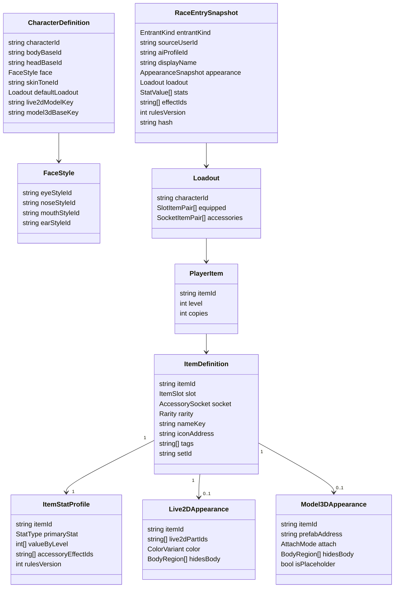

# 캐릭터·아이템 공통 데이터 모델 (설계)

- 상위 문서: [00_Architecture.md](00_Architecture.md)
- 관련: [03_ServerAsyncPvP.md](03_ServerAsyncPvP.md) (DB 테이블)
- 상태: 설계만. 코드는 로드맵 2단계에서 만든다.
- 2차 변경: 능력치·효과·규칙의 원본을 DB(Admin)로 정하고, 스냅샷에 AI 구분과 외형을 추가했다.
- 3차 변경 (2026-11-10, 사용자 결정): 스타킹·신발 슬롯 분리, 색 변형 ID 분리, 색은 `AppearancePreset`, 눈썹 독립 ID, 새 ID 에서 색 이름 제거, 외형 매핑은 렌더러별. 상세 설계와 정책 목록은 [05_CharacterItemSystem.md](05_CharacterItemSystem.md) 0장.

## 1. 원칙

1. **하나의 아이템 ID** 가 Live2D 외형, 3D 외형, 능력치를 모두 찾는 열쇠다.
2. 외형 데이터와 성능 데이터는 다른 파일에 둔다. 밸런스를 바꿔도 외형 에셋은 바뀌지 않고, 반대도 마찬가지다.
3. 정의(Definition, 기획 데이터)와 보유(Instance, 플레이어 데이터)를 나눈다. 정의는 클라이언트와 서버가 같은 내용을 갖고, 보유와 능력치 계산 결과는 서버가 최종 판단한다.
4. 3D 외형이 없는 아이템도 게임에 넣을 수 있다. 3D 는 슬롯별 임시 기본 모델로 대신한다.

## 2. 슬롯

능력치 묶음 (`StatGroup`, 레이싱 능력치):

| 묶음 | 내용 | 레이싱 능력치 (`StatType`) |
|---|---|---|
| `Hair` | 헤어스타일 | `HairResist` — 헤어스타일 저항력·엉킴 방지 |
| `Top` | 상의 (원피스 포함) | `WindResist` — 강풍 저항력 |
| `Bottom` | 하의 (원피스 포함) | `SlideControl` — 슬라이딩·마찰 제어력 |
| `Footwear` | 신발 (스타킹·양말은 제외, 3차 변경) | `Stomp` — 밟기·압착력 |
| `Accessory` | 머리띠, 귀걸이, 핸드백 등 | 없음. 보조 효과(`AccessoryEffect`)만 |

착용 슬롯 (`EquipmentSlot`, 3차 변경): `hair`, `top`, `bottom`, `legwear`(스타킹·양말, 능력치 없음), `shoes`, `acc.head`, `acc.ear`, `acc.neck`, `acc.hand`, `acc.back`. 원피스는 `top`·`bottom` 두 칸을 차지하는 아이템이고, `Top`·`Bottom` 능력치를 가지되 상·하의 조합보다 커지지 않게 정규화한다 (05 문서 4-10). `hair`·`top`·`bottom`·`shoes` 는 비울 수 없고 `legwear`·액세서리는 비울 수 있다.

액세서리는 위치마다 1개씩 장착한다. 동시에 장착할 수 있는 최대 개수는 밸런스 설정값으로 둔다.

얼굴(눈·코·입·귀·눈썹)과 피부·머리·눈 색은 아이템 슬롯이 아니다. 얼굴 스타일과 색은 `AppearancePreset` 에 둔다 (3차 변경). 눈썹은 독립 스타일 ID 이고 색은 처음에 머리색을 따른다.
Live2D 의 머리 소체(민머리 `Head_Skin`)와 얼굴 스타일·헤어 아이템 레이어 구분은 `Live2DSource/MainGirlfriend/09_Head/HeadBase_LayerPlan.md` 에 있다.

## 3. 엔티티

아래 그림은 2차 변경 때의 그림이다. 3차 변경으로 `Live2DAppearance`·`Model3DAppearance` 는 렌더러별 `AssetMapping` 으로, `Loadout` 은 `EquipmentState`(변형 ID 포함)로, `CharacterDefinition.skinToneId`·`FaceStyle` 은 `AppearancePreset`(피부·머리·눈 색, 눈썹 포함)으로 바뀌었고, `ItemVariant`·`BodyPreset`·`EquipmentSlot` 이 더해졌다. 지금 필드는 05 문서 4장과 `Assets/_Game/Scripts/Data`, `Shared/schemas/catalog.schema.json` 이 기준이다.

| 엔티티 | 저장 위치 | 설명 |
|---|---|---|
| `ItemDefinition` | 원본: DB `item_defs` (Admin 관리), Unity 는 사본 | ID, 슬롯, 등급, 이름(Localization 키), 아이콘, 태그(예 `long_boots`), 세트 |
| `ItemStatProfile` | DB `item_stat_levels` (규칙 버전별) | 슬롯의 주 능력치 레벨별 값, 액세서리 효과, 규칙 버전. Unity 는 표시용 사본만 |
| `AccessoryEffect` | DB `accessory_effects` | 효과 ID, 종류(예: 특정 구간 보너스), 수치 |
| `ItemVariant` (3차) | DB `item_variants` | 변형 ID `<itemId>.<이름>`, 아이템 고유 색 |
| 렌더러별 `AssetMapping` (3차, 이전 `Live2DAppearance`·`Model3DAppearance`) | 클라이언트 | Cubism: 논리 레이어·색 대상, 3D: 프리팹 주소·붙이는 방식·몸 부위 메시, 임시 모델 여부. 공통 데이터에는 그래픽 이름이 없다 |
| `CharacterDefinition` | 공통 | 캐릭터 ID, 고를 수 있는 체형·얼굴 스타일·색, 기본 외형, 기본 장착 (렌더러 베이스는 렌더러 매핑이 찾음) |
| `BodyPreset` (3차) | 공통 | 몸 소체, 머리 소체, 체형 (처음 1개 `standard`) |
| `AppearancePreset` (3차) | 캐릭터마다 | 얼굴 스타일(`FaceStyle`: 눈·코·입·귀·눈썹, 부위마다 따로), 피부·머리·눈 색 (자유 선택), 눈썹 색은 머리색을 따름 |
| `PlayerItem` | DB `player_items` + `player_item_variants` (클라이언트는 사본) | 보유 아이템, 레벨, 모은 개수 / 보유 변형 |
| `EquipmentState` (3차, 이전 `Loadout`) | DB `equipment_states` | 캐릭터별 착용 `(slotId, itemId, variantId)`, 버전. 변경은 Edge Function 이 검증 |
| `RaceEntrySnapshot` | DB `race_entries` (경기별, 불변), `player_race_snapshots` (매칭 풀, 유저당 최신 1개) | 참가 시점의 외형·장착·계산된 능력치 사본. `entrantKind` 는 `player` 또는 `ai`. AI 는 `sourceUserId` 가 없고 `aiProfileId` 를 가짐 |
| `AppearanceSnapshot` | 스냅샷 안 | 상대를 3D·Live2D 로 그리는 데 필요한 것만: 캐릭터 정의 ID, 체형, 얼굴 스타일, 피부·머리·눈 색 ID, 착용 `(slotId, itemId, variantId)` |

`BodyRegion`(예: `Torso`, `UpperArm`, `Thigh`, `Calf`, `Foot`, `Neck`)은 2D·3D 공통으로 "이 아이템을 입으면 가려지는 몸"을 뜻한다. 3D 에서는 해당 부위의 몸 메시를 숨겨 옷 뚫림을 막고, Live2D 에서는 소체 표시 방식을 고르는 데 쓴다.

## 4. ID 규칙과 기존 Live2D 데이터 대응

게임 아이템 ID 형식 (3차 변경): `<종류>_<모양>[_<세부>]_<번호>` (소문자, 밑줄). **색 이름을 넣지 않는다.** 색은 변형 ID `<itemId>.<이름>` 으로 나눈다 (예 `top_blouse_01.cream`). 플레이어는 보유한 변형만 고를 수 있다.

| 착용 슬롯 | 접두어 | 예 |
|---|---|---|
| hair | `hair_` | `hair_bob_01` |
| top | `top_` | `top_blouse_01` |
| bottom | `bottom_` | `bottom_pleatskirt_01` |
| top + bottom (원피스) | `onepiece_` | `onepiece_sundress_01` |
| legwear | `legwear_` | `legwear_thighhigh_01` |
| shoes | `shoes_` | `shoes_ankleboot_01` |
| acc.<위치> | `acc_<위치>_` | `acc_head_hairclip_x_01` |

Live2D 작업 데이터(`Live2DSource/MainGirlfriend/08_Body/v17/manifest.json`)의 `itemId` 는 **Live2D 파츠 ID** 로 그대로 쓴다. Live2D 작업은 바꾸지 않는다. 새 공통 ID 와 Live2D 파츠 ID 는 Cubism 렌더러 매핑으로 연결한다.

게임의 기본 지급 의상은 트레이닝 세트 `starter_tracksuit_01` (`top_tracksuit_01.v_mocha`, `bottom_joggers_01.v_mocha`, `shoes_slide_01.v_cream`, 스타킹 없음)이다 (2026-11-11 결정, 05 문서 0-1). 아래 표는 지금 Live2D 에 그려진 **컨셉 의상**의 대응표다. 컨셉 의상은 지우지 않고 갈아입을 수 있는 의상으로 남긴다 (레이어 단위 대응은 05 문서 9-2):

| 게임 아이템 ID (기본 변형) | 착용 슬롯 | Live2D 파츠 ID |
|---|---|---|
| `hair_bob_01` (`.default`) | hair | `hair_bob_brown_01` |
| `top_blouse_01` (`.cream`) | top | `top_blouse_cream_01` |
| `bottom_pleatskirt_01` (`.navy`) | bottom | `bottom_pleatskirt_navy_01` |
| `legwear_thighhigh_01` (`.black`) | legwear | `legwear_thighhigh_black_01` |
| `shoes_ankleboot_01` (`.black`) | shoes | `shoes_ankleboot_black_01` |
| `acc_head_hairclip_x_01` (`.white`) | acc.head | `acc_hairclip_x_white_01` |
| (아이템 아님) | 캐릭터 | `face_base_01`, `body_base_01`, `head_base_01` |

얼굴 스타일 ID 형식: `<부위>_<종류>_<번호>`, 부위 접두어 `eye_`, `nose_`, `mouth_`, `ear_`, `brow_` (색 이름 없음). MainGirlfriend: `eye_round_01`, `nose_dot_01`, `mouth_basic_01`, `ear_basic_01`, `brow_basic_01`. Live2D manifest 의 얼굴 레이어는 지금 모두 `face_base_01`(`EyeShade` 만 `eye_round_brown_01`)이며 그대로 둔다. `09_Head/HeadBase_LayerPlan.md` 2장의 `eye_round_brown_01` 은 Live2D 쪽 이름으로 남고, 공통 ID `eye_round_01` 과는 렌더러 매핑이 연결한다.

주의: Live2D 의 `Leg_R/L` 그룹에는 스타킹과 함께 허벅지 맨살(`Thigh_Skin_*`, manifest slot `body`)이 들어 있다. 맨살은 소체에 속한다. 스타킹이 없을 때 맨살을 보이는 일은 Cubism Visual Adapter 가 `coveredRegions` 로 정한다 (05 문서 7장). 옷장 방식은 아직 보류 (05 문서 U5).

## 5. 저장 형식과 원본 위치

데이터마다 원본(고치는 곳)을 하나로 정한다 (2차 결정).

| 데이터 | 원본 | 다른 쪽 |
|---|---|---|
| 아이템 정의(ID·슬롯·등급·태그), 능력치, 효과, 규칙 버전, 코스·구간·난이도, 매칭 설정, AI 프로필 | DB (Next.js Admin 에서 편집, 규칙 버전으로 발행) | Unity 는 카탈로그 사본(JSON)을 받아 표시에만 사용 |
| Live2D 외형, 3D 외형, 아이콘, 장소 테마 연출, 그래픽 표현 규칙 (렌더러별 매핑) | Unity (ScriptableObject + Addressables) | 서버는 아이템 ID 만 앎 |
| 게임 규칙 (슬롯·차지·필수 슬롯·체형·배타 태그·모자-헤어 조합 제한), 변형 목록, 색 정의 | DB | Unity 는 사본. 같은 규칙의 C# 구현(`EquipmentRules`)과 서버 TypeScript 구현을 공통 JSON 테스트 케이스(`Shared/testcases/appearance/`)로 비교 |
| 플레이어 보유·장착·스냅샷·경기·보상 | DB | Unity 는 사본 |

- Unity 외형 데이터는 ScriptableObject 로 편집한다: `Assets/_Game/ScriptableObjects/Items/<슬롯>/<itemId>.asset`.
- 검증 도구: DB 카탈로그의 모든 활성 아이템 ID 에 Unity 외형(또는 임시 기본 모델 지정)이 있는지, Unity 에만 있는 ID 가 없는지 확인한다 (로드맵 2단계).
- 카탈로그 사본은 버전(`catalogVersion`)을 붙여 앱에 기본 포함하고, 실행 시 서버에서 새 버전을 받는다.
- 이름과 설명은 Localization 테이블(`Items` 테이블 신규)의 키로 둔다. 현재 `UI_Text` 테이블은 그대로 둔다.
- 3D 프리팹과 아이콘은 Addressables 주소로 찾는다. Addressables 를 코드에서 직접 쓰기 시작할 때 `Packages/manifest.json` 에 명시적으로 추가한다 (지금은 Localization 의 의존성으로만 설치돼 있음).

## 6. 능력치 계산 (초안)

- 아이템 능력치 = `valueByLevel[level]`. 레벨은 같은 아이템을 모아 올린다 (성장 시스템).
- 캐릭터 능력치 = 능력치 묶음별 장착 아이템의 주 능력치. `Footwear` 는 신발만, 스타킹은 없음. 원피스는 `Top`·`Bottom` 값을 가지며 정규화한다 (05 문서 4-10). 액세서리는 효과만 더한다.
- 서버가 `RaceEntrySnapshot` 을 만들 때 능력치를 계산해 넣는다. 클라이언트가 보낸 능력치 값은 믿지 않는다. Unity 의 능력치 표시는 서버 값이나 카탈로그 사본으로 계산한 미리보기다.
- 모든 값은 정수다 (예: 1000 = 1.0). 계산이 어디서 돌아도 같은 결과가 나오게 하기 위해서다.
- 스냅샷은 경기 생성 시점에 고정된다. 장비를 강화·교체해도 이미 만든 경기는 바뀌지 않는다.

## 7. 임시 기본 모델 규칙

`Model3DAppearance` 가 없거나 `isPlaceholder = true` 인 아이템은 슬롯별 기본 모델을 쓴다. 기본 모델은 아이템 색(대표색)만 반영한다. 3D 를 나중에 만들어도 데이터 ID 는 바뀌지 않는다.
