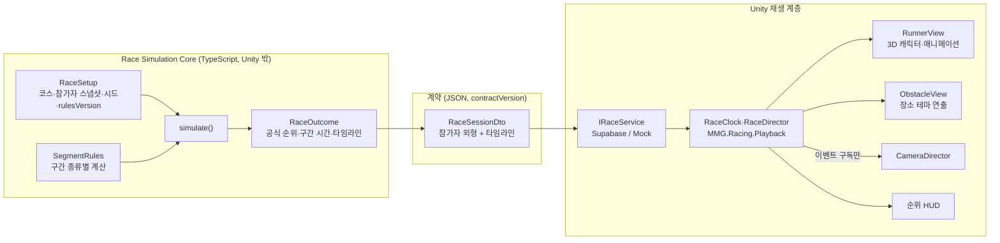

# 레이싱 시스템 — 계산 코어와 Unity 재생 계층 (설계)

- 상위 문서: [00_Architecture.md](00_Architecture.md)
- 관련: [01_CharacterItemDataModel.md](01_CharacterItemDataModel.md), [03_ServerAsyncPvP.md](03_ServerAsyncPvP.md), [04_ScreenAndCamera.md](04_ScreenAndCamera.md)
- 상태: 설계만. 레이싱 전체를 이번 단계에서 구현하지 않는다.
- 2차 변경: 계산 코어를 Unity C# 에서 **Unity 밖 독립 TypeScript 모듈**로 옮겼다. Unity 는 공식 타임라인을 재생만 한다.

## 1. 요구사항 요약

- Pocket Champs 와 비슷한 **완전 자동** 레이스. 레이스 중 사용자 조작 없음.
- 처음 6명, 나중에 최대 12명. 비동기 상대(실제 유저 스냅샷 + AI).
- 경기 전에 고른 아이템과 능력치로 승패 결정. 공식 결과는 서버가 계산.
- **결과 계산과 화면 연출은 독립**. Unity 물리·카메라는 결과에 영향을 주지 않는다.
- 한 레이스에 4가지 구간을 섞는다.

## 2. 계층



| 계층 | 위치 | 책임 | 하지 않는 것 |
|---|---|---|---|
| Race Simulation Core | `Server/race-core` (TypeScript) | 입력으로 공식 순위, 구간별 통과 시간, 아이템 발동 시점, 이벤트 타임라인 계산 | DB, 네트워크, 시간 흐름, 외형 |
| 서버 서비스 | Supabase Edge Functions | 매칭, Core 실행, 저장, 보상 (03 문서) | 연출 |
| 계약 | `MMG.Contracts` (C#) ↔ Core 타입 (TS) | 같은 JSON 형식과 버전 | 로직 |
| 재생 (`MMG.Racing.Playback`) | Unity | 타임라인을 일정한 속도로 재생, 선수 위치 보간, 표시용 순위 | 결과 변경, 다시 계산 |
| 연출 (`MMG.Racing.Presentation`) | Unity | 3D 선수, 장애물 변형, 파티클, 사운드, 표정 | 계산 |
| 카메라 (`MMG.Racing.Camera`) | Unity | 이벤트에 따른 샷 전환 (04 문서) | 재생 시간·결과 변경 |

Unity 의 물리 효과(옷·머리카락 흔들림, 장애물 파편 등)는 순수 연출이다. 선수 위치는 물리로 정하지 않고 타임라인 보간으로 정한다.

## 3. 계산 규칙

- 정수·고정소수점만 쓴다 (예: 1000 = 1.0). 부동소수점 계산 결과에 의존하지 않는다. TypeScript 에서는 안전 정수 범위 안의 정수 연산과 32비트 정수 연산으로 난수를 구현한다.
- 난수는 경기 시드로 초기화한 자체 구현 생성기만 쓴다. 참가자·구간별로 하위 시드를 나눠, 참가자 수가 바뀌어도 계산 순서가 흔들리지 않게 한다.
- 규칙이 바뀌면 `rulesVersion` 을 올린다. Core 는 지원하는 규칙 버전 목록을 갖고, 저장된 경기는 저장된 결과를 쓴다.
- Core 버전(`coreVersion`)도 결과와 함께 저장한다.
- 같은 입력(코스, 참가자 스냅샷, 시드, 규칙 버전)이면 항상 같은 출력이다. 이 성질을 테스트로 고정한다 (예시 입력·출력 고정 파일).

입력 (`RaceSetup`):

1. 코스와 구간 정보 (순서, 종류, 길이, 난이도)
2. 참가자 6~12명의 능력치 (서버가 계산한 스냅샷)
3. 장착 아이템과 특수 효과
4. 각 구간의 난이도
5. 경기별 난수 시드
6. 규칙 버전

## 4. 타임라인 (초안)

```text
RaceOutcome
  contractVersion, rulesVersion, coreVersion
  ranks[]: lane, finishTimeMs
  segmentTimes[]: lane, segmentIndex, enterMs, exitMs
  timeline:
    durationMs
    segments[]: segmentIndex, type(Stomp|Wind|Slide|Hair), startDistance, endDistance
    events[] (시간순):
      timeMs, lane, segmentIndex,
      kind: Enter | Exit | Success | Struggle | Fail | Boost | Overtake | SpecialItem | Finish,
      value (예: 속도 배율, 순위), itemId (SpecialItem 일 때)
    keyframes[]: timeMs, lane, distance   (위치 보간용: 구간 경계와 이벤트 시점)
```

- 연출은 `kind` 와 장소 테마를 조합해 고른다. 계산은 장소를 모른다.
- 크기 목표: 12명 기준 수 KB. 키프레임은 구간 경계와 이벤트 시점만 두고 사이는 Unity 가 보간한다.

## 5. 구간 종류와 장소 테마

| 구간 (`SegmentType`) | 사용 능력치 | 계산 (공통) | 봄 축제 | 여름 해변 | 가을 숲 | 겨울 산 |
|---|---|---|---|---|---|---|
| `Stomp` 밟기 | Footwear `Stomp` (신발만, 스타킹 제외) | 장애물 저항 대비 압착력 → 통과 시간·실패 | 슬라임 | 젖은 모래 | 진흙 | 눈더미 |
| `Wind` 강풍 | Top `WindResist` | 풍속 대비 저항 → 감속량 | (미정) | (미정) | (미정) | (미정) |
| `Slide` 슬라이딩 | Bottom `SlideControl` | 마찰 제어 → 미끄러짐·가속 | (미정) | (미정) | (미정) | (미정) |
| `Hair` 헤어 | Hair `HairResist` | 엉킴 확률·회복 시간 | (미정) | (미정) | (미정) | (미정) |

장소가 달라도 **같은 능력치·같은 계산**을 쓰고, 다음만 바뀐다: 장애물 모델·재질, 찌그러짐·변형 애니메이션, 파티클·사운드, 캐릭터 표정·반응, 카메라 프리셋. 장소별 장애물은 `ObstacleTheme`(장소 × 구간 종류) 데이터로 Unity 에 둔다.

## 6. 특수 장비 연출

- 아이템 효과가 계산에 보너스를 주면 Core 가 `SpecialItem` 이벤트(시점, 아이템 ID)를 남긴다.
- Unity 는 이벤트를 보고 강화 연출을 재생한다 (더 강한 슬라임 압착, 강풍 돌파 가속, 슬라이딩 강화, 헤어 반응 변화).
- 계산 효과가 없는 순수 외형 연출은 Unity 의 외형 데이터로만 처리한다.

## 7. 개발용 재생 (서버 없이)

- Core 가 예시 경기들의 `RaceOutcome` 을 JSON 고정 파일로 만든다 (6명, 12명, 접전, 독주, 아이템 발동 등).
- Unity 의 `MockRaceService` 가 이 파일을 읽어 `RaceSessionDto` 로 넘긴다. 서버가 없어도 재생·카메라·HUD 를 개발할 수 있다.
- 같은 고정 파일이 Core 의 결정성 테스트에도 쓰인다. 계약이 바뀌면 고정 파일을 다시 만들고 양쪽 테스트를 함께 고친다.

## 8. 성능 목표 (초안, 3D 단계에서 확정)

- 12명 동시: 캐릭터당 폴리곤·본·재질 예산, 텍스처 아틀라스, 플레이어 외 주자 LOD (세부 예산은 미정).
- 장애물 변형은 셰이더·블렌드셰이프 중 가벼운 쪽.
- 연출용 파티클은 장소별 공용 풀.

## 9. 구현 순서 (00 문서 로드맵 2~6, 9단계)

1. 데이터 계약: JSON 스키마, C# DTO (`MMG.Contracts`), TS 타입.
2. Core: 6명·4구간, 결정성 테스트, 예시 고정 파일, 6·12명 벤치마크.
3. Unity 재생 그레이박스: `MockRaceService`, 캡슐 선수, 직선 코스, 순위 HUD, 기본 카메라(사선·추적·결승). Cinemachine 설치.
4. Supabase MVP 와 연결 (`SupabaseRaceService`).
5. 부하 테스트 후 Core 실행 위치 결정.
6. 장소 테마 1개(봄 축제)로 4구간 외형, 전체 카메라 샷, 그 뒤 나머지 장소.
