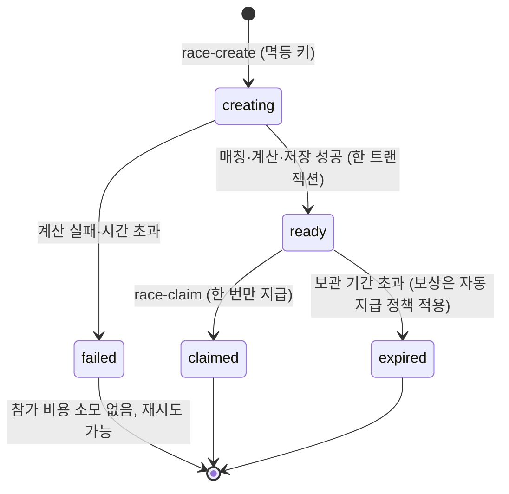

# 서버 아키텍처 — 비동기 PvP (설계)

- 상위 문서: [00_Architecture.md](00_Architecture.md)
- 관련: [01_CharacterItemDataModel.md](01_CharacterItemDataModel.md), [02_RacingModules.md](02_RacingModules.md)
- 상태: 설계만. 서버·DB 는 아직 만들거나 배포하지 않았다.

## 1. 결정 사항

- 실시간 PvP 게임 서버를 두지 않는다. **Pocket Champs 와 비슷한 비동기 PvP** 다.
- 처음 6명, 나중에 최대 12명. 참가자가 동시에 접속할 필요가 없다.
- 상대는 실제 유저가 저장해 둔 캐릭터·아이템·능력치(스냅샷)다. 부족하면 시스템 AI 선수로 즉시 채운다.
- 사용자는 매칭 대기 없이 바로 레이스를 시작한다.
- 레이스 중 사용자 조작은 없다. 선수 좌표를 매 프레임 서버로 보내는 구조는 금지한다.

| 구성 | 역할 |
|---|---|
| Supabase Auth | 사용자 인증 (JWT) |
| Supabase PostgreSQL | 프로필, 캐릭터, 아이템, 장착, 능력치 스냅샷, 경기 세션·결과, 보상, 리그 |
| Supabase Edge Functions | 경기 생성, 상대 매칭, 결과 조회, 보상 처리, 장착 변경 검증 |
| Race Simulation Core | 공식 순위·구간 시간·아이템 발동·이벤트 타임라인 계산 (서비스와 독립된 순수 TypeScript 모듈) |
| Unity | 공식 데이터로 3D 레이스 재생 |
| Next.js Admin | 밸런스, 규칙 버전, AI 난이도, 운영 데이터 |

상시 실행되는 전용 서버는 처음부터 만들지 않는다. 계산량이 커지면 Race Simulation Core 만 따로 확장한다 (5장 인터페이스, 7장 확장 단계).

## 2. 경기 생명주기



1. **race-create** (Edge Function)
   1. JWT 확인, 요청의 멱등 키(`Idempotency-Key`) 확인. 같은 키의 경기가 있으면 그 경기를 그대로 돌려준다.
   2. 사용자의 현재 장착을 읽어 **서버가 능력치를 계산**하고 내 참가자 스냅샷을 만든다. 클라이언트가 보낸 능력치는 받지 않는다.
   3. 상대 매칭 (3장): 스냅샷 풀에서 실제 유저 상대를 고르고, 부족한 자리는 AI 선수로 채운다.
   4. 코스(장소 포함), 경기 난수 시드(서버 보안 난수), 현재 `rulesVersion` 을 정한다.
   5. `ISimulationRunner.run(setup)` 으로 공식 결과와 타임라인을 계산한다.
   6. 세션, 참가자 스냅샷, 결과, 타임라인을 **한 트랜잭션**으로 저장하고 참가 비용(있다면)을 같은 트랜잭션에서 차감한다.
   7. 참가자 외형 정보와 타임라인을 응답한다. 클라이언트는 받은 즉시 재생을 시작한다.
2. **race-get**: 세션 ID 로 저장된 경기를 다시 받는다 (앱 재시작, 다시 보기).
3. **race-claim**: 보상 지급. DB 의 고유 제약(세션당 보상 1행)과 트랜잭션으로 한 번만 지급한다. 같은 요청을 다시 보내면 이미 지급된 결과를 그대로 돌려준다.
4. **race-pending**: 보상을 받지 않은 경기 목록 (앱이 레이스 도중 꺼진 경우).

공식 결과는 경기 생성 때 이미 정해진다. 재생을 끝까지 보지 않아도 결과는 같다.

### 스냅샷 불변

- 참가자 스냅샷(장착 아이템, 레벨, 계산된 능력치, 효과, 외형 ID)은 경기 생성 시점에 복사해 저장하고 이후 바꾸지 않는다.
- 장비를 강화·교체해도 이미 만든 경기의 스냅샷과 결과는 그대로다.
- 다시 보기는 저장된 타임라인을 재생한다. 규칙이 바뀌어도 그 경기의 `rulesVersion` 으로 저장된 결과를 쓴다.

## 3. 상대 매칭 (실제 유저 + AI 혼합)

### 스냅샷 풀

- 유저가 장착을 바꾸거나 경기를 마칠 때 `player_race_snapshots` 에 **공개용 최신 스냅샷**을 갱신한다 (유저당 1행, 버전 번호).
- 풀에 들어가는 정보: 표시명, 캐릭터 외형(얼굴 스타일·장착 아이템 ID·색), 계산된 능력치, 효과, 리그·트로피, 총 능력치, 최근 성과, 갱신 시각.
- 공개하지 않는 정보: 이메일, 인증 정보, 결제 정보, 보유 아이템 전체 목록.
- 상대로 뽑힐 때 그 시점의 스냅샷을 경기에 복사한다. 상대가 오프라인이어도 상관없다.

### 매칭 점수

| 요소 | 사용 방법 |
|---|---|
| 리그·트로피 | 1차 필터: 같은 리그, 트로피 범위 ±T |
| 캐릭터 총 능력치 | 내 총 능력치 대비 범위 안 |
| 장비 구성 | 같은 구성만 몰리지 않게 다양성 가산점 |
| 최근 성과 | 연승 중이면 조금 강한 상대, 연패 중이면 조금 약한 상대 |
| 경기 난이도 | 목표 난이도 곡선 (예상 순위 분포)에 맞춰 상대 조합 |
| 중복 방지 | 최근 N 경기에 만난 상대, 자기 자신, 차단·정지 계정 제외 |

- 범위를 단계적으로 넓힌다 (예: 트로피 ±T → ±2T → 같은 리그 전체). **기다리지 않는다**. 정해진 단계 안에서 못 채운 자리는 AI 로 채운다.
- 매칭 쿼리는 인덱스(리그, 트로피, 총 능력치, 갱신 시각)로 처리하고, 후보를 일정 수만 가져와 함수 안에서 점수를 매긴다.
- 매칭 규칙의 수치(범위, 가산점, 단계 수)는 설정 테이블로 두어 Admin 에서 바꾼다.

### AI 선수

- 시스템이 만든 선수다. 내부 데이터에서 `entrantKind = ai` 로 구분하고, 실제 유저의 `user_id` 를 갖지 않는다.
- 능력치는 목표 난이도에 맞춰 생성한다 (내 총 능력치 기준 비율, 난이도 곡선, 규칙 버전별 AI 프로필).
- 외형은 카탈로그의 AI 전용 프리셋에서 고른다. **실제 유저의 프로필·표시명·외형 조합을 복사해 AI 로 쓰지 않는다.**
- 화면에서 AI 를 실제 접속 중인 유저로 표현하지 않는다: "온라인" 표시를 하지 않고, AI 임을 알 수 있는 표시(문구는 미정, 00 문서 8장)를 둔다.
- 실제 유저 상대도 "실시간 접속 중" 으로 표현하지 않는다. 비동기 상대임을 전제로 한다.

## 4. 데이터베이스 (초안)

| 테이블 | 주요 컬럼 | 비고 |
|---|---|---|
| `profiles` | user_id, display_name, league, trophies, created_at | Auth 사용자와 1:1 |
| `characters` | character_id, user_id, character_def_id, body_preset_id | 플레이어 캐릭터 (01 문서) |
| `appearance_states` | character_id, face_style(jsonb: eye·nose·mouth·ear·brow), skin_color_id, hair_color_id, eye_color_id, brow_color_mode, version | 아이템이 아닌 외형 (05 문서 4-3). 색은 처음에 자유 선택 |
| `item_defs` | item_id, kind, occupies, rarity, tags, covers, hair_forms, fits_body_types, default_variant_id, is_active | 아이템 정의 (원본: DB, Admin 관리). ID 에 색 이름 없음 |
| `item_variants` | variant_id, item_id, colors(jsonb), is_active | 색 변형 (05 문서 4-5) |
| `equipment_slots`, `compat_rules` | 슬롯(능력치 묶음·필수 여부), 배타 태그·모자-헤어 조합 제한, accessory_max_count, rules_version | 게임 규칙 (05 문서 7장) |
| `color_defs`, `face_style_defs`, `character_defs`, `body_presets` | 05 문서 4장 | 캐릭터·외형 카탈로그 |
| `item_stat_levels` | item_id, rules_version, level, value | 레벨별 능력치 |
| `accessory_effects` | effect_id, rules_version, kind, params | 보조 효과 |
| `rule_versions` | rules_version, status(draft·live·retired), published_at | 발행 후 내용 변경 금지 |
| `courses`, `course_segments`, `venues` | course_id, venue_id, 구간 순서·종류·길이·난이도 | 장소는 외형용 ID |
| `player_items` | user_id, item_id, level, copies, first_acquired_at | 보유 (현재 상태) |
| `player_item_variants` | user_id, variant_id, acquired_at | 보유 변형. 보유한 변형만 착용 가능 |
| `purchases`, `store_products` | 05 문서 5장 | 구매 기록 (추가만), 상품 (아이템과 분리). 실제 결제는 상점 단계 |
| `item_grants`, `currency_ledger` | 05 문서 5장 | 획득·재화 기록 (추가만). `player_items` 는 같은 트랜잭션에서 갱신 |
| `equipment_states` | character_id, slot_id, item_id, variant_id, version, rules_version | 착용 (이전 이름 `loadouts`). `version` 이 맞을 때만 저장 |
| `player_race_snapshots` | user_id, version, league, trophies, power, snapshot(jsonb), updated_at | 매칭 풀 (유저당 1행) |
| `ai_profiles` | ai_profile_id, rules_version, difficulty, stat_ratio, appearance_preset | AI 생성 규칙 |
| `race_sessions` | session_id, user_id, idempotency_key, status, seed, rules_version, course_id, created_at | (user_id, idempotency_key) 고유 |
| `race_entries` | session_id, lane, entrant_kind(player·ai), source_user_id, ai_profile_id, snapshot(jsonb) | 불변 |
| `race_results` | session_id, ranks, finish_times, timeline(jsonb 또는 Storage 경로), core_version, hash | 불변 |
| `race_rewards` | session_id (고유), user_id, rewards(jsonb), claimed_at | 한 번만 지급 |
| `matchmaking_config` | key, value, rules_version | Admin 에서 조정 |

- RLS: 유저는 자기 행만 읽고 쓴다. 다른 유저 정보는 Edge Function 이 공개 필드만 골라 돌려준다. 경기·보상 쓰기는 Edge Function(서비스 역할)만 한다.
- 장착 변경도 Edge Function(`equip-set`)으로 검증한다: 아이템·변형 보유, 슬롯·종류, 원피스 차지, 필수 슬롯 기본 아이템, 체형, 배타 태그, 모자-헤어 조합 제한, 액세서리 개수 (05 문서 7장). 그래픽 표현 규칙은 서버가 보지 않는다. 같은 규칙의 Unity C# 구현과 결과가 같은지 `Shared/testcases/appearance/` 의 공통 JSON 테스트 케이스로 확인한다.
- 타임라인은 크기를 보고 jsonb 또는 Supabase Storage 에 둔다 (6·12명 기준 수 KB 목표).

## 5. 인터페이스와 확장

### 서버 안 (TypeScript)

```ts
// Race Simulation Core: 의존성 없는 순수 함수
export function simulate(setup: RaceSetup): RaceOutcome;

// Edge Function 이 쓰는 실행기: 구현을 바꿔 Core 를 옮긴다
interface ISimulationRunner {
  run(setup: RaceSetup): Promise<RaceOutcome>;
}
class InProcessRunner implements ISimulationRunner { /* Core 를 같은 함수 안에서 실행 */ }
class HttpRunner implements ISimulationRunner { /* AWS Lambda 등 서버리스 함수 호출, 서명된 요청 */ }

interface IOpponentProvider {           // 실제 유저 스냅샷 / AI
  pick(request: MatchRequest, count: number): Promise<EntrantSnapshot[]>;
}
interface IRewardService {
  claim(sessionId: string, userId: string): Promise<RewardResult>; // 멱등
}
```

- `RaceSetup` 과 `RaceOutcome` 은 JSON 으로 주고받는 계약(`contractVersion`)이다. Core 는 DB 나 Supabase 를 모른다.
- Core 를 옮길 때 바뀌는 것은 `ISimulationRunner` 구현 선택(설정값)뿐이다. 매칭, 저장, 보상 코드는 그대로다.
- Next.js Admin 은 같은 Core 를 가져와 밸런스 시뮬레이션(수천 경기 일괄 계산)에 쓴다.

### Unity (C#)

```csharp
public interface IAuthService   { Task SignInAsync(...); string AccessToken { get; } }
public interface IPlayerService { Task<PlayerState> GetStateAsync(); Task<EquipResultDto> SetEquipmentAsync(EquipRequestDto request); }  // 결과에 자동 해제 목록 포함 (05 문서 7-3)
public interface IRaceService
{
    Task<RaceSessionDto> CreateRaceAsync(CreateRaceRequest request, string idempotencyKey);
    Task<RaceSessionDto> GetRaceAsync(string sessionId);
    Task<RewardDto> ClaimRewardAsync(string sessionId);
    Task<IReadOnlyList<RaceSummaryDto>> GetPendingAsync();
}
```

- 구현은 `SupabaseRaceService` (HTTP) 와 `MockRaceService` (예시 타임라인 JSON 을 읽음) 두 가지로 시작한다.
- DTO 는 `MMG.Contracts` 에 두고 서버 계약과 같은 `contractVersion` 을 쓴다. 버전이 맞지 않으면 클라이언트 업데이트를 안내한다.

## 6. 실패·재시도 정책

| 상황 | 처리 |
|---|---|
| race-create 응답 시간 초과 | 같은 멱등 키로 재시도 → 이미 만들어진 경기면 그대로 받음. 지수 백오프 최대 3회 |
| 계산 실패·Core 호출 실패 | 세션 `failed`, 참가 비용 차감 없음 (같은 트랜잭션), 사용자에게 다시 시도 안내 |
| 사용자 오프라인 (요청 전) | 공식 레이스 시작 불가 안내. 보상 없는 연습 재생은 나중에 검토 |
| 재생 도중 앱 종료·연결 끊김 | 결과는 이미 서버에 있음. 다음 실행 때 race-pending 으로 결과 화면 또는 다시 보기 |
| race-claim 중복 요청 | 고유 제약으로 1회만 지급, 이후 요청은 같은 결과 반환 |
| 상대 스냅샷 부족 | 매칭 범위 단계 확대 후 AI 충원. 대기 없음 |
| 상대가 오프라인·탈퇴 | 오프라인은 무관. 탈퇴 유저는 풀에서 제외, 기존 경기 스냅샷은 표시명 익명화 |
| 경기 중 규칙 버전 변경 | 경기는 생성 시점 버전 유지. 새 경기부터 새 버전 |
| 클라이언트 계약 버전 불일치 | 업데이트 안내, 서버는 이전 계약 버전을 일정 기간 지원 |
| 보상 미수령 경기 보관 기간 초과 | 자동 지급 또는 소멸 중 정책 결정 (미정, 리그 규칙과 함께) |

## 7. 서버 부하와 확장

- 서버가 하는 일: 경기 생성(매칭 + 계산 + 저장), 경기 조회, 보상, 장착 변경, 성장 데이터. 레이스 중 통신은 없다.
- 경기 1판의 서버 비용 = Edge Function 1회 (매칭 쿼리 + Core 계산 + 트랜잭션 저장) + 보상 1회.
- 확장 단계:
  1. Core 를 Edge Function 안에서 실행 (InProcessRunner).
  2. Core 계산 시간이 한도에 가까워지면 Core 만 AWS Lambda 등으로 분리 (HttpRunner). DB·함수 구조는 그대로.
  3. 매칭 쿼리가 무거워지면 스냅샷 풀을 리그별로 나누거나, 후보 목록을 주기적으로 미리 계산한다.

## 8. 부하 테스트 계획

| 단계 | 대상 | 방법 | 측정 | 통과 기준 (초안) |
|---|---|---|---|---|
| L0 | Race Core 단독 | 로컬에서 6명·12명 경기 1만 번 계산 | 경기당 CPU 시간 p50·p95, 메모리, 타임라인 크기 | 12명 p95 가 Edge Function CPU 한도의 20% 이하 |
| L1 | race-create | 스테이징 Supabase, 부하 도구(k6 등)로 초당 요청 단계 증가 | 응답 p50·p95·p99, 오류율, 함수 CPU·메모리 | p95 1초 이하, 오류율 0.1% 이하 (목표 동시 사용자 기준) |
| L2 | 매칭 쿼리 | 스냅샷 풀 1만·10만·100만 행 | 쿼리 시간, 인덱스 사용 | 풀 크기에 따라 시간이 급증하지 않음 |
| L3 | race-claim 동시성 | 같은 세션 동시 중복 요청, 다수 세션 동시 지급 | 중복 지급 수, 잠금 대기 | 중복 지급 0 |
| L4 | 전체 흐름 | 로그인 → 장착 → 생성 → 조회 → 보상, 혼합 시나리오 1시간 | 오류율, DB 연결 수, 비용 추정 | 연결 고갈 없음, 비용 예측 가능 |
| L5 | 급증 | 이벤트 시작 같은 짧은 폭주 | 대기열, 실패 후 재시도 성공률 | 재시도 후 성공 |

- Supabase 요금제별 Edge Function 한도(CPU 시간, 메모리, 실행 시간, 호출 수)와 DB 연결 수는 테스트 시점의 공식 문서로 확인해 기준값을 채운다.
- 기준을 넘으면: Core 분리(7장 2단계), 매칭 사전 계산, 요금제 조정 중에서 결정한다.
- 부하 테스트는 스테이징 프로젝트에서만 한다. 운영 데이터로 하지 않는다.

## 9. 보안·정합성 요약

- 능력치·결과·보상은 서버만 계산하고 쓴다. 클라이언트 값은 믿지 않는다.
- 정수 기반 결정적 계산, 시드 저장, 규칙 버전 저장으로 같은 경기를 다시 계산하면 같은 결과가 나온다 (감사·분쟁 대응).
- 결과에 해시를 저장해 변조를 확인한다.
- Admin 은 서비스 키를 서버 쪽에서만 쓰고, 규칙 버전은 발행 후 수정하지 않는다 (새 버전으로만 변경).
