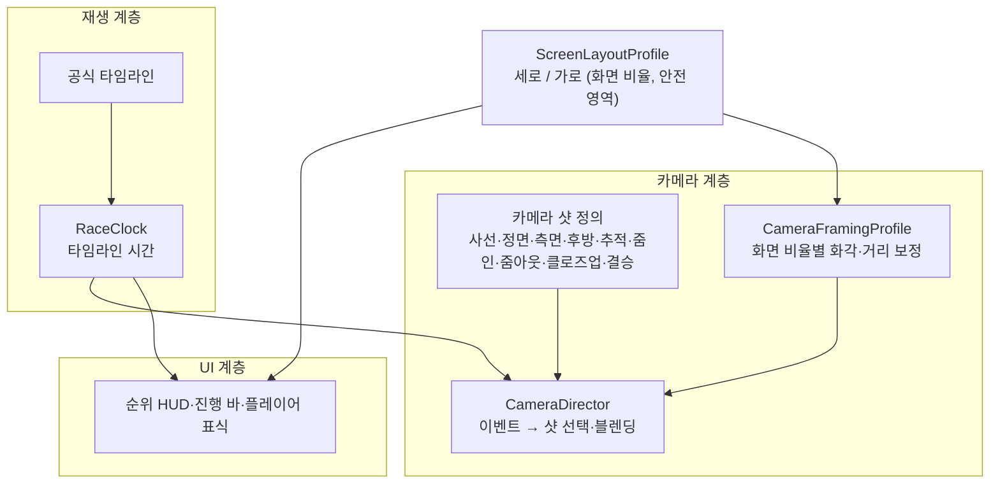

# 화면 방향, UI, 카메라 (설계)

- 상위 문서: [00_Architecture.md](00_Architecture.md)
- 관련: [02_RacingModules.md](02_RacingModules.md)
- 상태: 설계만. Cinemachine 은 아직 설치하지 않는다 (로드맵 4단계에서 설치).

## 1. 결정 사항

- 모바일 기본 화면 방향은 **세로(Portrait)** 다.
- **화면 방향과 3D 카메라 각도는 따로 관리**한다. 세로/가로는 UI 배치와 카메라 화각 조정에만 영향을 주고, 카메라 샷 종류·전환 규칙·레이스 재생은 바뀌지 않는다.
- 12명 레이스 가독성 테스트 결과로 화면 방향을 다시 검토할 수 있게 한다.
- Live2D 꾸미기 화면과 3D 레이스 화면은 같은 캐릭터·아이템 데이터를 쓴다.

현재 `ProjectSettings` 는 자동 회전(`defaultScreenOrientation: 4`)이다. 지금은 바꾸지 않고, 레이스 재생 그레이박스 단계에서 세로 고정으로 바꾼다.

## 2. 세 계층의 분리

| 계층 | 무엇이 바뀌나 | 무엇에 영향 주지 않나 |
|---|---|---|
| `ScreenLayoutProfile` | 세로/가로에 따라 HUD 위치, 안전 영역, 카메라 화각 보정값 선택 | 샷 종류, 전환 규칙, 재생 |
| 카메라 (`CameraDirector`) | 이벤트에 따라 샷 선택, 블렌딩 | 재생 시간, 순위, 결과 |
| 재생 (`RaceClock`) | 공식 타임라인을 일정한 속도로 진행 | 카메라가 무엇을 보든 멈추거나 느려지지 않음 |

- 샷은 월드 공간 기준(선수·코스 기준 오프셋, 바라보는 대상)으로 정의한다. 화면 비율이 바뀌면 `CameraFramingProfile` 이 화각이나 거리만 보정해 같은 내용이 화면에 들어오게 한다.
- UI 는 Canvas 와 안전 영역 기준으로 배치하고, 세로·가로 레이아웃 프리팹을 프로필로 고른다.

## 3. 카메라 샷 (Cinemachine 기반 계획)

| 샷 | 용도 | 트리거 (타임라인 이벤트) | 길이 |
|---|---|---|---|
| `Diagonal` 기본 사선 3D | 일반 레이스 | 기본 | 계속 |
| `Front` 정면 | 표정·반응, 구간 진입 연출 | 구간 진입 (테마 프리셋) | 짧게 |
| `Side` 측면 | 경쟁 상황, 슬라이딩 | 구간 진입 (테마 프리셋), 접전 | 중간 |
| `RearChase` 후방 추적 | 속도감 | 가속(`Boost`) | 중간 |
| `Follow` 특정 선수 추적 | 플레이어·주요 경쟁자 | 기본 대상 선택 | 계속 |
| `ItemZoomIn` 특수 아이템 줌인 | 아이템 발동 | `SpecialItem` | 짧게 (상한 있음) |
| `PackZoomOut` 줌아웃 | 추월, 다수 선수 확인, 12명 전체 | `Overtake`, 선두와 플레이어 거리 벌어짐 | 중간 |
| `ObstacleCloseUp` 클로즈업 | 장애물 압착·통과 | `Stomp` 구간 `Success`·`Struggle` (플레이어) | 짧게 |
| `Finish` 결승·승리 | 결승선, 승리 연출 | `Finish` | 끝까지 |

Cinemachine 구성(예정): 샷마다 가상 카메라 1개, 다수 선수용 타깃 그룹, 기본 블렌드 설정과 샷 간 개별 블렌드. 실제 컴포넌트 구성은 설치 단계에서 정한다.

## 4. 연출 원칙 (순위 가독성)

1. 일반 레이스에서는 **플레이어 캐릭터와 주요 경쟁자**(바로 앞·뒤 순위, 선두)를 중심으로 보여준다.
2. 12명 전체를 보여줄 필요가 있을 때(출발, 큰 추월, 결승 직전) 줌아웃한다.
3. 특별한 아이템 효과는 **짧은 클로즈업**으로만 보여주고 바로 기본 샷으로 돌아온다.
4. 카메라 전환은 **부드러운 블렌딩**을 쓴다. 잘라 넘기기는 결승 같은 특별한 경우만.
5. 카메라가 바뀌는 동안에도 **공식 레이스 재생은 계속 진행**한다. 카메라 때문에 재생을 멈추거나 늦추지 않는다.
6. 플레이어가 **언제든 현재 순위를 확인**할 수 있게 순위 HUD 는 항상 보인다.

`CameraDirector` 규칙:

- 샷마다 우선순위, 최소 유지 시간, 최대 길이(클로즈업·줌인), 재사용 대기 시간을 둔다. 이벤트가 몰려도 카메라가 산만하게 튀지 않게 한다.
- 플레이어와 관계없는 다른 선수의 이벤트는 기본적으로 카메라를 가져가지 않는다 (줌아웃 조건 제외).
- 카메라는 재생 계층의 이벤트를 **구독만** 한다. 타임라인과 결과를 바꾸지 않는다.

## 5. 순위 HUD

| 요소 | 세로 배치 (기본) | 가로 배치 (재검토용) |
|---|---|---|
| 현재 순위 (내 순위 / 전체) | 상단 중앙 크게 | 좌측 상단 |
| 순위 목록 (상위 몇 명 + 내 앞뒤) | 상단 아래 접힌 목록 | 좌측 세로 목록 |
| 코스 진행 바 (전체 선수 점) | 화면 측면 세로 바 | 상단 가로 바 |
| 플레이어 표식 | 3D 머리 위 아이콘·외곽선 | 같음 |
| 현재 구간 종류 아이콘 | 진행 바 옆 | 같음 |

- 순위는 재생 계층이 타임라인에서 계산한 값(공식 결과와 같은 규칙)을 쓴다. 카메라 화면에 보이는 위치로 계산하지 않는다.
- AI 선수 표시는 서버 문서의 원칙을 따른다 (03 문서 3장).

## 6. 가독성 테스트 (로드맵 11단계 이전, 그레이박스로 시작 가능)

- 6명·12명, 세로·가로, 휴대폰 크기 2종 이상.
- 확인: 내 캐릭터를 3초 안에 찾는지, 현재 순위를 1초 안에 읽는지, 클로즈업 뒤 상황을 다시 파악하는 시간.
- 결과에 따라 세로 유지, 가로 전환, 또는 둘 다 지원을 정한다. 이 결정은 `ScreenLayoutProfile` 과 `CameraFramingProfile` 추가로 처리하고 레이스 로직은 바꾸지 않는다.
