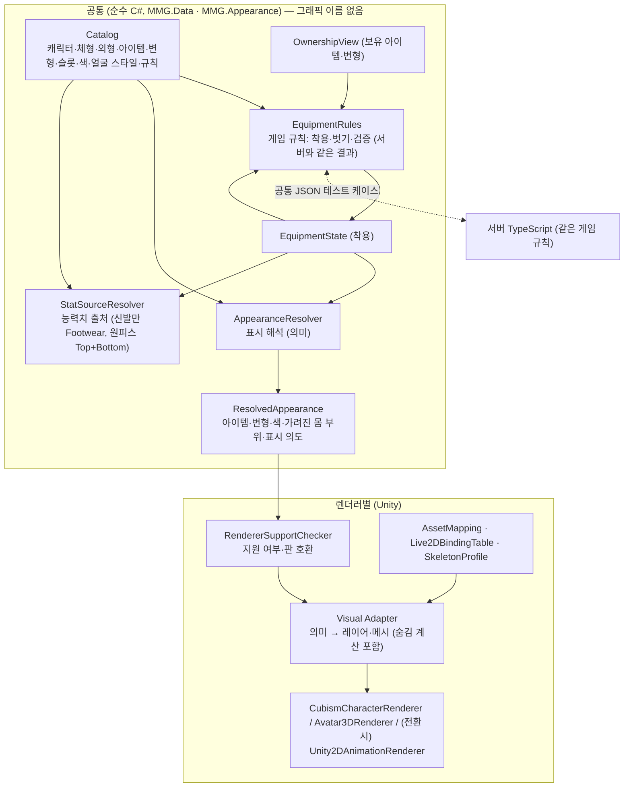
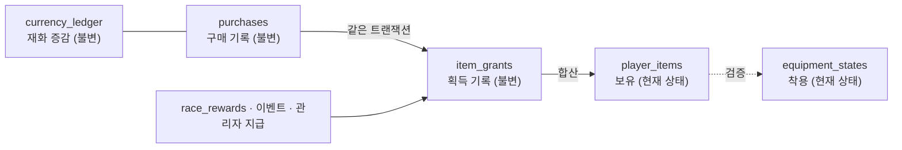

# 2D·3D 공통 캐릭터·아이템 시스템 (상세 설계안)

- 상위 문서: [00_Architecture.md](00_Architecture.md), 기본 데이터 모델: [01_CharacterItemDataModel.md](01_CharacterItemDataModel.md), DB: [03_ServerAsyncPvP.md](03_ServerAsyncPvP.md)
- 작성일: 2026-11-10
- 상태: **방향 승인 (2026-11-10)**. 초기 정책은 0장에 확정했고, 01·03 문서에 반영했다 (16장). U5(옷장 방식)·U9(호스팅)는 보류. S1·S2 를 구현했다 (15장). Cubism 분리 모델 실험 A0·A1 결과는 17-4·17-6, 기본 지급 의상은 0-1.
- 지킬 것: 기존 Unity 씬·프리팹, Blender 파일, Cubism 파일(96 메쉬·ID·레이어·리깅)·원본 PSD 는 바꾸지 않는다. DB 생성·패키지 설치·PRO 전환·원격 호스팅·실제 결제는 하지 않는다.
- 검증 표시: 이 문서에서 "확인" 은 실제로 실행해 본 것만 뜻한다. Cubism 마스크 동작, 곱하기 색 품질, 2D Animation 품질, Addressables 원격 배포는 아직 확인하지 않았다.

## 0. 확정 정책 (2026-11-10, 사용자 결정)

| # | 정책 |
|---|---|
| U1 | 스타킹(`legwear`)과 신발(`shoes`)은 착용 슬롯을 나눈다. `Footwear` 능력치(`Stomp`)는 신발에서만 계산한다. 스타킹은 능력치가 없다 |
| U2 | 원피스는 `Top`·`Bottom` 두 능력치를 가진다. 상·하의 조합보다 커지지 않게 정규화한다 (4-10) |
| U3 | 아이템 ID 와 색 변형 ID 를 나눈다. 보유한 변형만 고를 수 있다 (`player_item_variants`) |
| U4 | 앞으로 색을 바꿀 파츠는 중성(회색조) 텍스처 + 색 마스크를 먼저 검토한다. 기존 2D 원화는 바꾸지 않는다. 피부·머리·눈 기본 색은 자유 선택으로 시작한다 |
| U5 | 보류. 독립 Cubism 모델(아이템별 모델 겹치기) 방식과 같은 메쉬 텍스처 교체 방식을 각각 프로토타입으로 검증한다. 모든 아이템을 한 모델에 넣는 방식은 기본안에서 뺀다 |
| U6 | 눈썹 스타일은 독립 ID (`brow_*`). 처음 눈썹 색은 머리색을 따른다 |
| U7 | 새 공통 아이템 ID 에서 색 이름을 뺀다 (예 `hair_bob_01`). 기존 Cubism manifest 와 ID 는 그대로 두고 렌더러 매핑으로 연결한다 (9-2) |
| U8 | 충돌하는 아이템은 자동으로 벗기고 바뀐 내용을 UI 에 보여 준다. 모자에 맞는 헤어 형태가 없으면 그 조합은 막는다 |
| U9 | 원격 그래픽 호스팅은 S9 까지 보류 |
| U10 | 게임 규칙(보유·슬롯·능력치·조합 제한)은 서버가 검증한다. 그래픽 표현 규칙은 Unity 의 렌더러별 매핑이 관리한다 |
| U11 | 기본 체형 1개로 시작한다 (`standard`) |
| U12 | 스타킹·액세서리는 비울 수 있다. 헤어·신발은 비울 수 없고 벗기면 기본 아이템으로 돌아간다. 상의·하의는 몸 가림 필수 (원피스가 둘 다 차지할 수 있음) |
| U13 | 초기 3D 는 부위별 메시 숨김 방식 |
| U14 | 코디 저장은 나중 기능 |

아키텍처 보완 (같은 날 사용자 지시):
- 공통 `AppearanceResolver` 는 Cubism ArtMesh ID, Unity Sprite 이름, Blender 메시 이름을 모른다. 공통 데이터에는 몸 부위, 아이템, 색, 호환성, 표시 의도 같은 의미 정보만 둔다.
- 숨길 레이어·메시처럼 그래픽 구현에 묶인 것은 렌더러별 **Visual Adapter** 가 계산한다 (8장).
- 렌더러별 에셋 지원 여부와 버전 호환을 검사하는 `RendererSupportChecker` 를 둔다 (8-3).
- 서버 TypeScript 와 Unity C# 의 게임 규칙 결과를 비교하는 공통 JSON 테스트 케이스를 둔다 (`Shared/testcases/appearance/`).

## 0-1. 기본 지급 의상 (2026-11-11, 사용자 결정)

지금 Live2D 모델이 입은 블라우스·네이비 치마·검은 스타킹·부츠는 **캐릭터 컨셉 제작용 의상**이다. 게임에서 처음 지급·착용하는 기본 의상은 아래로 바꾼다. 컨셉 의상은 지우지 않고 나중에 갈아입을 수 있는 의상으로 남긴다 (얻는 방법은 미정).

| 슬롯 | 아이템 ID | 변형 ID | 내용 |
|---|---|---|---|
| top | `top_tracksuit_01` | `top_tracksuit_01.v_mocha` | 모카 브라운 트레이닝 집업 |
| bottom | `bottom_joggers_01` | `bottom_joggers_01.v_mocha` | 같은 계열 조거 트레이닝 팬츠 |
| shoes | `shoes_slide_01` | `shoes_slide_01.v_cream` | 크림·베이지 슬라이드 슬리퍼 |
| legwear | (없음) | — | 스타킹 없음 (U12 로 비울 수 있음) |
| hair | `hair_bob_01` | `hair_bob_01.default` | 현재 디자인 유지 |
| acc.head | `acc_head_hairclip_x_01` | `acc_head_hairclip_x_01.white` | 현재 디자인 유지 |
| 얼굴·색 | 4-3 그대로 | | 현재 디자인 유지 |

- 코디 세트 ID `starter_tracksuit_01`: 위 상의·하의·신발 세 아이템의 `setId`. 세트는 표시·지급 묶음일 뿐이고, 세 아이템은 각자 따로 갈아입는다 (원피스가 아님).
- 변형 ID 이름은 이번부터 `v_<색>` 꼴을 쓴다 (`<itemId>.v_mocha`). 4-5 의 형식 `<itemId>.<이름>` 안에 들어가므로 검사 규칙은 그대로다.
- 캐릭터 기본 착용(`CharacterDefinition.defaultEquipment`): 위 표. 필수 슬롯 기본 복원(U12)도 이 아이템으로 돌아간다.
- 처음 지급(`item_grants`, `source_kind = starter`): 세 아이템과 각 기본 변형 (N4 정책), 헤어·머리핀. 컨셉 의상 4종은 처음 지급하지 않는다 (지급 시점 미정).
- **아직 바꾸지 않은 것**: DB(없음), 게임 런타임 기본값, `Shared/samples/catalog_mainGirlfriend_v1.json`·테스트 카탈로그 (지금 그려진 컨셉 의상 기준). 새 의상 그래픽이 생긴 뒤 샘플 데이터를 바꾼다.
- 제작 명세: [06_StarterOutfitSpec.md](06_StarterOutfitSpec.md).

## 1. 조사 결과 (2026-11-10)

### Live2D (Cubism)

| 항목 | 값 | 출처 |
|---|---|---|
| 최신 작업 파일 | `Live2DSource/MainGirlfriend/06_PSD/MainGirlfriend_Front_v7_r30_neckhair.cmo3` | 작업 기록 |
| Unity 에 들어간 판 | r28 (`Assets/_Game/Art/Characters/MainGirlfriend/Live2D/MainGirlfriend_r28/`), r26 (테스트 씬이 쓰는 판) | 00 문서 |
| ArtMesh (드로어블) | 96 (FREE 한도 100) | r30 저장 파일 해독 |
| Part (그룹) | 29 (한도 30). 이 중 3개는 빈 PSD 그룹(`Part`, `Part2`, `Part3`), `Head`/`Head2`, `Body`/`Body2`/`Body3`, `Face`/`Face2`, `Arm_L`/`Arm_L2`, `Arm_R`/`Arm_R2` 처럼 이름이 겹친다 | `11_Export/r28/MainGirlfriend.cdi3.json` |
| 디포머 | 25 (한도 50) | r30 해독 |
| 파라미터 | 28 (한도 30): 각도 XYZ, 눈·눈동자, 눈썹 8, 입 2, 볼, 몸 각도 3, 호흡, 머리 흔들림 3, 가슴 | cdi3 |
| 텍스처 | 2048 px 1장 (한도) | model3.json |

요청서의 "약 97개 파츠" 는 레이어(ArtMesh) 96개를 가리키는 것으로 보았다. Cubism 의 Part(그룹)는 29개다.

레이어마다 manifest(`08_Body/v17/manifest.json`)에 `slot`, `itemId`(Live2D 파츠 ID), `partId`(논리 이름, 예 `top.torso`), `group`, `subgroup` 이 적혀 있다. 96개의 소속:

| manifest `slot` / `itemId` | 레이어 수 | 레이어 |
|---|---|---|
| `hair` / `hair_bob_brown_01` | 6 | `Hair_Back_AI`, `Hair_Back`, `HairSide_R/L`, `Bangs`, `Hair_Shadow_Face` |
| `top` / `top_blouse_cream_01` | 9 | `Blouse_AI`, `Blouse_Ext`, `Blouse`, `UpperArm_Sleeve_R/L`, `Sleeve_Cuff_R/L`, `Shoulder_R/L` |
| (없음) | 1 | `Top_Blouse_Bust` (가슴 흔들림용 블라우스 조각, slot 이 비어 있음) |
| `bottom` / `bottom_pleatskirt_navy_01` | 3 | `Skirt_AI`, `Skirt`, `Skirt_Waistband` |
| `legwear` / `legwear_thighhigh_black_01` | 12 | `Stocking_{Calf,Calf_Ext,Thigh,Thigh_Ext,Knee,Band}_R/L` |
| `shoes` / `shoes_ankleboot_black_01` | 4 | `Boot_R/L`, `Boot_Buckle_R/L` |
| `acc_head` / `acc_hairclip_x_white_01` | 1 | `HairClip_X` |
| `body` / `body_base_01` | 19 | 목, 몸통 피부, 팔·손, 허벅지 맨살, 속옷 소체(`Inner_Top/Bottom`), `Hips_Under_AI` |
| `head_base` / `head_base_01` | 1 | `Head_Skin` |
| `face` / `face_base_01` | 39 | 눈 22 (양쪽 흰자·홍채·동공·하이라이트·속눈썹), 입 10, 코 1, 귀 2, 눈썹 4 |
| `face` / `eye_round_brown_01` | 1 | `EyeShade` |

같은 아이템이 여러 Cubism 그룹·디포머에 흩어져 있다. 예를 들어 블라우스는 `Body`·`Arm_R`·`Arm_L` 그룹에 있고, 헤어의 `Hair_Shadow_Face` 는 `Face` 그룹에 있으면서 `앞머리 흔들림` 워프를 따른다. 그래서 **Cubism 의 Part(그룹) 단위로는 아이템을 켜고 끌 수 없고, 드로어블 단위로 묶어야 한다** (9장).

Unity 의 드로어블 ID 는 7개가 레이어 이름과 다르다: `Hair_Back2`, `Ear_L2`, `Ear_R2`, `Nose2`, `Brow_L2`, `Brow_R2`, `Skirt2`. manifest 의 `partId` 중 `arm.upper_skin` 은 좌우 구분이 없다.

설치된 Cubism SDK for Unity 5-r.6.1 에는 드로어블별 곱하기·스크린 색 (`CubismRenderer.MultiplyColor`·`ScreenColor`, 덮어쓰기 켜기 `DrawObjectMultiplyColorEnabled`), Part 불투명도 (`CubismPart.Opacity`), 파츠 색 (`CubismPartColorsEditor`) 이 있다.

### Blender

- `BlenderSource/Characters/MainGirlfriend/Models/` 에 블록아웃 .blend 5개와 생성 스크립트 6개. 오브젝트 접두어 `Blockout_`, `Hair_`, `Eye_`, `Face_`, 머티리얼 접두어 `MG_`, 컬렉션 `MainGirlfriend_Blockout`·`_Hair`·`_Eyes`·`_FaceDetails`, 보호 컬렉션 `Reference_Images`.
- 아마추어(스켈레톤)·웨이트·내보낸 FBX 가 없다 (`Exports/`, `Animations/`, `Textures/` 비어 있음). 00 문서대로 치비 비율이 아니라 보류 중이며, 레이싱용 3D 는 Live2D 디자인 확정 뒤 새로 만든다.
- 그래서 3D 매핑(10장)은 **앞으로 만들 베이스의 규칙**으로 설계했다.

### Unity

- Unity 6000.6.8f1, URP 17.6, Localization 1.5.14. 게임 코드는 Localization 스크립트 2개뿐이고 `_Game/Scripts/*` 는 빈 폴더다.
- Addressables 2.11.2 는 Localization 의존성으로만 설치돼 있다 (`Packages/manifest.json` 에 없음). 그룹은 `Default Local Group` 과 Localization 그룹뿐이고 원격 카탈로그는 꺼져 있다 (`m_BuildRemoteCatalog: 0`). `Assets/_Game/Addressables/` 는 빈 폴더.
- 2D Animation·PSD Importer 패키지는 없다.

### 서버

- Supabase 프로젝트·DB 는 없다. 03 문서에 테이블 계획(`item_defs`, `player_items`, `loadouts`, `characters` 등)만 있다.

## 2. 기존 결정과의 관계

자세한 차이 분석과 반영 위치는 16장. 요약:

| 01·03 문서의 이전 내용 | 지금 | 근거 |
|---|---|---|
| 하나의 아이템 ID 가 Live2D·3D·능력치를 찾음 | 그대로. 변형(`ItemVariant`)과 렌더러별 매핑을 더함 | 유지·확장 |
| 능력치 슬롯 5개, Footwear = 신발 + 양말·스타킹 | 능력치 묶음(`StatGroup`) 5개는 그대로. 착용 슬롯은 `legwear`·`shoes` 로 나누고 `Footwear` 는 신발만 | U1 |
| `Live2DAppearance`, `Model3DAppearance` | 렌더러별 매핑(`AssetMapping`, `rendererKind`)으로 합침. 공통 데이터에는 그래픽 이름이 없음 | 아키텍처 보완 |
| `Loadout` / DB `loadouts` | `EquipmentState` / `equipment_states` (변형 ID·버전) | U3 |
| `CharacterDefinition.skinToneId` | 피부·머리·눈 색은 `AppearancePreset` (자유 선택) | U4 |
| `FaceStyle` 눈·코·입·귀, 눈썹 미정 | 눈썹도 독립 ID (`brow_*`), 색은 머리색을 따름 | U6 |
| ID 에 색 이름 (`hair_bob_brown_01`), 접두어 `foot_` | 새 공통 ID 에는 색 이름 없음 (`hair_bob_01`), 접두어 `legwear_`·`shoes_`·`onepiece_`. 기존 Cubism ID 는 매핑으로 연결 | U1·U7 |
| `PlayerItem` (보유, 레벨, 개수) | 그대로 + 변형 보유 `player_item_variants`, 구매·획득·재화 기록 테이블 | U3, 요구 2 |
| Live2D manifest `itemId` 는 파츠 ID 로 그대로 | 그대로 | 유지 |
| 옷장 구현 방식 미정 | 계속 보류. 단일 모델 방식은 기본안에서 제외, 두 방식 프로토타입 | U5 |

## 3. 전체 구조

공통 데이터는 그래픽 엔진을 모른다. 공통 해석 결과는 **의미**(어떤 아이템·변형·색, 어떤 몸 부위가 가려지는지, 어떤 표시 의도인지)만 담는다. 레이어·메시 이름으로 바꾸는 일은 렌더러별 Visual Adapter 가 한다.



- 서버(DB)가 원본인 것: 아이템 정의, 변형 목록, 슬롯, 게임 규칙(조합 제한 포함), 색 정의 목록, 보유·구매·착용.
- Unity 가 원본인 것: 렌더러별 매핑, 그래픽 표현 규칙, 그래픽 에셋 (01 문서 5장 원칙, U10).
- 2D 와 3D 의 그래픽 에셋은 따로 관리하고 같은 아이템 ID 를 쓴다.

## 4. 데이터 구조 (요구 1)

필드 이름은 JSON(camelCase)·DB(snake_case) 둘 다 같은 뜻으로 쓴다. 아래 예시는 현재 MainGirlfriend 기준이다. 4-1 ~ 4-7 이 공통 데이터(구현: `Assets/_Game/Scripts/Data`, 스키마: `Shared/schemas/catalog.schema.json`, 샘플: `Shared/samples/catalog_mainGirlfriend_v1.json`), 4-8 은 렌더러별 데이터다.

### 4-1. CharacterDefinition — 캐릭터 틀

캐릭터의 정체성과 렌더러별 베이스를 묶는다. 플레이어가 고르는 "캐릭터 종류" 하나에 하나.

| 필드 | 설명 |
|---|---|
| `characterDefId` | 예 `chr_mainGirlfriend_01` |
| `nameKey` | Localization 키 |
| `allowedBodyPresetIds` | 고를 수 있는 몸 프리셋 |
| `defaultBodyPresetId`, `defaultAppearancePresetId` | 처음 값 |
| `defaultEquipment` | 슬롯 → (itemId, variantId). 처음 착용 |
| `allowedFaceStyleIds` | 고를 수 있는 얼굴 스타일 ID 목록 (`eye_*`, `nose_*`, `mouth_*`, `ear_*`, `brow_*`) |
| `allowedColorIds` | 고를 수 있는 피부·머리·눈 색 ID 목록 (6장, 처음에는 모두 자유 선택) |

렌더러별 베이스 모델(예 Cubism `l2d/base/mainGirlfriend`, 3D `m3d/base/chibi_f_v1`)은 공통 데이터에 두지 않고 렌더러 매핑이 `characterDefId` 로 찾는다.

### 4-2. BodyPreset — 몸 소체

| 필드 | 설명 |
|---|---|
| `bodyPresetId` | 예 `body_base_01` (manifest 의 `body_base_01` 과 같은 이름) |
| `headBaseId` | 예 `head_base_01` (민머리 `Head_Skin`) |
| `bodyType` | 체형 ID. 아이템의 `fitsBodyTypes` 와 비교한다. 처음에는 `standard` 하나 (U11) |
| `regions` | 이 소체가 가진 몸 부위(`BodyRegion`) 목록 |

- 몸 소체는 노출 없는 상태(속옷 소체 `Inner_Top/Bottom` 포함)로 둔다 (기존 원칙).
- 체형별 렌더러 값(3D 블렌드셰이프 등)은 렌더러 매핑에 둔다. 체형이 늘면 의상을 체형마다 맞춰야 해서 제작량이 곱으로 늘어난다.

`BodyRegion` (01 문서와 같은 뜻, 2D·3D 공통): `Neck`, `Torso`, `Chest`, `Hips`, `UpperArm_L/R`, `Forearm_L/R`, `Hand_L/R`, `Thigh_L/R`, `Knee_L/R`, `Calf_L/R`, `Foot_L/R`, `Ear_L/R`, `HeadTop`.

### 4-3. AppearancePreset — 아이템이 아닌 외형

| 필드 | 설명 |
|---|---|
| `appearancePresetId` | 디자이너 프리셋(예 AI 선수용)은 고정 ID, 플레이어 캐릭터는 캐릭터마다 1개 |
| `faceStyle` | `{ eye, nose, mouth, ear, brow }` (01 문서 `FaceStyle`, 눈썹은 U6 으로 독립 ID) |
| `skinColorId`, `hairColorId`, `eyeColorId` | 색 정의 ID (6장). 아이템 ID 와 별개. 처음에는 자유 선택 (U4) |
| `browColor` | `followHair` (처음 값, U6) 또는 `{ colorId }` (나중 기능) |
| `version` | 저장할 때마다 1 증가 (동시 수정 감지) |

### 4-4. ItemDefinition — 아이템

| 필드 | 설명 |
|---|---|
| `itemId` | `<종류>_<모양>[_<세부>]_<번호>`, 색 이름 없음 (U7). 접두어 `hair_`, `top_`, `bottom_`, `onepiece_`, `legwear_`, `shoes_`, `acc_<위치>_`. 예 `top_blouse_01`, `acc_head_hairclip_x_01` |
| `kind` | `hair`, `top`, `bottom`, `onepiece`, `legwear`, `shoes`, `accessory` |
| `occupies` | 차지하는 착용 슬롯 목록. 원피스는 `[top, bottom]`, 액세서리는 `[acc.<위치>]` (7장) |
| `tags` | 규칙에 쓰는 성질. 예 `long_boots`, `thighhigh`, `hat`, `long_hem` |
| `covers` | 이 아이템이 가리는 몸 부위 (`BodyRegion`). 의미 정보다. 실제로 어떤 레이어·메시를 숨길지는 렌더러가 정한다 |
| `hairForms` | 헤어만: 지원하는 형태. `default` 는 항상, 모자용 `under_hat` 은 그린 헤어만 (U8) |
| `fitsBodyTypes` | 맞는 체형 (U11 로 처음에는 `["standard"]`) |
| `rarity`, `nameKey`, `setId` | 기존과 같음 |
| `defaultVariantId` | 변형을 고르지 않았을 때 |
| `isActive` | 판매·지급 가능 여부 |

능력치(`ItemStatProfile`)는 01 문서대로 DB 에 따로 둔다. 원피스는 `Top`·`Bottom` 두 값을 가진다 (4-10).

### 4-5. ItemVariant — 같은 아이템의 다른 모습

같은 모양(같은 메쉬·리깅)을 쓰면서 색·무늬만 다른 것.

| 필드 | 설명 |
|---|---|
| `variantId` | `<itemId>.<이름>`. 이름에는 색 이름을 써도 된다. 예 `top_blouse_01.cream`, `top_blouse_01.pink` |
| `itemId` | 속한 아이템 |
| `colors` | 아이템 고유 색 (`primary`, `secondary`, `accent` → sRGB) — 피부·머리·눈 색과 다름 |
| `isActive` | |

- 보유한 변형만 고를 수 있다 (U3). 아이템을 처음 얻을 때 함께 얻는 변형은 지급 데이터(`item_grants`)가 정한다.
- 헤어의 머리색은 변형이 아니라 `AppearancePreset.hairColorId` 다. 그래서 헤어는 보통 변형 1개(`.default`).

### 4-6. EquipmentSlot — 착용 슬롯

| 필드 | 설명 |
|---|---|
| `slotId` | `hair`, `top`, `bottom`, `legwear`, `shoes`, `acc.head`, `acc.ear`, `acc.neck`, `acc.hand`, `acc.back` |
| `acceptsKinds` | 들어올 수 있는 아이템 종류. `top` 은 `top`·`onepiece`, `bottom` 은 `bottom`·`onepiece` |
| `statGroup` | 능력치 묶음: `hair`→`Hair`, `top`→`Top`, `bottom`→`Bottom`, `shoes`→`Footwear`, `acc.*`→`Accessory`(효과만), `legwear`→없음 (U1) |
| `required` | 비울 수 없는 슬롯 (U12): `hair`, `top`, `bottom`, `shoes`. 벗기면 캐릭터의 기본 아이템으로 돌아간다 |
| `layer` | 겹침 순서(의미). 낮을수록 몸에 가깝다: `legwear` 10 < `bottom` 20 < `top` 30 < `shoes` 40 < `acc.*` 50 < `hair` 60. 아래 아이템의 어느 몸 부위가 위 아이템에 가려지는지 계산할 때 쓴다 (그리기 순서는 렌더러가 정함) |
| `order` | 결과 정렬 순서 (같은 입력 → 같은 출력) |

원피스는 슬롯이 아니라 `occupies = [top, bottom]` 인 아이템으로 다룬다. 그래야 원피스가 생겨도 능력치·DB 의 슬롯 목록이 바뀌지 않는다. 액세서리 전체 개수 제한(00 문서 미정)은 `rules.accessoryMaxCount` 로 두고, 값이 없으면 위치별 1개만 제한한다.

### 4-7. EquipmentState — 착용 상태

| 필드 | 설명 |
|---|---|
| `characterId` | 플레이어 캐릭터 |
| `entries` | `[{ slotId, itemId, variantId }]`. 원피스는 `top`·`bottom` 두 칸에 같은 itemId 가 들어감 (차지 표시) |
| `version` | 저장할 때마다 증가. 서버는 버전이 맞을 때만 저장 (낙관적 잠금) |
| `rulesVersion` | 검증에 쓴 규칙 버전 |

착용 상태에는 **보유 여부·구매 정보를 넣지 않는다** (5장).

### 4-8. AssetMapping — 공통 ID → 렌더러 에셋 (렌더러별 데이터, S3 이후)

`(rendererKind, itemId, variantId)` 하나에 한 행. 렌더러를 바꾸면 이 표만 새로 채운다. 공통 데이터·공통 해석은 이 표를 읽지 않는다. 아래 `hidesRegions` 같은 그래픽 숨김은 공통의 `covers`(의미)를 렌더러가 자기 에셋에 맞게 풀어 쓴 것이다.

| 필드 | 설명 |
|---|---|
| `rendererKind` | `cubism`, `unity2d`, `model3d` |
| `itemId`, `variantId` | `variantId` 가 비면 그 아이템의 모든 변형에 씀 |
| `baseKey` | 어느 베이스용인지 (예 `l2d/base/mainGirlfriend`, `m3d/base/chibi_f_v1`) |
| `minBaseRevision` | 필요한 베이스 판 (예 Cubism `r28`, 3D 스켈레톤 `v1`) |
| `address` | Addressables 주소 (11장). Cubism 에서 같은 모델 안 레이어만 켤 때는 비어 있음 |
| `cubism` | `logicalLayers`(manifest `partId` 목록), `colorTargets`(채널 → 논리 레이어), `layerVariants`(이름 → 논리 레이어 목록), `textureOverride`(선택) |
| `unity2d` | `spriteCategory`·`spriteLabel` 목록, `colorTargets` |
| `model3d` | `attach`(`skinned` / `socket`), `socket`, `meshes`, `materialChannels`, `hidesRegions`, `lods` |
| `hidesRegions` | 렌더러 값: 이 에셋 때문에 숨길 몸 부위 메시·레이어. 기본은 공통 `covers` 와 같고, 에셋 모양에 맞게 렌더러가 덧붙이거나 뺄 수 있다 |
| `isPlaceholder` | 임시 기본 모델 (01 문서 7장) |
| `assetRevision` | 이 매핑·에셋의 판 (정수, 바꿀 때 증가) |

### 4-9. 플레이어 캐릭터 (참고)

`PlayerCharacter { characterId, userId, characterDefId, bodyPresetId, appearancePresetId }` — 03 문서 `characters` 테이블에 해당. 외형 = `CharacterDefinition` + `BodyPreset` + `AppearancePreset` + `EquipmentState`.

경기 스냅샷의 `AppearanceSnapshot` (01 문서) 에는 `characterDefId`, `bodyPresetId`, `faceStyle`(눈썹 포함), 색 ID 3개와 눈썹 색 방식, 착용 `(slotId, itemId, variantId)` 목록을 넣는다. 그래픽 주소는 넣지 않는다 (렌더러가 바뀌어도 이전 경기 재생 가능).

### 4-10. 능력치 출처 (U1·U2)

능력치 값은 DB(서버)가 계산한다 (01 문서 6장). 공통 코드는 "어느 착용 아이템이 어느 능력치 묶음을 채우는지" 와 원피스 정규화 공식만 가진다 (`StatSourceResolver`, `OnePieceStatNormalizer`).

| 능력치 묶음 | 출처 |
|---|---|
| `Hair` | `hair` 슬롯 |
| `Top` | `top` 슬롯 (원피스면 원피스) |
| `Bottom` | `bottom` 슬롯 (원피스면 원피스) |
| `Footwear` (`Stomp`) | `shoes` 슬롯만. 스타킹은 없음 |
| `Accessory` | `acc.*` 슬롯들 (효과만) |

원피스 정규화 (정수 계산):
- 원피스는 `Top` 값 `t`, `Bottom` 값 `b` 를 가진다. 기준값 `T`, `B` 는 같은 등급·레벨에서 상의·하의가 가질 수 있는 최댓값이다.
- 각각 기준을 넘지 않게 자른다: `t' = min(t, T)`, `b' = min(b, B)`. 그러면 합도 상·하의 최고 조합 `T + B` 를 넘지 않는다.
- 기준값을 어떤 표에서 가져올지(등급별·레벨별)는 밸런스 단계에서 정한다 (00 문서 미정 "세부 아이템 성장 수치"). 기준을 합으로만 주는 방식이 필요해지면 그때 공식을 바꾼다.

## 5. 보유·구매·착용 분리 (요구 2)

세 가지를 다른 테이블, 다른 쓰기 경로로 둔다.



| 개념 | 테이블 (제안, 만들지 않음) | 쓰는 곳 | 성질 |
|---|---|---|---|
| 구매 | `purchases` (purchase_id, user_id, product_id, store_kind(`iap`/`soft`), receipt_ref, idempotency_key, status, price, created_at). (user_id, idempotency_key) 고유 | 상점 Edge Function | 추가만, 수정·삭제 없음. 환불은 새 행 |
| 상품 | `store_products` (product_id, grants jsonb, price, 판매 기간) | Admin | 상품 ≠ 아이템. 묶음 판매·할인을 아이템 정의와 분리 |
| 획득 | `item_grants` (grant_id, user_id, item_id, variant_id, copies, source_kind(`purchase`/`race_reward`/`event`/`admin`/`starter`), source_ref, created_at). (source_kind, source_ref, item_id, variant_id) 고유 | 구매·보상·관리 함수 | 추가만. 어디서 얻었는지 추적, 같은 보상 두 번 지급 방지 |
| 재화 | `currency_ledger` (entry_id, user_id, currency, delta, balance_after, reason, ref) | 구매·보상 함수 | 추가만 |
| 보유 | `player_items` (user_id, item_id, level, copies, first_acquired_at) + 변형 보유 `player_item_variants` (user_id, variant_id, acquired_at) (U3) | 획득과 같은 트랜잭션에서만 갱신 | 현재 상태. `item_grants` 합계로 다시 계산할 수 있어야 함 |
| 착용 | `equipment_states` (character_id, slot_id, item_id, variant_id, version, rules_version) | `equip-set` Edge Function | 보유·규칙을 검증한 뒤에만 저장 |

규칙:
- 클라이언트는 테이블에 직접 쓰지 않는다. 읽기는 RLS 로 본인 행만, 쓰기는 Edge Function(서비스 권한)만 (03 문서 원칙).
- 아이템을 잃는 경우(환불 등)는 `item_grants` 에 음수 행을 넣고, 착용 중이면 같은 트랜잭션에서 그 슬롯을 기본 아이템으로 되돌린다.
- 착용 저장은 `version` 이 맞을 때만 (두 기기에서 동시에 바꿀 때 덮어쓰기 방지).
- 레벨·개수(성장)는 보유에 붙는다. 착용은 레벨을 모른다. 경기 스냅샷이 그 시점 레벨을 고정한다 (01 문서 6장).
- 03 문서의 `loadouts` 는 `equipment_states` 로 바꿨다 (03 문서 반영, DB 는 아직 없음).
- 공통 코드에서 보유는 `OwnershipView` (보유 아이템과 변형 목록) 로만 받는다. 착용 규칙은 보유 데이터의 출처(구매·보상)를 모른다.

## 6. 피부·머리·눈 색 (요구 6)

### 색 정의 `ColorDefinition`

| 필드 | 설명 |
|---|---|
| `colorId` | 예 `skin_light_01`, `haircolor_brown_01`, `eyecolor_brown_01` |
| `category` | `skin`, `hair`, `eye` (나중에 `brow`, `cheek`) |
| `values` | 렌더러 무관 값: `base`, `shade`, `highlight` (sRGB) |
| `rendererOverrides` | 렌더러별 보정값 (선택). 예 Cubism 의 곱하기·스크린 색 쌍, 3D 머티리얼 값 |
| `unlock` | 처음에는 모두 `free` (U4). 나중에 `item` / `achievement` 를 더할 수 있게 필드만 둔다 |

- 색은 아이템이 아니다. `AppearancePreset` 이 색 ID 를 가진다. 헤어 아이템을 바꿔도 머리색은 그대로이고, 머리색을 바꿔도 아이템은 그대로다.
- 아이템 고유 색(블라우스 크림/분홍)은 `ItemVariant.colorChannels` 로, 피부·머리·눈 색과 섞지 않는다.

### 어떤 레이어에 칠하는가

색 카테고리 → 논리 레이어 대응은 베이스(캐릭터·렌더러)별 데이터로 둔다. MainGirlfriend Cubism 의 제안:

| 색 | 대상 (manifest `partId` 기준) |
|---|---|
| 피부 | `head.base.skin`, `body.*` 의 피부 레이어, `face.ear.*`, `face.nose`, `head.mouth.mouth_skin_cover` |
| 머리 | 착용 중인 헤어 아이템의 `colorTargets.hair` (`hair.back`, `hair.side.*`, `hair.front.bangs`, `hair.shadow.face`) |
| 눈 | `face.eye.iris.*`, `head.eyeball_*.iris_rim_*` (동공·하이라이트는 제외) |
| 눈썹 | `face.brow.*`. 색은 머리색을 따른다 (U6) |

위 표는 Cubism 렌더러 매핑(Visual Adapter)에 둘 내용이다. 공통 해석 결과는 "피부색 = `skin_light_01`, 머리색 = …, 눈썹 색 = 머리색" 까지만 낸다.

### 칠하는 방법 (렌더러별, U4)

| 렌더러 | 방법 | 상태 |
|---|---|---|
| Cubism | 앞으로 색을 바꿀 파츠는 중성(회색조) 텍스처 + 색 마스크를 먼저 검토. 기존 원화(MainGirlfriend)는 바꾸지 않고, 쓸 수 있으면 드로어블별 곱하기·스크린 색(`CubismRenderer.MultiplyColor`·`ScreenColor`)을 시험 | 미확인. 이미 칠해진 그림에 곱하기 색만으로 큰 색 변화(갈색→금발)가 되는지는 S4 에서 본다 |
| Unity 2D Animation | 같은 방식 (중성 텍스처 + 마스크, `SpriteRenderer.color`·머티리얼) | 미확인 |
| 3D | 공통 셰이더의 색 마스크 + `MaterialPropertyBlock` | 3D 는 처음부터 색 마스크로 만든다 (10장) |

## 7. 충돌·호환 규칙 (요구 7)

### 7-1. 규칙 데이터

규칙은 두 종류로 나눈다 (U10).

| 종류 | 원본 | 누가 판단 | 공통 코드 |
|---|---|---|---|
| 게임 규칙 (보유, 슬롯·종류, 차지, 필수 슬롯, 체형, 배타, 모자-헤어 조합 제한, 액세서리 개수) | DB (`catalog.rules`, 규칙 버전으로 발행) | 서버가 저장 때 검증. 클라이언트는 같은 규칙으로 미리 보여 줌 | `EquipmentRules` (C#) — 서버 TypeScript 와 같은 결과 |
| 그래픽 표현 규칙 (어떤 레이어·메시를 숨길지, 그리기 순서, 긴 상의의 허리띠 처리, 귀를 덮는 헤어의 귀걸이 표시) | Unity 렌더러별 매핑 | Visual Adapter | 공통 코드에는 없음. 공통 결과(`covers`, 가려진 몸 부위, 표시 의도)만 씀 |

게임 규칙 데이터 (`catalog.rules`):

```text
rules {
  rulesVersion,
  accessoryMaxCount?,                       // 없으면 위치별 1개만 제한
  exclusive: [{ ruleId, tagA, tagB }],      // 둘 다 입을 수 없음 → 나중에 입은 쪽이 이기고 다른 쪽은 자동 해제 (U8)
  hairFormRequirements: [{ ruleId, tag, hairForm }]   // 이 태그 아이템은 헤어가 이 형태를 지원해야 함, 아니면 착용 거부 (U8)
}
```

### 7-2. 기본 규칙

| 대상 | 규칙 | 종류 |
|---|---|---|
| 원피스 | `occupies [top, bottom]`. 원피스를 입으면 상의·하의를 자동 해제, 상의나 하의를 입으면 원피스를 자동 해제하고 빈 쪽은 기본 아이템으로 (U8·U12) | 게임 |
| 필수 슬롯 | `hair`, `top`, `bottom`, `shoes` 는 비울 수 없다. 벗기면 캐릭터 기본 아이템 (U12) | 게임 |
| 빈 슬롯 허용 | `legwear`, `acc.*` (U12) | 게임 |
| 스타킹 ↔ 신발 | 서로 다른 슬롯, 함께 입을 수 있음. 능력치는 신발만 (U1) | 게임 |
| 같은 슬롯 | 새 아이템으로 바꿈 (이전 아이템은 `replaced` 로 표시) | 게임 |
| 배타 태그 | `exclusive` 규칙의 두 태그 아이템은 함께 입지 못함. 나중에 입은 쪽이 남고 다른 쪽은 자동 해제 (`conflict`) (U8) | 게임 |
| 헤어 ↔ 모자 | 모자(`hat` 태그)는 헤어가 `under_hat` 형태를 지원해야 입을 수 있다. 지원하지 않으면 모자 착용도, 모자를 쓴 채 그 헤어로 바꾸는 것도 막는다 (U8) | 게임 |
| 체형 | `fitsBodyTypes` 에 캐릭터 체형이 없으면 착용 불가 (U11) | 게임 |
| 변형 보유 | 보유한 변형만. 변형을 안 고르면 기본 변형(보유 시) → 보유 변형 중 ID 순 첫째 (U3) | 게임 |
| 액세서리 | 위치마다 1개. `accessoryMaxCount` 가 있으면 전체 개수 제한, 넘으면 착용 거부 (자동 해제할 대상을 정하는 규칙이 없으므로) | 게임 |
| 가려진 몸 부위 | 각 아이템의 `covers` 합 → `coveredRegions`. 겹침 순서(`layer`)가 위인 아이템이 아래 아이템의 몸 부위를 가리면 그 아이템의 `occludedRegions` 에 넣음 (예 긴 부츠가 스타킹 종아리를 가림) | 공통 결과 (의미) |
| 헤어 형태 | 모자를 쓰면 표시 의도 `hairForm = under_hat` | 공통 결과 (의미) |
| 레이어·메시 숨김, 그리기 순서 | 위 의미 정보를 렌더러가 자기 레이어·메시로 바꿈 (예 Cubism 은 `legwear.calf.*` 끄기, 3D 는 `Body_Calf_L` 끄기) | 그래픽 (렌더러) |
| 헤어 ↔ 머리핀 | 머리핀 아래 머리카락은 그려 둔다 (r23 방식). 규칙 없음 | — |

### 7-3. 처리 순서

착용 변경 (`EquipmentRules.Equip` / `Unequip`, 게임 규칙):
1. 아이템·변형 확인: 있는지, 활성인지, 보유했는지, 종류가 슬롯에 맞는지, 체형이 맞는지
2. 모자-헤어 조합 확인 (안 되면 거부, 상태는 그대로)
3. 같은 슬롯 아이템 교체, 원피스 차지, 배타 태그 → 자동 해제
4. 빈 필수 슬롯을 기본 아이템으로 채움
5. 액세서리 전체 개수 확인
6. 결과: 새 상태 + 바뀐 내용 목록 (`equipped`, `replaced`, `autoUnequipped`(이유 `onePiece`/`conflict`), `defaultRestored`). UI 는 이 목록을 보여 준다 (U8)

거부하면 상태는 바뀌지 않고 오류 코드만 낸다 (`unknownItem`, `itemInactive`, `itemNotOwned`, `variantNotOwned`, `slotMismatch`, `bodyTypeMismatch`, `hairFormUnavailable`, `accessoryLimit`, `noDefaultForRequiredSlot`).

표시 해석 (`AppearanceResolver.Resolve`, 의미):
1. 착용 상태를 정렬하고 같은 아이템이 두 칸을 차지하면 하나로 묶음
2. 비어 있는 필수 슬롯이 있으면 기본 아이템으로 보이고 경고를 남김 (검증되지 않은 상태가 들어와도 화면은 나온다)
3. 색: 피부·머리·눈, 눈썹은 머리색 (U6)
4. `coveredRegions`, 아이템별 `occludedRegions`
5. 표시 의도 (`hairForm`)

같은 입력이면 항상 같은 결과가 나온다 (모든 목록을 정해진 순서로 정렬, 정수만 사용, 해시·사전 순서에 기대지 않음). EditMode 테스트가 입력 순서를 섞어서 확인한다.

### 7-4. 신발 착용 시 발 표시 (2026-11-11 사용자 결정, 런타임 코드는 아직 바꾸지 않음)

맨발 소체(`Foot_R/L`)는 신발에 맞춰 모양을 바꾸지 않는다 (부츠 밖으로 맨발 모서리가 나와도 발을 좁히지 않음). 대신 신발이 발을 덮으면 발을 숨긴다.

| 신발 종류 (의미) | 예 | 발 `Foot_L/R` | 발목·종아리 |
|---|---|---|---|
| 맨발 (발을 덮는 신발 없음) | — | 표시 | 표시 |
| 슬리퍼 (발등 띠) | `shoes_slide_01` | 표시 (띠가 발등 일부를 덮는 것은 그리기 순서로 처리) | 표시 |
| 발가락이 보이는 샌들 | (예정) | 표시 | 신발별 `covers` |
| 발 전체를 덮는 운동화 | (예정) | 숨김 | 신발별 `covers` (하이탑이면 발목) |
| 기존 검은 앵클부츠 | `shoes_ankleboot_01` | 숨김 | 발목 (부츠 목이 덮음), 종아리 아래는 그리기 순서 |

역할 (8장 원칙 그대로):
- 공통 데이터: 신발 `ItemDefinition.covers` 에 "완전히 가리는 몸 부위" 만 적는다. 슬리퍼·샌들은 `[]`, 운동화·부츠는 `["Foot_L","Foot_R"]` (+ 아래 N8 이 정해지면 발목). 일부만 가리는 것(슬리퍼 띠가 발등 일부)은 `covers` 에 넣지 않는다.
- `AppearanceResolver`: 지금과 같이 `covers` 합으로 `coveredRegions`, 위 레이어 아이템이 아래 아이템 부위를 가리면 `occludedRegions` (예 운동화가 양말 발 부분을 가림). 새 계산은 필요 없다. 그래픽 이름은 모른다.
- Cubism Visual Adapter: `coveredRegions` 의 각 부위에 대해 `Live2DBindingTable` 의 `region` 열이 그 부위인 **몸 소체 논리 레이어** (`body.foot.R` → `Foot_R` 아트메시들) 를 끈다. `occludedRegions` 는 그 아이템의 같은 부위 논리 레이어를 끈다. 표시 순서·일부 가림은 그리기 순서 (슬리퍼 밑창 100/200 < 다리 130/230 < 발 135/235 < 슬리퍼 띠 150/250 < 부츠 280).
- 3D Visual Adapter: 같은 `coveredRegions` 로 `Body_Foot_L/R` 메시를 끈다 (U13).

AssetMapping 변경안 (제안, 구현 전):
- 4-8 의 `hidesRegions` 를 `model3d` 전용에서 **렌더러 공통 선택 필드**로 옮긴다. 비우면 공통 `covers` 를 그대로 쓰고, 에셋 모양 때문에 더 숨기거나 덜 숨길 때만 적는다 (예 부츠 그림의 목이 길어 종아리 아래 양말 레이어까지 숨김).
- `cubism` 에 `bodyLayerOverrides` 는 두지 않는다 (부위 → 레이어 연결은 바인딩 표 `region` 열이 담당).

```json
{ "rendererKind": "cubism", "itemId": "shoes_slide_01", "variantId": "", "baseKey": "l2d/base/mainGirlfriend",
  "cubism": { "logicalLayers": ["shoes.slide.sole.R", "shoes.slide.sole.L", "shoes.slide.strap.R", "shoes.slide.strap.L"] },
  "hidesRegions": [] }
{ "rendererKind": "cubism", "itemId": "shoes_ankleboot_01", "variantId": "", "baseKey": "l2d/base/mainGirlfriend",
  "cubism": { "logicalLayers": ["shoes.boot.R", "shoes.boot.L", "shoes.buckle.R", "shoes.buckle.L"] },
  "hidesRegions": ["Foot_L", "Foot_R"] }
```

바인딩 표에 추가할 몸 소체 행 (새 본체 마스터 등록 때): `body.leg.R/L` (`Leg_Skin_R/L`, region `Thigh`·`Knee`·`Calf` 중 대표 `Calf_*`), `body.foot.R/L` (`Foot_R/L`, region `Foot_R/L`). 다리 한 장이 허벅지·무릎·종아리를 모두 가지므로, 부위별로 따로 숨기려면 다리를 나누거나 가림을 그리기 순서로 처리한다 (지금은 그리기 순서).

검사 (구현 때 `Shared/testcases/appearance` 에 추가): 슬리퍼 → `coveredRegions` 에 `Foot_*` 없음, 부츠 → `Foot_L/R` 있음, 운동화 + 양말 → 양말의 `occludedRegions` 에 `Foot_*`, 같은 입력이면 같은 결과.

## 8. Renderer Adapter (요구 3)

모든 렌더러가 같은 인터페이스를 구현한다. 게임 코드(옷장, 결과 화면, 레이스)는 렌더러 종류를 모른다.

### 8-1. 공통 해석 결과 (구현: `Assets/_Game/Scripts/Appearance`)

```csharp
// MMG.Appearance (UnityEngine 참조 없음)
public sealed class ResolvedAppearance
{
    string CharacterDefId, BodyPresetId, BodyType, HeadBaseId;
    FaceStyle Face;                                   // eye, nose, mouth, ear, brow
    ResolvedColors Colors;                            // skin, hair, eye, brow(+ browFollowsHair)
    IReadOnlyList<ResolvedItem> Items;                // slotIds, itemId, variantId, kind, layer, tags, colors, occludedRegions
    IReadOnlyList<BodyRegion> CoveredRegions;         // 옷이 가린 몸 부위 (의미)
    IReadOnlyList<DisplayIntent> Intents;             // 예 hairForm = under_hat (원인 아이템)
    IReadOnlyList<string> Warnings;
}

ResolvedAppearance AppearanceResolver.Resolve(Catalog, characterDefId, bodyPresetId, AppearancePreset, EquipmentState);
EquipResult EquipmentRules.Equip(Catalog, CharacterContext, EquipmentState, EquipRequest, OwnershipView);
```

드로어블 ID, 스프라이트 이름, 메시 이름, 숨길 레이어 목록은 결과에 없다.

### 8-2. 렌더러 (S3 이후, 아직 만들지 않음)

```csharp
// MMG.Characters.* (렌더러마다 하나)
public interface ICharacterRenderer : IDisposable
{
    RendererKind Kind { get; }
    RendererCapabilities Capabilities { get; }               // 색 지원, 표정 지원, 레이어 변형 지원 …
    Task InitializeAsync(CharacterRenderContext context, CancellationToken ct);  // 베이스 로드
    Task ApplyAsync(ResolvedAppearance appearance, CancellationToken ct);       // 이전 상태와 차이만 적용
    void SetExpression(ExpressionIntent intent);             // 렌더러 무관 표정 (13장)
}

public interface IAssetMappingProvider
{
    bool TryGet(RendererKind kind, string baseKey, string itemId, string variantId, out AssetMapping mapping);
}

public interface IAppearanceAssetLoader      // Addressables 구현 (11장), 테스트용 목업 구현
{
    Task<AssetLease<T>> LoadAsync<T>(string address, CancellationToken ct) where T : UnityEngine.Object;
}
```

각 렌더러 안의 **Visual Adapter** 가 `ResolvedAppearance` 의 의미 정보를 자기 그래픽으로 바꾼다:

```text
IVisualAdapter<TPlan>.Plan(ResolvedAppearance, RendererMapping) → TPlan
  Cubism: 켤 드로어블, 끌 드로어블(아이템 미착용·covers·occludedRegions·hairForm), 드로어블별 색
  3D:     붙일 메시, 끌 몸 부위 메시(coveredRegions), 소켓, 머티리얼 색 값
```

| 구현 | 하는 일 |
|---|---|
| `CubismCharacterRenderer` | 베이스 모델 프리팹 생성 → `Live2DBindingTable` 로 논리 레이어를 드로어블에 연결 → Visual Adapter 계획대로 켜고 끄고 색을 넣음. 옷장 방식(U5)에 따라 아이템별 모델 겹치기 또는 텍스처 교체 (둘 다 프로토타입 대상) |
| `Avatar3DRenderer` | 스켈레톤 베이스 생성 → 아이템 메시를 같은 본에 붙이거나 소켓에 부착 → 숨김 부위 메시 끄기 → 색 마스크 적용 → 없으면 임시 기본 모델 |
| `Unity2DAnimationRenderer` | (전환 시) Sprite Library 의 카테고리·라벨을 바꾸는 방식 (13장) |

공통 동작:
- `ApplyAsync` 는 이전 `ResolvedAppearance` 와 비교해 바뀐 아이템만 로드·해제한다.
- 매핑이 없거나 로드에 실패하면 슬롯별 임시 표시로 대신하고 `Warnings` 에 남긴다. 화면이 멈추지 않는다.
- 렌더러는 게임 규칙을 판단하지 않는다. 게임 규칙은 `EquipmentRules`(와 서버), 의미 해석은 `AppearanceResolver`, 그래픽 표현은 Visual Adapter.
- 레이스의 상대 선수도 같은 경로를 쓴다 (`AppearanceSnapshot` → `Resolve` → `Avatar3DRenderer`).

### 8-3. 렌더러 지원·판 호환 검사 (구현: `RendererSupportChecker`)

렌더러마다 "무엇을 그릴 수 있는지" 를 이름 없는 목록(`RendererSupportManifest`)으로 낸다: `rendererKind`, `baseKey`, `baseRevision`(정수, 예 Cubism r28 → 28, 3D 스켈레톤 v1 → 1), 항목 `{ kind: item/faceStyle/bodyPreset, id, variantId?, minBaseRevision, maxBaseRevision? }`. 검사기는 `ResolvedAppearance` 의 각 항목을 `supported` / `missing`(임시 표시) / `revisionMismatch` 로 나눈다. 렌더러별 목록은 S3(Cubism)·S8(3D) 에서 매핑 데이터로부터 만든다.

어셈블리: `MMG.Data` (`Scripts/Data`), `MMG.Appearance` (`Scripts/Appearance`) — 둘 다 UnityEngine 참조 없음 (`noEngineReferences`). 렌더러는 계획대로 `MMG.Characters.Live2D`, `MMG.Characters.Avatar3D`, 전환 시 `MMG.Characters.Sprite2D`.

## 9. Cubism 파츠와 공통 슬롯 매핑 (요구 4)

### 9-1. 세 단계로 연결

```text
공통 아이템 (itemId, variantId)
   └ AssetMapping.cubism.logicalLayers   →  논리 레이어 키 = manifest partId   (예 "top.torso", "top.arm.cuff.R")
        └ Live2DBindingTable              →  Cubism 드로어블 ID                 (예 "Blouse", "Blouse_AI", "Blouse_Ext")
```

- **논리 레이어 키는 manifest 의 `partId` 를 그대로 쓴다.** 이미 96개 레이어 모두에 있고 (`Top_Blouse_Bust` 1개만 비어 있음), Cubism 그룹 구조와 무관하다.
- `Live2DBindingTable` 은 베이스 판마다 하나 (예 `MainGirlfriend@r28`). 에디터 도구가 Unity 프리팹의 드로어블 목록과 manifest 를 읽어 **자동으로 만든다**. 행: `logicalKey`, `layerName`, `drawableId`, `manifestSlot`, `manifestItemId`, `side`, `region`(BodyRegion). 레이어 이름과 드로어블 ID 가 다른 7개(`Hair_Back2` 등)도 여기서 맞춘다.
- Cubism 의 Part(그룹)는 쓰지 않는다. 같은 이름의 그룹이 여러 개이고 아이템이 그룹 여러 곳에 흩어져 있기 때문이다.
- 기존 모델·manifest 는 바꾸지 않는다. 빠진 값(`Top_Blouse_Bust` 의 slot, `arm.upper_skin` 의 좌우)은 바인딩 표의 **보정 목록**(사람이 적는 작은 파일)에서 채운다.

### 9-2. 현재 모델의 대응 (새 공통 ID ↔ 기존 Cubism ID, U7)

기존 Cubism manifest 의 `itemId`·`partId`·레이어 이름·드로어블 ID 는 그대로 둔다. 새 공통 ID 와는 Cubism 렌더러 매핑(S3 에서 데이터 파일로 만듦)이 연결한다. 아래 표가 그 내용이다.

| 새 공통 ID (변형) | 기존 Cubism manifest `itemId` | 논리 레이어 (manifest `partId`) | 레이어 수 |
|---|---|---|---|
| 헤어 `hair_bob_01` (`.default`) | `hair_bob_brown_01` | `hair.back`, `hair.side.R/L`, `hair.front.bangs`, `hair.shadow.face` | 6 |
| 상의 `top_blouse_01` (`.cream`) | `top_blouse_cream_01` | `top.torso`, `top.arm.upper_sleeve.R/L`, `top.arm.cuff.R/L`, `top.arm.shoulder.R/L`, (보정) `Top_Blouse_Bust` | 10 |
| 하의 `bottom_pleatskirt_01` (`.navy`) | `bottom_pleatskirt_navy_01` | `bottom.skirt`, `bottom.skirt.waistband` | 3 |
| 스타킹 `legwear_thighhigh_01` (`.black`) | `legwear_thighhigh_black_01` | `legwear.{calf,thigh,knee,band}.R/L` | 12 |
| 신발 `shoes_ankleboot_01` (`.black`) | `shoes_ankleboot_black_01` | `shoes.boot.R/L`, `shoes.buckle.R/L` | 4 |
| 머리 액세서리 `acc_head_hairclip_x_01` (`.white`) | `acc_hairclip_x_white_01` | `acc.head.hairclip` | 1 |
| 몸 소체 `body_base_01` | `body_base_01` | `body.*`, `arm.upper_skin` | 19 |
| 머리 소체 `head_base_01` | `head_base_01` | `head.base.skin` | 1 |
| 눈 스타일 `eye_round_01` | `face_base_01` (눈 레이어), `eye_round_brown_01` (`EyeShade`) | `face.eye.*`, `head.eyeball_*.*`, `head.eye_*.*`, `face.eye.shade` | 23 |
| 코 스타일 `nose_dot_01` | `face_base_01` | `face.nose` | 1 |
| 입 스타일 `mouth_basic_01` | `face_base_01` | `face.mouth.*`, `head.mouth.*` | 10 |
| 귀 스타일 `ear_basic_01` | `face_base_01` | `face.ear.R/L` | 2 |
| 눈썹 스타일 `brow_basic_01` (U6) | `face_base_01` | `face.brow.R/L` | 4 |
| 합계 | | | 96 |

현재 그림의 색은 이미 칠해져 있으므로, 변형 이름(`.cream` 등)은 지금 그림의 색을 뜻한다. 다른 색 변형은 U4 방식(중성 텍스처 + 마스크)이 검증된 뒤 만든다.

### 9-3. 렌더러가 쓰는 제어

| 하려는 것 | 방법 | 확인 필요 |
|---|---|---|
| 아이템 보이기·숨기기 | 드로어블의 렌더러를 켜고 끔 (Part 불투명도는 그룹이 섞여 있어 못 씀) | 미확인: 클리핑 마스크(흰자 안 홍채 등)의 마스크 쪽 드로어블을 끌 때 동작 |
| 색 | 드로어블별 곱하기·스크린 색 (SDK 에 기능이 있음을 코드로 확인) | 미확인: 이미 칠해진 그림에서의 품질 (U4) |
| 헤어 형태 (`under_hat`) | 그 헤어의 다른 레이어 묶음을 켜고 끔, 또는 별도 모델 | 미확인 |
| 표정 | 파라미터 (매 프레임 LateUpdate 이전에 넣어야 함, 00 문서) | r26 에서 확인 |
| 새 아이템 | U5 프로토타입 두 가지: 아이템별 독립 모델 겹치기 / 같은 메쉬에 텍스처 교체. 한 모델에 모두 넣는 방식은 기본안에서 제외 | 미확인 |

## 10. Blender 메시·스켈레톤·머티리얼 매핑 (요구 5)

지금 Blender 에는 리깅된 베이스가 없으므로 앞으로 만들 치비 베이스의 규칙이다. 기존 블록아웃 파일은 그대로 둔다.

**얼굴·헤어 정식 베이스라인 (2026-11-13):**
- 파일: `Models/MainGirlfriend_Race3D_v1.blend`
- 이 판에는 리그와 전신이 없다.
- 오브젝트 이름은 실험 이름을 그대로 쓴다. `Blockout_*`, `Eye_Lids.*`, `Eye_Lash.*`, `Eye_Ball.*`, `hair_bob_01__*`, `acc_head_hairclip_x_01` 이다.
- 이 이름은 `EyeViewController` 연결과 검증 스크립트가 쓰므로 그대로 둔다.
- 10-1 스켈레톤과 10-2 몸 부위 메시는 전신·리깅 단계에서 만든다. 그때 이름도 이 규칙으로 바꾼다.

### 10-1. 스켈레톤 (`SkeletonProfile`)

- 이름 예 `skel_chibi_f_v1`. 판(`v1`, `v2`)을 올리면 그 판에 맞춘 아이템만 쓸 수 있다 (`AssetMapping.minBaseRevision`).
- 본 이름은 Unity Humanoid 에 맞춘다 (`Hips`, `Spine`, `Chest`, `Neck`, `Head`, `UpperArm.L` …). 레이싱 애니메이션을 여러 캐릭터가 같이 쓰기 위해서다.
- 흔들림 본: `Hair_*`, `Skirt_*`, `Ribbon_*` (선택).
- 소켓 본: `Socket_HeadTop`, `Socket_Ear_L/R`, `Socket_Neck`, `Socket_Hand_L/R`, `Socket_Back` — 액세서리 `socket` 과 이름을 맞춘다.

### 10-2. 메시

| 대상 | 규칙 |
|---|---|
| 몸 소체 | `BodyRegion` 별로 나눈 메시 (`Body_Torso`, `Body_Thigh_L` …). 옷이 가리는 부위(`coveredRegions`)의 메시를 끈다 (U13) |
| 의상·스타킹·신발·헤어 | 같은 스켈레톤에 웨이트를 준 스킨드 메시. 아이템별 FBX 에는 아마추어를 함께 넣되, Unity 에서 본 이름으로 베이스 스켈레톤에 다시 묶는다 |
| 액세서리 | 소켓 본에 붙이는 단단한 메시 (`attach = socket`) |
| 이름 | 오브젝트 `<itemId>__<부위>` (예 `top_blouse_01__Torso`), LOD 는 `_LOD0`, `_LOD1`. 이 이름은 3D 매핑에만 쓰고 공통 데이터는 모른다 |
| 체형 | 처음에는 1개 (U11). 늘리면 몸·의상에 같은 이름의 블렌드셰이프 |

### 10-3. 머티리얼

- 공통 툰 셰이더 1종 + 색 마스크 텍스처 (R = 아이템 주색, G = 보조색, B = 강조색, 피부·머리·눈은 전용 채널). 변형(`ItemVariant`)과 피부·머리·눈 색은 `MaterialPropertyBlock` 으로 넣는다. 변형마다 텍스처를 따로 만들지 않아도 된다.
- 머티리얼 이름 `M_<itemId>_<번호>`. `AssetMapping.model3d.materialChannels` 가 머티리얼 슬롯 → 색 채널을 적는다.
- 모바일 예산(폴리곤·텍스처 크기·LOD)은 00 문서 미정 사항 그대로.

### 10-4. 검사 도구 (구현 단계)

Unity 에디터 검사: 아이템 메시의 본이 모두 스켈레톤에 있는지, 판이 맞는지, `hidesRegions` 와 실제 메시가 맞는지, 머티리얼 채널이 셰이더에 있는지.

## 11. Addressables 로딩과 버전 관리 (요구 8)

### 11-1. 주소·라벨

| 종류 | 주소 예 | 라벨 |
|---|---|---|
| Cubism 베이스 | `l2d/base/mainGirlfriend` | `renderer:cubism`, `preload` |
| Cubism 아이템 (모델을 따로 둘 때) | `l2d/item/top_blouse_01/cream` | `renderer:cubism`, `slot:top` |
| 3D 베이스·스켈레톤 | `m3d/base/chibi_f_v1` | `renderer:model3d`, `preload` |
| 3D 아이템 | `m3d/item/top_blouse_01` | `renderer:model3d`, `slot:top` |
| 임시 기본 모델 | `m3d/placeholder/top` | `preload` |
| 아이콘 | `icon/item/top_blouse_01/cream` | `icon` |
| 매핑 데이터 | `data/assetmapping/<rendererKind>` | `preload` |

`AssetMapping.address` 에 이 주소를 적는다. 주소를 코드에 직접 쓰지 않는다.

### 11-2. 그룹

| 그룹 | 위치 | 내용 |
|---|---|---|
| `Core_Local` | 앱에 포함 | 베이스 모델, 임시 모델, 매핑 데이터, 기본 아이템 아이콘 |
| `Items_<slot>_<renderer>` | 원격 (호스팅 결정 후) | 아이템 그래픽. 슬롯·렌더러별로 나눠 필요한 것만 받음 |
| `Icons_Items` | 원격 | 아이콘 |
| 기존 `Default Local Group`, Localization 그룹 | 그대로 | 손대지 않음 |

### 11-3. 버전 네 가지

| 버전 | 뜻 | 바뀌는 때 |
|---|---|---|
| `catalogVersion` | DB 의 아이템·변형·슬롯·규칙 데이터 판 (01 문서) | Admin 발행 |
| Addressables 콘텐츠 카탈로그 | 그래픽 번들 판 (Addressables 가 해시로 관리) | 그래픽 업데이트 빌드 |
| `baseRevision` | Live2D 모델 판 (`r28`), 3D 스켈레톤 판 (`v1`) | 모델 다시 내보내기 |
| `assetRevision` | 매핑 행 하나의 판 | 매핑 수정 |

- 시작할 때 서버가 `catalogVersion` 과 필요한 최소 콘텐츠 판을 알려 준다. 클라이언트는 원격 카탈로그 갱신(`CheckForCatalogUpdates` → `UpdateCatalogs`) 후, 착용·상점에 필요한 라벨만 받는다 (`GetDownloadSizeAsync`, `DownloadDependenciesAsync`).
- DB 에 아이템이 있는데 그래픽이 아직 없으면 임시 기본 모델을 쓴다. 그래픽이 있는데 DB 에 없는 아이템은 표시하지 않는다.
- 로드한 에셋은 `AssetLease` 로 렌더러가 쥐고, 벗거나 화면을 닫으면 해제한다 (참조 수 관리).
- 출시 뒤 그래픽 업데이트는 Addressables 콘텐츠 업데이트 빌드로 한다. `addressables_content_state.bin` 은 버전 관리에 남긴다.
- Live2D 베이스 모델(moc3)을 다시 내보내면 `baseRevision` 이 바뀌고, 이전 판 기준 매핑은 검사 도구가 경고한다 (드로어블 ID 가 사라졌는지 확인).

### 11-4. 하기 전에 필요한 결정·확인

- Addressables 를 `Packages/manifest.json` 에 명시적으로 넣기 (01 문서 5장, 해당 단계에서 사용자 확인).
- 원격 카탈로그 켜기와 호스팅 위치 (U9, S9 까지 보류).

## 12. 새 의상·헤어 추가 절차 (요구 9)

### 12-1. 먼저 고르는 것: 변형인가, 새 아이템인가

| 경우 | 만드는 것 | 재사용 |
|---|---|---|
| 같은 모양, 색만 다름 | `ItemVariant` 행 + 색 값 | 메쉬·리깅·텍스처 전부 (중성 텍스처 + 색 마스크, U4. 기존 원화에는 검증 전까지 쓰지 않음) |
| 같은 실루엣, 무늬만 다름 | `ItemVariant` + 텍스처 (Cubism 은 같은 메쉬 텍스처 교체 프로토타입, U5) | 메쉬·리깅 |
| 실루엣이 다름 | 새 `ItemDefinition` + 새 레이어·메시 (Cubism 은 독립 모델 프로토타입, U5) | 소체·디포머 구조·스켈레톤·물리 설정 |

### 12-2. Live2D (Cubism)

1. 같은 캔버스(2048×3072)의 템플릿 PSD 에 소체(`08_Body/v17/png_full` 의 전체 소체)를 안내 레이어로 깔고 그린다.
2. 레이어 이름·manifest 는 기존 규칙 (`partId` 는 `<slot>.<부위>.<좌우>`). 같은 부위면 기존 `partId` 를 그대로 쓴다 → 바인딩 표·색 대상이 자동으로 맞는다.
3. 가려지는 곳을 그려 둔다: 아이템 밑 소체, 머리핀 아래 머리카락처럼 아이템을 빼면 보이는 곳 (r23), 고개를 돌리거나 기울이면 드러나는 곳 (r30 의 어깨·목 문제).
4. 스크립트로 만든 PSD 는 레이어 마스크를 뺀 뒤 넣는다 (`s17_strip_psd_masks.py`, r24).
5. 새 레이어는 기존 디포머에 넣는다: 상의 → `상체 워프`·`가슴 워프`, 헤어 → `뒷머리 워프`·`앞머리 워프`·`앞머리/옆머리 흔들림`, 하의 → 스커트 쪽 워프. 디포머·물리는 새로 만들지 않는다.
6. 메쉬는 자동 생성 표준 프리셋. 메쉬 자체에 키가 있으면 확인한다 (r27 에서 옆머리 메쉬 자체 키 때문에 잘림이 생김).
7. 확인: 각도 X·Y·Z ±30, 대각선, 표정 6개, 흔들림 (`scripts/s7_cubism_check.py` 의 `angle`·`anglez`·`qa`·`hair` 묶음).
8. FREE 한도 확인 (메쉬 96/100, 파츠 29/30). 기존 모델에 아이템을 계속 더하는 방식은 기본안이 아니다 (U5). 새 의상은 독립 모델 또는 텍스처 교체 프로토타입으로 만든다. PRO 전환은 사용자 결정 사항.
9. 아틀라스·moc3·Unity 갱신은 모델 수정을 모두 마친 뒤 한 번 (사용자 결정).
10. Unity: 바인딩 표 다시 생성 → `AssetMapping` 행 추가 → 검사 도구 통과.

### 12-3. 3D (Blender)

1. 베이스 스켈레톤·몸 메시가 든 템플릿 .blend 에서 시작한다 (새 파일로 저장, 템플릿은 덮어쓰지 않음).
2. 몸 메시에서 웨이트를 옮긴다 (Data Transfer 모디파이어) → 흔들림 본만 따로 칠한다.
3. 색 마스크 텍스처 규칙(10-3)으로 칠한다. 변형은 색 값만 추가.
4. `hidesRegions` 를 정하고, 몸 메시를 끈 상태에서 기본 애니메이션 몇 개로 뚫림을 본다.
5. FBX 내보내기 → Unity 가져오기 → 검사 도구 → `AssetMapping` 행 추가.
6. 3D 를 아직 못 만들었으면 `isPlaceholder` 로 먼저 출시할 수 있다.

### 12-4. 데이터

1. Admin 에서 `ItemDefinition`·`ItemVariant`·태그·능력치 등록 (초안 규칙 버전).
2. 필요한 호환 규칙 추가 (예 긴 부츠는 `long_boots` 태그만 붙이면 기존 규칙이 적용됨).
3. Unity 매핑·그래픽 → 검사 도구 (DB 와 Unity 의 ID 목록 비교, 01 문서 5장).
4. 규칙 버전 발행 → 상품 등록.

## 13. Unity 2D Animation 으로 바꿀 때 (요구 10)

### 바뀌지 않는 것

`CharacterDefinition`, `BodyPreset`, `AppearancePreset`, `ColorDefinition`, `ItemDefinition`, `ItemVariant`, `EquipmentSlot`, `EquipmentState`, 호환 규칙, 보유·구매 테이블, 경기 스냅샷, `AppearanceResolver`, 논리 레이어 키(manifest `partId`), `BodyRegion`.

### 바뀌는 것

| 항목 | Cubism | Unity 2D Animation |
|---|---|---|
| 어댑터 | `CubismCharacterRenderer` | `Unity2DAnimationRenderer` 새로 작성 |
| 매핑 | `AssetMapping(rendererKind=cubism)` | `rendererKind=unity2d` 행을 새로 채움 |
| 레이어 연결 | 바인딩 표 (논리 레이어 → 드로어블) | Sprite Library: 카테고리 = 논리 레이어 키, 라벨 = 변형 ID. `SpriteResolver` 로 교체 |
| 색 | 곱하기·스크린 색 | `SpriteRenderer.color` 또는 머티리얼 |
| 표정 | 파라미터 | 본 포즈·스프라이트 교체·애니메이션 |
| 원본 그림 | PSD → Cubism | 같은 PSD 를 PSD Importer 로 (레이어 이름 규칙을 지금부터 유지하면 재사용 가능) |

### 지금부터 지킬 것

- 공통 데이터에 Cubism 파라미터 ID(`ParamAngleX` 등)나 드로어블 ID 를 쓰지 않는다. 표정은 렌더러 무관 `ExpressionIntent` (예 `eye.open.L = 0.0`, `mouth.smile = 1.0`, `head.angle.x = 15`) 로 주고, 렌더러별 표가 파라미터나 애니메이션으로 바꾼다.
- 그림 원본(PSD)의 레이어 이름과 manifest `partId` 를 계속 같은 규칙으로 유지한다.
- 2D Animation 의 본 변형은 Cubism 의 워프·각도 표현(고개 돌리기 등)과 품질이 다르다. 전환 전에 작은 범위(얼굴 + 헤어 1종)로 품질을 먼저 비교한다. 패키지(2D Animation, PSD Importer)는 그때 사용자 확인 후 설치한다.

## 14. 미정 사항

U1–U14 는 0장에서 정했다 (U5·U9 는 보류). 남은 미정:

| # | 항목 | 선택지 | 비고 |
|---|---|---|---|
| U5 | Live2D 옷장 방식 | A. 아이템별 독립 Cubism 모델 겹치기 / B. 같은 메쉬 텍스처 교체 (둘 다 프로토타입) | 한 모델에 모두 넣는 방식은 제외. 17장 검증 계획 |
| U9 | 원격 그래픽 호스팅 | Unity CCD / Supabase Storage(+CDN) / S3+CloudFront·R2 | S9 에서 결정 |
| N1 | 원피스 정규화 기준값 `T`·`B` | **정책 (2026-11-10)**: 기존 상의·하의의 등급별·레벨별 성장 테이블을 기준으로 한다. 구체 수치는 밸런스 단계 | 공식은 4-10 에 구현 |
| N2 | 액세서리 개수 | **정책**: 위치별 1개 유지, 전체 제한은 보류 (`accessoryMaxCount = null`) | 테스트 카탈로그의 2 는 규칙 확인용 값 |
| N3 | 색 해금(피부·머리·눈) 도입 시점·방식 | 상점·성장 단계 | 지금은 모두 자유 (U4), `unlock` 필드만 있음 |
| N4 | 변형 지급 | **정책**: 아이템을 기본 지급할 때 기본 색 변형(`defaultVariantId`)을 함께 지급한다. 특정 색 상품은 그 변형을 명시한다 (`store_products.grants` 에 `variant_id`) | `item_grants.variant_id` |
| N5 | `under_hat` 헤어 | **정책**: 제작은 모자 구현 단계로 미룬다 | 그때까지 모자 아이템은 넣지 않는다 |
| N6 | 색 샘플값 | **정책**: S4 에서 원화에 맞게 보정한다 | `Shared/samples/catalog_mainGirlfriend_v1.json` |
| N7 | "맨발" 표현 (신발 슬롯은 필수, U12) | A. 맨발 아이템 `shoes_barefoot_01` (`covers: []`, 능력치 0) / B. 슬롯은 필수로 두고 맨발은 옷장 미리보기·연출 전용 표시 상태 / C. 신발 슬롯을 비울 수 있게 U12 변경 | 7-4. 표시 규칙은 정해졌고 방법만 미정 |
| N8 | 발목 부위 | A. `BodyRegion` 에 `Ankle_L/R` 추가 (하이탑·부츠가 덮음) / B. 추가하지 않고 발목은 `Calf_*`·그리기 순서로 처리 | 7-4. 추가하면 스키마·검사·테스트 함께 수정 |

## 15. 단계별 구현 계획

00 문서 9장 로드맵에 맞춘다. 각 단계는 끝날 때 확인하고 다음으로 간다. 패키지 설치, DB 생성, 서버 배포는 해당 단계에서 사용자 확인 후.

| 단계 | 로드맵 | 내용 | 완료 기준 | 기존 파일 영향 |
|---|---|---|---|---|
| S0 | 0 | 이 문서 검토, 정책 결정, 01·03 문서 반영 | **완료 (2026-11-10)**: 0장, 16장 | 문서만 |
| S1 | 2 | `MMG.Data`: 4장 타입 (C#), JSON 스키마, 샘플 데이터, 일관성·참조 검사 | **완료 (2026-11-10)**: 15-1 | 새 폴더 `Scripts/Data`, `Shared/` 만 |
| S2 | 2 | `MMG.Appearance`: 착용 규칙, `AppearanceResolver`, 능력치 출처, 렌더러 지원 검사, 공통 JSON 테스트 케이스 | **완료 (2026-11-10)**: EditMode 62개 통과 (15-1) | 새 폴더 `Scripts/Appearance`, `Scripts/Tests` 만 |
| S3 | 7 | Cubism 바인딩: 에디터 도구가 r28 프리팹(읽기만)·manifest 로 `Live2DBindingTable` 생성 + 보정 목록 | 96개 모두 논리 키 연결, 빠진 값 0 | 새 에셋만 (프리팹·씬 수정 없음) |
| S4 | 7 | `CubismCharacterRenderer` 프로토타입: 새 테스트 씬에서 머리핀 켜고 끄기, 피부·머리·눈 색, 마스크 동작 확인 | 머리핀·색 변경이 각도·표정에서도 맞음, U4 품질 판단 자료 | 새 씬만 (기존 `Live2DTest_MainGirlfriend` 그대로) |
| S5 | 7 | Addressables: manifest 명시 추가(확인), 그룹·주소·라벨, `IAppearanceAssetLoader`, 로컬만 | 베이스·매핑이 주소로 로드·해제됨 | 새 그룹만 (Localization 그룹 그대로) |
| S6 | 5 | 서버: 5장 테이블·RLS (로컬 Supabase 먼저), `equip-set`·구매·획득 함수, 규칙 검증 | 멱등·중복 지급·동시 착용 수정 테스트 | 새 DB (확인 후) |
| S7 | 7 | 옷장 방식(U5) 결정 프로토타입: 상의 2 × 하의 2 (00 문서 7단계와 같음), 12장 절차로 두 번째 의상 제작 | 조합 정상, 절차 문서 보완 | Cubism 은 새 파일로만 |
| S8 | 8 | 3D: 스켈레톤·몸 부위 메시·임시 기본 모델, `Avatar3DRenderer`, 검사 도구 | 같은 `ResolvedAppearance` 로 2D·3D 표시, 상대 외형 표시 | 새 .blend·새 에셋만 |
| S9 | 11 | 원격 콘텐츠: 호스팅(U9) 결정, 원격 카탈로그, 콘텐츠 업데이트 빌드 | 앱 재설치 없이 새 아이템 그래픽 받음 | Addressables 설정 (확인 후) |
| S10 | 선택 | 2D Animation 비교: 얼굴 + 헤어 1종으로 `Unity2DAnimationRenderer` 시험 | 같은 데이터로 두 렌더러 표시, 품질 비교 | 별도 브랜치 또는 복사본 |

S3·S4 는 r30 이후 아틀라스·moc3 를 다시 내보낸 판으로 하는 것이 좋다 (지금 Unity 에 있는 판은 r28).

### 15-1. S1·S2 결과 (2026-11-10)

| 위치 | 내용 |
|---|---|
| `Assets/_Game/Scripts/Data/` (`MMG.Data`, UnityEngine 참조 없음) | 타입 (`Catalog`, `CharacterDefinition`, `BodyPreset`, `AppearancePreset`, `FaceStyle`, `ItemDefinition`, `ItemVariant`, `SlotDefinition`, `EquipmentState`, `ColorDefinition`, `CatalogRules`, `OwnershipView`), 엄격한 JSON 읽기·정규 JSON 쓰기 (`Json/`, 다른 패키지에 기대지 않는 자체 파서), 카탈로그 검사 (`Validation/CatalogValidator`: 중복·참조·ID 형식·ID 의 색 이름(U7)·U1/U12 정책·기본 착용) |
| `Assets/_Game/Scripts/Appearance/` (`MMG.Appearance`, UnityEngine 참조 없음) | `EquipmentRules` (착용·벗기·검증, 바뀐 내용 목록), `AppearanceResolver`, `StatSourceResolver`·`OnePieceStatNormalizer`, `RendererSupportChecker`, `ResultJson` (서버와 비교할 정규 결과 트리) |
| `Assets/_Game/Scripts/Tests/EditMode/` (`MMG.Tests.EditMode`, 에디터 전용) | 공통 케이스 실행기와 테스트 |
| `Shared/schemas/` | `catalog`, `equipment-state`, `ownership`, `testcases` 스키마 |
| `Shared/samples/catalog_mainGirlfriend_v1.json` | 현재 MainGirlfriend 콘텐츠 (아이템 6, 변형 6, 색 9, 얼굴 스타일 5, 체형 1). 색 값은 원화와 맞추지 않은 샘플값 |
| `Shared/testcases/appearance/` | 테스트 카탈로그(실제 6종 + 테스트 전용 가상 아이템 10종), 게임 규칙 케이스 25개(`cases_equipment.json`, 서버도 같은 결과를 내야 함), 표시 해석 케이스 3개(`cases_resolve.json`, 클라이언트 전용) |
| `Shared/tools/check_schema.py` | 표준 라이브러리만 쓰는 스키마 검사 (스키마가 쓰는 기능만 지원). 4개 파일 통과, 일부러 넣은 오류 5개를 모두 잡는 것 확인 |

검증 상태 (사용자 확인, 2026-11-10): EditMode 62/62 통과를 S1·S2 완료로 인정. 서버 TypeScript 와의 교차 검증, 실제 그래픽 적용은 미검증.

EditMode 테스트 (Unity Test Runner, 2026-11-10): 62개 모두 통과. 내용: 공통 케이스 28개, 입력 순서를 섞은 결정성 검사 5개 시드, 카탈로그 정상·고장 사례 13개, JSON 읽기·쓰기 7개, 공통 어셈블리가 UnityEngine·UnityEditor·Live2D 를 참조하지 않는지 2개, 렌더러 지원·판 검사 1개, 능력치 2개, 비교 코드가 틀린 기대값을 잡는지 대조 3개, 케이스 ID 중복 1개.

서버(TypeScript)가 할 일: `cases_equipment.json` 의 `scope: gameplay` 케이스를 같은 방법(픽스처 이름 해석 → 실행 → 결과를 키 정렬 정규 JSON 으로 만들어 `expected` 와 비교)으로 돌린다. 오류 코드·바뀐 내용 이름은 `EquipmentTypes.cs` 의 문자열과 같다.

## 16. 01·03 문서와의 차이와 반영 (2026-11-10)

| 문서 | 이전 내용 | 새 정책 | 반영 |
|---|---|---|---|
| 01 2장 | 슬롯 5개, Footwear = 신발 + 양말·스타킹 | 능력치 묶음 5개 유지, 착용 슬롯 10개 (`legwear`·`shoes` 분리), Footwear 는 신발만, 원피스는 Top·Bottom (U1·U2·U12) | 01 2장 고침 |
| 01 2장 | 얼굴·피부색은 `CharacterDefinition` | 얼굴 스타일·피부·머리·눈 색은 `AppearancePreset`, 눈썹 독립 ID, 색은 머리색 따름 (U4·U6) | 01 2장·3장 표 |
| 01 3장 | `Live2DAppearance`·`Model3DAppearance`·`Loadout` | 렌더러별 `AssetMapping`, `EquipmentState`, `ItemVariant`·`BodyPreset` 추가 (아키텍처 보완·U3) | 01 3장 그림 위 설명과 표. 그림 자체는 2차 기록으로 남김 |
| 01 4장 | ID 에 색 이름, 접두어 `foot_`, 대응표 | 색 없는 ID, `<itemId>.<이름>` 변형 ID, 접두어 `legwear_`·`shoes_`·`onepiece_`, Cubism ID 는 매핑으로 연결 (U7) | 01 4장 고침, Cubism manifest 는 그대로 |
| 01 5장 | 외형은 Unity, 규칙·능력치는 DB | 그래픽 표현 규칙은 Unity 렌더러 매핑, 게임 규칙은 DB·서버, 공통 JSON 테스트 케이스 (U10) | 01 5장 표에 두 줄 |
| 01 6장 | 캐릭터 능력치 = 슬롯별 주 능력치 | Footwear 는 신발만, 원피스 정규화 | 01 6장 |
| 03 4장 | `characters`(face_style), `item_defs`(slot, socket), `player_items`, `loadouts` | `characters`(character_def_id, body_preset_id), `appearance_states`, `item_defs` 새 열, `item_variants`, `equipment_slots`·`compat_rules`, `player_item_variants`, `purchases`·`store_products`·`item_grants`·`currency_ledger`, `equipment_states` | 03 4장 표. DB 는 만들지 않음 |
| 03 4장 | 장착 검증: 보유·슬롯 | `equip-set` 이 보유·변형·차지·필수·체형·배타·모자 조합·액세서리 개수 검증 | 03 4장 |
| 03 5장 | `SetLoadoutAsync(LoadoutDto)` | `SetEquipmentAsync(EquipRequestDto)` → 자동 해제 목록 포함 결과 | 03 5장 |
| 02 표 | `Stomp` = Footwear | 신발만 | 02 표 한 칸 |
| 규칙 파일 | Footwear(신발+양말·스타킹) | Footwear(신발만), 착용 슬롯 분리, 색 없는 ID | `.cursor/rules/game-architecture.mdc` 슬롯 줄 |

바꾸지 않은 것: 01 문서의 "하나의 아이템 ID", "정의와 보유 분리", "임시 기본 모델", 능력치·스냅샷 규칙. 03 문서의 경기·매칭·보상 테이블. 기존 Cubism manifest(`itemId`, `partId`), 레이어, 드로어블 ID, 리깅. `09_Head/HeadBase_LayerPlan.md` 의 `eye_round_brown_01` 등 Live2D 쪽 이름 (그대로 두고 공통 ID 와 매핑).

## 17. 다음 단계: Cubism 새 의상 프로토타입 검증 계획 (U5. 방식 A 는 A0·A1 실행, 방식 B 와 새 그림 의상은 아직)

목표: U5 의 두 방식 중 무엇을 기본으로 할지 정할 근거를 만든다. 두 방식 모두 기존 `MainGirlfriend_Front_v7_r30_neckhair.cmo3` 와 원본 PSD 는 바꾸지 않고, 새 파일(`다른 이름으로 저장`)과 새 Unity 폴더·새 테스트 씬에서만 한다. PRO 는 쓰지 않는다.

### 17-1. 방식 A: 아이템별 독립 Cubism 모델 (실루엣이 다른 새 의상)

1. **대조 실험 먼저 (새 그림 없음):** r30 을 다른 이름으로 저장한 사본에서 블라우스 10장만 남기고 나머지 메쉬를 지운 "블라우스 모델" 을 만든다 (디포머·키폼·파라미터 ID 가 그대로 남아 리깅을 다시 하지 않음). 블라우스를 끈 본체 모델 사본 + 블라우스 모델을 Unity 에서 겹쳐, 한 모델일 때와 같은 그림이 나오는지 본다.
2. Unity: 본체의 파라미터 값을 매 프레임 아이템 모델로 복사 (물리는 본체만). 두 모델의 그리기 순서를 섞는 방법(블라우스가 몸과 머리카락 사이)을 시험한다 — Cubism 렌더러의 정렬 순서·URP 렌더 패스에서 모델 사이 드로어블 순서를 섞을 수 있는지가 핵심 확인 사항.
3. 확인 자세: 기본, 각도 X·Y·Z ±30, 대각선, 표정 6개, 머리·가슴 흔들림 (Unity Play 모드 캡처, r28 확인 때와 같은 방법).
4. 판정 기준: 한 모델 화면과 픽셀 차이 (가장자리 외 0 에 가까워야 함), 머리카락·옷깃이 블라우스 앞뒤로 맞게 그려지는지, 마스크(클리핑)가 모델 사이에서 필요한 경우가 있는지, 프레임 시간·드로우콜·메모리 증가.
5. 통과하면 새 상의 1종(실루엣이 다른 것)으로 같은 절차를 반복: 같은 캔버스 템플릿 PSD 에 그림 → 블라우스 모델 사본에 PSD 교체 → 메쉬 다시 만들기 → 12-2 의 확인.

### 17-2. 방식 B: 같은 메쉬 텍스처 교체 (색·무늬만 다른 변형)

1. r28(또는 최종 아틀라스 판) 텍스처에서 블라우스 영역만 바꾼 텍스처를 스크립트로 만든다 (예: 크림 → 분홍, 그리고 체크 무늬 1종). 원본 텍스처 파일은 바꾸지 않는다.
2. Unity: 블라우스 드로어블 10장의 머티리얼 텍스처만 새 텍스처로 바꾼다 (다른 드로어블은 그대로).
3. 판정 기준: 메쉬 가장자리 번짐·이음매, 각도 ±30 에서 무늬가 메쉬를 따라 자연스럽게 휘는지, 텍스처 메모리 (변형마다 2048 한 장이 필요한지, 블라우스 부분만 작은 텍스처로 뺄 수 있는지).
4. 비교: 같은 변형을 곱하기 색(U4 기존 원화 방식)으로 했을 때와 화면 비교 → U4 의 "중성 텍스처 + 마스크" 를 새 아이템부터 쓸지 판단 자료.
5. 주의: 이 방식은 아틀라스 배치에 묶인다. 아틀라스를 마지막에 다시 하므로 (사용자 결정), 본 작업은 최종 아틀라스 뒤에 해야 하고 지금은 r28 텍스처로 방법만 확인한다.

### 17-3. 공통

- 결과는 `07_Face/v7/automation_status_stage7.md` 와 이 문서에 기록하고, 두 방식의 장단점 표로 보고한 뒤 사용자가 U5 를 정한다.
- 필요한 결정 (사용자): 시험할 새 상의 디자인과 그림 출처, 방식 A 에서 본체 모델을 아이템을 뺀 별도 판으로 둘지 (기존 r30 은 그대로 두고 사본으로).
- 이 단계에서는 공통 데이터·규칙 코드(S1·S2)를 바꾸지 않는다. 바뀌는 것은 Cubism 렌더러 매핑과 `CubismCharacterRenderer` 프로토타입뿐이다.

### 17-4. A0 결과 (2026-11-10, Unity 안 모델 복제 대조 실험)

**이 실험은 같은 moc3 의 인스턴스 2개를 겹친 것이다. 별도 moc3 파일(아이템별 모델) 배포를 증명하지 않는다 (A1).** 같은 moc 이라 두 모델의 드로어블 번호·그리기 순서가 같다는 점이 결과에 유리하게 작용한다.

구성 (새 씬 `Assets/_Game/Scenes/Prototypes/A0_CubismSplit.unity`, 코드 `Assets/_Game/Scripts/Prototypes/CubismSplitA0/`, 결과 `Live2DSource/MainGirlfriend/12_UnityCheck/A0/run1·run2/`):
- Unity 에 있는 r28 프리팹 인스턴스만 사용 (프리팹·기존 씬은 바이트 단위로 그대로).
- 원점에 본체(블라우스 드로어블 10장 숨김) + 블라우스(그 10장만 표시)를 겹치고, 비교용 단일 모델(x = +3)과 대조용 단일 모델(x = −3)을 같은 프레임에 함께 돌린다. 캡처는 같은 카메라를 옮겨 같은 구도로 찍는다.
- 숨김: 드로어블의 `MeshRenderer.enabled = false` 를 매 프레임 Cubism 갱신 뒤에 적용 (URP 패스가 꺼진 렌더러를 건너뜀).
- 동기화: 블라우스 모델은 자기 물리를 끄고, 본체의 물리 뒤 최종 파라미터·파츠 불투명도를 `LateUpdate`(실행 순서 31000)에서 복사. Cubism 의 모델 갱신 예약은 `PreLateUpdate` 끝, 완료는 다음 프레임 `PreUpdate` 라서 두 모델이 같은 프레임 값으로 갱신된다.

| 항목 | 결과 | 판정 |
|---|---|---|
| 외형 (정지 17자세 × 전신·상체, 움직임 4프레임) | 단일 모델 대비 최대 5/255, 차이 > 2 인 픽셀 0–3개. 대조(단일 2개끼리) 최대 4/255. 1차 실행의 각도 X −30 한 장(정수리 2 px, 최대 21)은 2차에서 재현되지 않음 | 정상 |
| 정점 위치 | 모든 정지 자세와 움직임 240프레임에서 본체·블라우스 드로어블 정점이 단일 모델과 정확히 같음 (차이 0) | 정상 |
| 그리기 순서 (본체·블라우스·팔·머리카락) | 같은 `GroupedSortingIndex`·같은 `SortingOrder` 이면 `BackToFrontZ`·`BackToFrontOrder` 둘 다 단일 모델과 같음. 블라우스만 `GroupedSortingIndex = 1` 또는 `SortingOrder = +200` 이면 블라우스가 몸 위에 통째로 그려져 V 넥 안 피부가 블라우스 바탕에 덮임 (최대 200/255, 약 6,600 px) | 조건부 정상 |
| URP 렌더 패스 | `CubismRenderPassFeature` 는 같은 그룹의 모든 모델 렌더러를 모아 `MeshRenderer.sortingOrder` → 깊이 순으로 한 번에 정렬해 그림. 그래서 모델 사이에 드로어블이 섞일 수 있다. 다른 그룹은 따로 그려짐. 카메라 레이어 마스크를 보지 않음 (모든 카메라가 모든 모델을 그림). 화면 밖 렌더러는 그리기에서 빠짐. `EnableDirectRendering = 1` (읽기만, 바꾸지 않음) | 확인 |
| 클리핑 마스크 | 블라우스 10장은 마스크 없음 (마스크는 눈에만). 대조: 블라우스 모델이 홍채를 그리고 자기 흰자는 숨겼을 때도 홍채가 흰자 모양으로 정상 클리핑 (최대 4/255) → 마스크 원본 렌더러를 꺼도 마스크는 동작. 다른 모델의 드로어블을 마스크로 쓰는 것은 구조상 불가 (마스크는 같은 moc 안 참조) | 같은 모델 안에서만 정상 |
| 반투명 | 블라우스 가장자리 반투명(`Blouse_AI`·`Blouse_Ext`) 이 단일 모델과 잡음 수준으로 같음 | 정상 |
| 물리·호흡 동기화 (복사 방식) | 움직임 240프레임 동안 파라미터 차이 0 | 정상 |
| 물리 (각 모델이 자기 물리) | 같은 입력이어도 시작 시점이 다르면 어긋남: 머리·가슴 파라미터 최대 0.27, 가슴 정점 최대 0.0018 유닛(약 3.8 px), 화면 최대 72/255 | 실패 → 아이템 모델은 자기 물리를 돌리지 않는다 |
| 드로우콜 (에디터 Play, 모델을 화면 중앙에 두고 300프레임 평균) | 단일 110 → 분리 111 (+1), 정점 8,221 같음. 숨기지 않은 모델 2개는 225, 16,610 | 정상 |
| CPU (에디터, 참고값) | 메인 스레드 1.53–1.57 ms → 2.02–2.06 ms (+0.5 ms, +32%). Cubism 플레이어 루프 구간 0.20 ms → 0.39 ms (×1.95): 숨긴 드로어블까지 모델마다 96장을 모두 변형하기 때문. 프로토타입 숨김·복사 스크립트 자체 +0.09 ms (매 프레임 집합 재생성, 줄일 수 있음) | 부분 성공 (인스턴스당 비용이 선형으로 늚) |
| 메모리 (인스턴스 1개 추가) | Total Used +7.1 MB, Mesh +0.85 MB (메쉬 96개는 인스턴스마다 새로 만들어짐), Texture +4.2 MB (모델별 렌더 텍스처로 추정, 미확인), 원본 텍스처는 공유 (96/96 렌더러가 같은 텍스처 객체). 지우면 원래 값으로 돌아옴 | 확인 |

측정 도구: Unity Profiler API 의 `ProfilerRecorder` 카운터 (Main Thread, Draw Calls, SetPass, Vertices, 메모리 카운터, `CubismModel` 플레이어 루프 구간). 프로파일러 캡처 파일은 저장하지 않았다. 에디터 수치라 모바일 성능은 아니다. 1차 실행의 성능 값은 단일 모델이 화면 밖(x = +3)이라 일부 렌더러가 빠져 무효로 하고, 2차 값만 쓴다.

### 17-5. A1 계획 (별도 moc3 본체·블라우스, 2026-11-11 실행 → 17-6)

블라우스 전용 아틀라스 다시 만들기(1번 셋째 줄)와 다른 실루엣 새 의상(4번)은 하지 않았다. 나머지 결과는 17-6.

같은 판끼리 비교하기 위해 Unity 에 이미 있는 r28 을 원본으로 쓴다 (r28 cmo3 는 `다른 이름으로 저장` 한 사본만 편집).

1. **Cubism (수동 GUI 작업, 사용자 확인 후):**
   - r28 사본 A `…_A1_body.cmo3`: 블라우스 10장 삭제.
   - r28 사본 B `…_A1_blouse.cmo3`: 블라우스 10장만 남기고 86장 삭제. 디포머·파라미터·물리 설정은 그대로 둔다 (리깅 유지 확인 대상).
   - B 는 블라우스만으로 텍스처 아틀라스를 다시 만든다 (작은 크기 가능).
   - A·B 각각 moc3 내보내기.
2. **Unity:** 새 폴더에 두 모델을 가져온다. 새 씬에서 A0 실험 진행기를 드로어블 번호 대신 ID 로 맞추도록 고쳐 같은 비교를 한다 (r28 단일 모델 대비).
3. **A1 에서 새로 생기는 핵심 문제: 그리기 순서 번호.** A0 는 같은 moc 이라 그리기 순서 번호가 같았지만, 별도 moc 은 번호가 각자 0부터다. 블라우스 드로어블을 본체의 원래 자리(몸 피부 위, 목·옆머리 아래)에 끼우려면 드로어블마다 정렬값을 지정해야 한다. 후보: `BackToFrontOrder` 모드 + `CubismRenderer.LocalSortingOrder` 로 본체 순서표의 자리 번호를 넣기 (A0 에서 `BackToFrontOrder` 가 정상임은 확인). 파라미터로 그리기 순서가 바뀌는 키가 본체에 있는지도 확인해야 한다.
4. **추가 검증:**
   - 리깅 유지: B 의 블라우스 정점이 r28 단일 모델과 같은지 (ID 로 비교).
   - 파라미터 ID 일치: 이름으로 복사.
   - 다른 실루엣의 새 의상 1종: 그림이 필요하므로 사용자 결정 후. 기존 디포머 아래에 새 메쉬를 넣고 메쉬 자체 키 없이 움직이는지.
   - 재활용 비율: 디포머·파라미터·물리 중 무엇을 새로 만들었는지 기록.
   - 의상 1개당 작업량: GUI 조작 횟수와 시간 기록.
   - 독립 로딩: 블라우스 프리팹만 따로 생성·삭제 (Addressables 는 S5 에서 명시 추가 확인 후).
5. **예상 GUI 작업 (A1, Cubism):** 다른 이름으로 저장 2번, 메쉬 삭제 2번 (B 는 86장을 그룹 단위로 골라 지움, 수십 클릭), 블라우스 아틀라스 1번, moc3 내보내기 2번. 반복 클릭은 이전과 같은 방식으로 한 단계씩 화면을 확인하며 한다.

### 17-6. A1 결과 (2026-11-11, 별도 moc3 본체·블라우스)

**판정: 성공 (조건부).** 서로 다른 moc3 두 개를 겹쳐 r28 한 모델과 같은 그림을 얻었다. 조건은 (1) 마스터 그리기 순서표로 드로어블마다 정렬값을 넣고, (2) 파라미터를 ID 로 복사하며 아이템 모델의 물리는 끄고, (3) 한 그룹 안의 모든 모델이 같은 정렬 모드를 쓰는 것.

구성:
- Cubism (r28 은 열어서 `다른 이름으로 저장` 만, r28·r30·PSD 는 그대로): `06_PSD/MainGirlfriend_Front_v7_r28_A1_body.cmo3` (블라우스 10장 삭제), `…_A1_blouse.cmo3` (블라우스 10장 + `상체 워프`·`가슴 워프` 만 남김). 내보내기 `11_Export/A1_body/`·`A1_blouse/` (r28 과 같은 설정). 아틀라스는 다시 만들지 않았다 (두 텍스처 모두 r28 텍스처와 바이트 단위로 같음).
- Unity: `Assets/_Game/Art/Characters/MainGirlfriend/Live2D/A1/` (가져오기로 생긴 프리팹 2개), 씬 `Assets/_Game/Scenes/Prototypes/A1_CubismSplitMoc.unity`, 코드 `Assets/_Game/Scripts/Prototypes/CubismSplitA1/` (`A1ParameterMirror`: ID 로 파라미터·파츠 불투명도 복사, `A1SortingMap`: 마스터 순서표로 `LocalSortingOrder` 지정, `A1Harness`). 결과 `Live2DSource/MainGirlfriend/12_UnityCheck/A1/run1/`, 시트 `sheet_A1_sorting.png`·`sheet_A1_match.png`·`sheet_A1_physics.png`.
- 비교 기준: 같은 씬의 r28 단일 모델 (x = +3, Z 모드). 캡처·자세·움직임은 A0 와 같다.

| 항목 | 결과 | 판정 |
|---|---|---|
| ID 대응 | 파라미터 28/28 같은 ID·같은 순서. 블라우스 파츠 12개 모두 r28 에 있음. 드로어블: 본체 86 + 블라우스 10 = r28 96, 모두 ID 로 짝지어짐 (본체·블라우스 모두 r28 과 같은 ID). 그리기 순서 번호는 각 moc3 가 0 부터 다시 매김 (블라우스 0–9, 본체 `Torso_Skin` 32 → 28 등) | 확인 |
| 같은 그룹 드로어블 정렬 | 마스터 순서 없이 겹치면 Z·Order 모드 모두 블라우스가 몸 피부·이너 뒤로 들어감 (최대 233/255, 상체 약 15만 px). `A1SortingMap` 으로 Order 모드는 `LocalSortingOrder = 마스터 − 자기 순서`, Z 모드는 `= 마스터` 를 넣으면 둘 다 r28 과 최대 1/255. 블라우스만 그룹 1 이면 V 넥 피부를 덮음 (최대 218/255) | 매핑 시 정상 |
| 정렬 모드를 섞을 때 | Order 매핑 캡처에서, 같은 그룹 0 에 있던 r28 단일 모델(Z 모드)의 왼팔 피부가 소매 위로 올라옴. 원인 (SDK 코드 확인): `CubismRenderPassFeature.CompareBySortingOrder` 는 `sortingOrder` 가 같고 두 렌더러가 모두 깊이 모드가 아니면 0(같음)을 돌려줘서, 모드가 섞인 그룹에서는 비교가 일관되지 않고 정렬이 깨진다 | 규칙: 한 그룹 = 한 캐릭터 = 한 정렬 모드. 화면에 캐릭터가 여럿이면 그룹 번호를 나눈다 |
| 블라우스와 팔·목·머리카락 겹침 | 정지 17자세 × 전신·상체 (+얼굴 4자세): r28 대비 최대 7/255, 한 장(눈 감기·미소 전신)만 2 px 가 16/255. 소매가 팔 피부 사이(마스터 36, 41–43, 48–49)에, 옆머리·목이 블라우스 위에 맞게 그려짐 | 정상 |
| 파라미터·물리 동기화 (ID 복사) | 움직임 240프레임과 모든 자세에서 그리기 직전 파라미터 차이 0, 본체·블라우스 정점이 r28 과 정확히 같음 (ID 로 비교, 차이 0). r28 의 그리기 순서는 모든 자세·움직임에서 바뀌지 않음 (파라미터로 순서가 바뀌는 키 없음) | 정상 |
| 물리 (블라우스가 자기 물리) | 가슴 파라미터 최대 0.29 어긋남, 블라우스 정점 최대 0.0023 유닛 (약 4.7 px), 화면 최대 76/255 | A0 와 같이 실패 → 아이템 모델은 물리를 끄고 복사 |
| 클리핑 마스크·반투명 | 본체 moc3 는 눈 마스크 10장을 그대로 가짐 (얼굴 확대 최대 7/255). 블라우스 moc3 는 마스크가 없어 마스크 컨트롤러도 생기지 않음. 블라우스 가장자리 반투명은 잡음 수준. moc3 를 넘나드는 마스크는 구조상 불가 (A0 와 같음) | 같은 moc 안에서만 정상 |
| 얼굴·몸 각도, 움직임 이음매 | 각도 X·Y·Z, 대각선, 복합, 움직임 4프레임 모두 이음매 없음 (위 수치). 단, r28 에서는 `ParamBodyAngleX/Y/Z`·`ParamBreath` 가 어떤 정점도 움직이지 않는다 (측정). 몸 회전 이음매는 몸 리깅이 생긴 뒤 다시 봐야 한다 | 현재 리깅 범위에서 정상 |

성능 (에디터 Play, 구성마다 화면 중앙에서 300프레임 평균, 두 번씩):

| 구성 | 메인 스레드 | Cubism 갱신 구간 | LateUpdate 스크립트 | 드로우콜 | 렌더러 (켜짐) | 메쉬 (개 / KB) | 텍스처 |
|---|---|---|---|---|---|---|---|
| r28 단일 | 1.20–1.30 ms | 0.15–0.16 ms | 0.013 ms | 110 | 96 (86) | 96 / 410 | 1 장 |
| A0 (r28 2개, 숨김) | 1.62 ms | 0.32 ms | 0.09 ms | 111 | 192 (86) | 192 / 693 | 1 장 (공유) |
| A1 (본체 + 블라우스 moc3) | 1.38–1.43 ms | 0.19–0.20 ms | 0.016 ms | 118 | 96 (86) | 96 / 411 | 2 장 |

- A1 은 숨긴 드로어블까지 변형하는 A0 의 낭비가 없어 CPU 가 단일 모델에 가깝다 (Cubism 구간 ×1.25, A0 는 ×2).
- 드로우콜은 A1 이 +8. 블라우스와 본체가 그리기 순서에서 8번 번갈아 나오는 것과 텍스처가 2장인 것이 원인 후보지만 확인하지 않았다 (A0 는 같은 번갈음에서 +1).
- 메모리 (인스턴스 추가): r28 단일 +6.8 MB (메쉬 +0.85, 텍스처 +4.0), A0 쌍 +13.6 MB (메쉬 +1.58, 텍스처 +8.0), A1 쌍 +6.7 MB (메쉬 +0.60, 텍스처 +4.0), A1 블라우스만 +0.4 MB (메쉬 +0.06, 텍스처 0). 마스크가 없는 블라우스 모델은 텍스처 증가가 0 이라, 인스턴스당 +4 MB 는 마스크용 렌더 텍스처일 가능성이 높다 (확정 아님).
- 텍스처 에셋: A1 은 2048 아틀라스가 2장 (본체·블라우스 각각, 둘 다 r28 아틀라스 전체). 블라우스 메쉬가 실제로 쓰는 면적은 아틀라스의 4.6% (UV 범위 x 0.50–0.99, y 0.09–0.61).

독립 moc3 에 남은 불필요한 것 (블라우스 moc3, 32 KB):
- 아트메쉬 10장, 디포머 2개는 모두 쓰임 (블라우스 메쉬의 부모). 지울 것이 없다.
- 파라미터 28개 중 블라우스 정점을 움직이는 것은 `ParamBustY` 1개뿐 (최소·최대값을 넣어 정점 이동을 잼. 불투명도만 바꾸는 키는 이 측정에 안 잡힘). 나머지 27개는 moc3·cdi3 에 남아 있다.
- 파츠 12개 중 9개는 r28 에도 있는 빈 그룹 (`MainGirlfriend_Front_v8/v9/v11.psd (레이어를 찾을 수 없음)` 3개와 그 안의 `Head2`·`Arm_L2`·`Arm_R2`·`Body2`·`Body3`·`Face2`).
- `physics3.json` 은 r28 과 같은 내용 (앞머리·옆머리·가슴). 복사 방식에서는 꺼 두므로 계산은 하지 않는다.
- 텍스처는 r28 아틀라스 전체 (2048, 블라우스는 4.6%). 블라우스 전용 아틀라스를 다시 만들면 줄어든다 (FREE 에서 가능, 이번에는 하지 않음).
- 본체 moc3 는 r28 에서 블라우스만 빠졌다. 디포머는 모두 그대로 쓰이고 (`상체 워프`·`가슴 워프` 는 피부·이너가 씀), 텍스처에 블라우스 그림이 남아 있다.

Cubism 작업량 (실측, 새 그림·메쉬 없음): 09:39–09:48 약 10 분, GUI 조작 약 50번 (열기 2, 다른 이름 저장 2, 메쉬·파츠 선택 클릭 약 30, 삭제 5 + 확인 2, 저장 2, moc3 내보내기 2 × 4단계). 아틀라스 다시 만들기는 하지 않았다.

독립 모델 방식의 구조적 한계:
1. **그리기 순서는 Cubism 밖에서 관리해야 한다.** 아이템 드로어블마다 마스터 순서표의 자리 번호가 필요하다. 새 아이템이 몸 사이에 끼어야 하면 순서표에 빈 번호를 미리 두어야 한다. Cubism 에디터에서는 아이템 조합을 미리 볼 수 없다 (조합 확인은 Unity).
2. **한 그룹 = 한 정렬 모드.** 섞으면 다른 모델의 정렬까지 깨진다. 캐릭터마다 그룹 번호를 나눈다.
3. **리깅이 파일마다 복사된다.** 아이템 cmo3 는 필요한 디포머(지금은 `상체 워프`·`가슴 워프`)의 사본을 가진다. 본체 리깅을 고치면 아이템 파일을 모두 다시 맞추고 내보내야 한다 → 아이템마다 기준 리깅 판을 기록하고 `RendererSupportChecker` 로 검사해야 한다.
4. **아이템은 자기 물리를 못 쓴다.** 옷자락 흔들림이 필요하면 그 파라미터와 물리를 본체 모델에 넣고 값을 복사한다.
5. **moc3 를 넘는 마스크 불가.** 손이 소매를 가리는 클리핑 같은 것은 마스크 원본을 아이템 모델 안에 넣어야 한다.
6. **몸 쪽 조각이 아이템에 묶여 있다.** 지금 본체의 `Torso_Skin`(블라우스 V 넥 안 피부), `Hips_Under_AI` 등은 특정 의상을 전제로 그려졌다. 다른 의상과 쓰려면 Visual Adapter 가 몸 드로어블을 의상별로 숨기거나, 몸 조각을 중립 형태로 다시 그려야 한다.
7. **텍스처는 아이템마다 따로.** 아이템 모델마다 아틀라스를 만들어야 하고, 만들지 않으면 2048 전체가 중복된다.
8. 드로우콜·모델 갱신 비용이 아이템 모델 수만큼 는다 (블라우스 1개에 +8 드로우콜, Cubism 구간 +0.03–0.04 ms, 에디터 기준).
